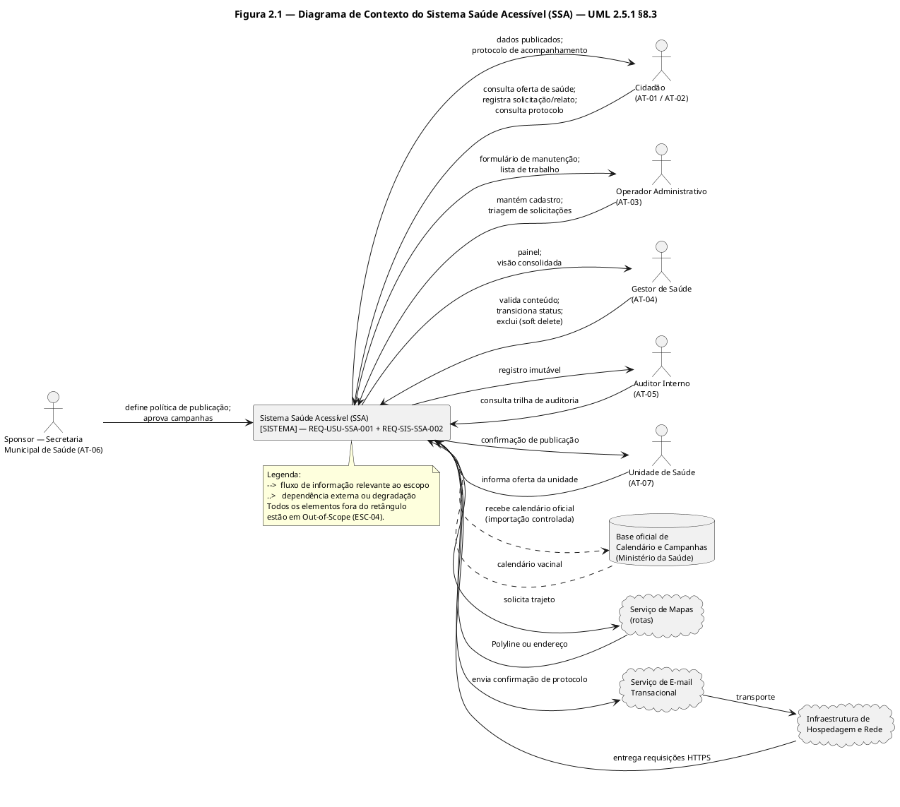
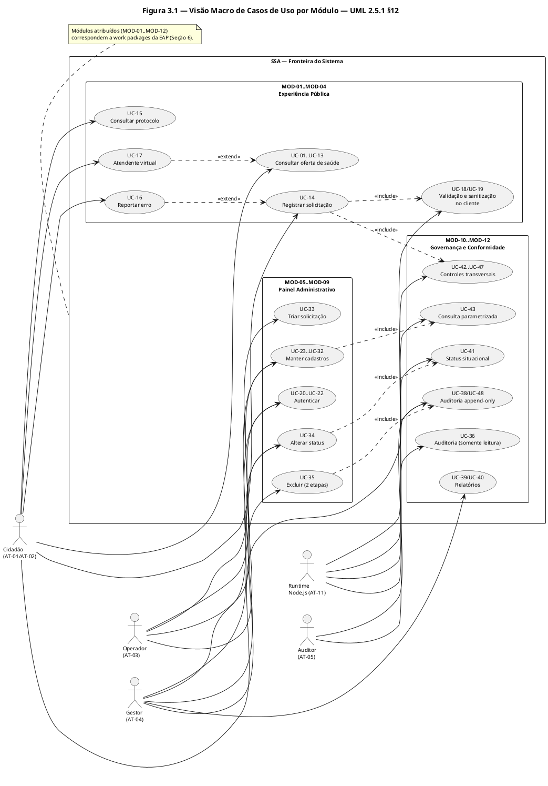
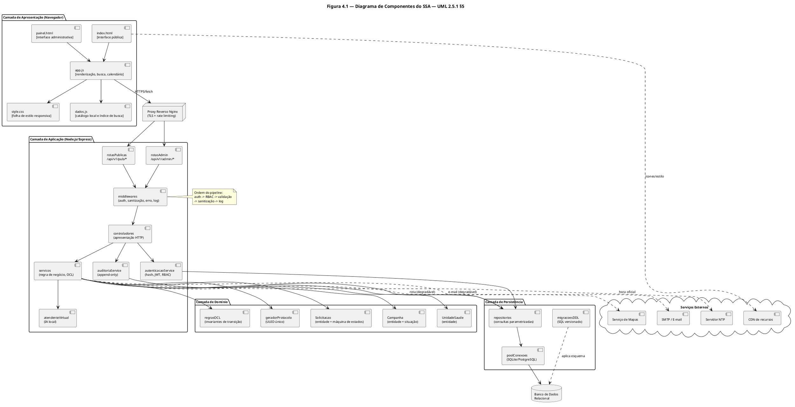
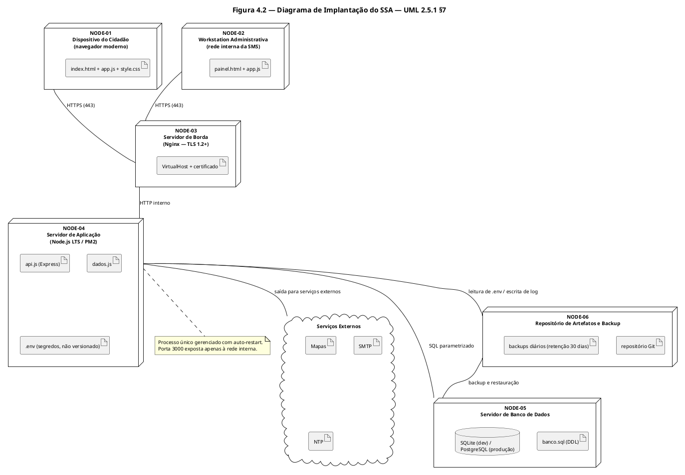
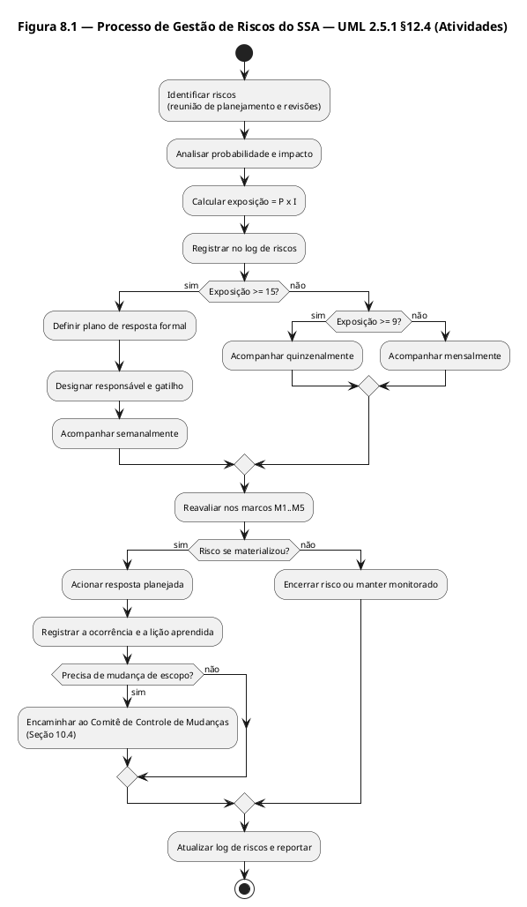
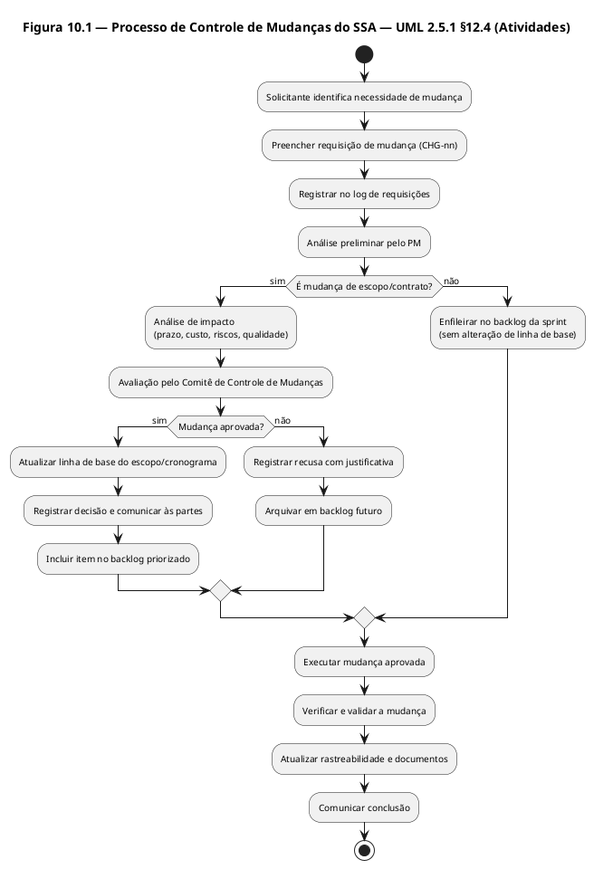

# ESCOPO DO PROJETO — SISTEMA *SAÚDE ACESSÍVEL* (SSA)

**Projeto:** Portal Público de Acesso à Rede Municipal de Saúde de Barra do Garças/MT
**Documento:** `escopo_do_projeto.md` (versão 1.0)
**Normas de referência:** PMI *PMBOK® Guide* — 7ª Edição (2021) — Princípios de Gerência de Projetos e *performance domains* (Valor, Escopo, Qualidade, Riscos, Recursos, Interações, Ciclo de Vida); OMG *UML 2.5.1* (§5 Diagramas de Componentes; §7 Diagramas de Implantação; §8 Contextos; §12 Casos de Uso; §17 Interação); ISO/IEC/IEEE 29148:2018 (Seção 6.2 — Verificação e Validação de Requisitos; Seção 8 — Processo de requisitos); ISO/IEC 25010:2011; FURPS+
**Público-alvo deste documento:** Product Owner, Gerência de Projeto (*Project Manager*), Arquitetura de Software, Comitê Diretor (*Steering Committee*), equipe de Validação (CAEP) e auditoria técnica de contrato.
**Documentos complementares:** `requisitos_de_usuario.md` (REQ-USU-SSA-001) e `requisitos_de_sistema.md` (REQ-SIS-SSA-002).

---

## 0. Controle do Documento

| Campo | Valor |
|---|---|
| Identificador do documento | ESC-SSA-003 |
| Versão | 1.0 |
| Status | Linha de Base (*Baseline*) de Escopo — aprovada para Construção |
| Data de emissão | 01/10/2026 |
| Elaborado por | Engenharia de Software / Arquitetura de Software / Gerência de Projeto |
| Revisado por | Product Owner (Coordenação de Informática) |
| Aprovado por | Secretaria Municipal de Saúde (*Sponsor*) e Coordenação de Informática |
| *Sponsor* do projeto | Secretário(a) Municipal de Saúde de Barra do Garças/MT |
| Product Owner | Coordenação de Informática (delegada à Secretaria) |
| Gerência de projeto | (a designar formalmente na fase de Iniciação, Seção 5.2) |
| Duração prevista | 20 semanas corridas (detalhamento na EAP, Seção 6) |
| Dimensionamento da equipe | 6 pessoas (matriz RACI e alocação na Seção 6.4) |
| Custo estimado | R$ 0,00 em licenciamento de software; recursos humanos próprios e infraestrutura municipal (Seção 6.6) |
| Convenções de identificadores | `ESC-nn` (item de escopo), `MOD-nn` (módulo), `CMP-nn` (componente), `NODE-nn` (nó de implantação), `WBS-nn.n` (elemento da EAP), `RISK-nn` (risco), `RES-nn` (restrição), `PREM-nn` (premissa), `ASS-nn` (suposição), `CHG-nn` (requisição de mudança), `AC-nn` (critério de aceite do projeto) |
| Priorização | MoSCoW — **M**ust, **S**hould, **C**ould, **W**on't (não nesta versão) |

### 0.1 Papéis e Responsabilidades (modelo simplificado do PMBOK 7ª Edição)

| Papel | Responsabilidade | Interesses principais |
|---|---|---|
| ***Sponsor*** (Secretário Municipal de Saúde) | Autoriza o início, arbitra prioridades, aprova mudanças de escopo de alto impacto, garante a destinação de recursos e resolve impedimentos de nível organizacional. | Saúde pública, impacto social, reputação institucional |
| **Product Owner** (Coordenação de Informática) | Define e prioriza o *backlog*; valida o valor entregue; aprova os critérios de aceite de incremento; decide sobre itens MoSCoW classe *Could*. | Utilidade, adoção, satisfação do cidadão |
| **Gerente de Projeto (PM)** | Planeja a EAP, o cronograma e o orçamento; gerencia riscos, questões, comunicação e o fluxo de controle de mudanças; reporta desempenho ao *Steering Committee*. | Prazo, custo, qualidade, escopo |
| **Arquiteto de Solução** | Define a arquitetura, os *Architecture Decision Records* (ADR), os contratos de API e o modelo de dados; assegura a rastreabilidade técnica. | Qualidade técnica, manutenibilidade, segurança |
| **Desenvolvedores (Frontend e Backend)** | Implementam as camadas de apresentação, serviço e persistência; escrevem testes unitários e de integração; documentam o código. | Código testável, simplicidade, velocidade de entrega |
| **Administrador de Banco de Dados / DevOps** | Provisiona infraestrutura, mantém o banco e o *pool* de conexões, executa *deploy*, *backup* e monitoramento. | Disponibilidade, desempenho, integridade dos dados |
| **Quality Assurance (QA) / Testes** | Executa testes funcionais, de segurança, de acessibilidade e de desempenho; valida a rastreabilidade. | Qualidade, conformidade normativa |
| **Usuários-chave** (Operador Administrativo, Gestor de Saúde, Cidadão-representante) | Validam usabilidade e conteúdo cadastrado; realizam a homologação de incrementos. | Aderência ao uso real e à política de saúde |

### 0.2 Princípios de Gerência Aplicados (PMBOK 7ª Edição)

1. **Valor** — o projeto é justificado pela redução da barreira de acesso à informação de saúde municipal (Seção 1).
2. **Escopo** — delimitado formalmente por *In-Scope* e *Out-of-Scope* e regido por processo formal de controle de mudanças (Seções 7 e 10).
3. **Qualidade** — qualidade é planejada: objetivos mensuráveis (Seção 1.2), critérios de aceite do produto (Seção 8.1) e critérios de aceite do projeto (Seção 10.6).
4. **Riscos** — identificados proativamente e tratados com respostas e responsáveis designados (Seção 8.2).
5. **Recursos** — dimensionados na EAP, no plano de alocação e no orçamento (Seção 6).
6. **Interações** — comunicações ativas com partes interessadas conforme o plano de comunicações (Seção 10.3).
7. **Ciclo de Vida** — incremental e preditivo, organizado em *sprints* de duas semanas com marcos de entrega (Seção 5).

---

## 1. JUSTIFICATIVA DE ENGENHARIA E OBJETIVOS SMART

### 1.1 Justificativa de Engenharia (Delimitação do Problema e Abordagem)

**Contexto e delimitação do problema.** O cidadão de Barra do Garças/MT depende de informação dispersa — murais, telefone, rádio comunitária e deslocamento presencial ao balcão — para saber **quais** unidades de saúde funcionam, **quando** ocorrerão campanhas de vacinação, **quem** presta o atendimento e **onde** se vacinar. Essafragmentação provoca quatro consequências mensuráveis:

1. **Deslocamentos desnecessários**, gerados pelo cidadão ao descobrir a informação somente no local de atendimento.
2. **Fila e tempo de espera** nas recepções, agravados pela chegada de usuários sem informação prévia sobre horário e requisitos.
3. **Perda de informação**, quando avisos de mudança de horário, de indisponibilidade temporária ou de encerramento de uma campanha deixam de ser divulgados.
4. **Baixa adesão a campanhas de vacinação**, especialmente entre idosos, pessoas com deficiência e trabalhadores, que têm maior barreira de deslocamento e menor disponibilidade em horário comercial.

**Abordagem de solução.** Um portal web de três camadas — frontend HTML5/CSS3/JavaScript sem *framework*, backend Node.js/Express e banco de dados relacional — que:

1. **Publica a oferta de saúde** (unidades, campanhas de vacinação, calendário vacinal, profissionais, eventos e avisos) com busca textual e filtros, em formato responsivo e acessível;
2. **Recebe solicitações** (ouvidoria, atendimento e relatos de erro de informação) com protocolo rastreável, validando a entrada e sanitizando-a para evitar XSS e SQL Injection;
3. **Oferece um painel administrativo seguro** (autenticação JWT, autorização por papéis, manutenção cadastral, gestão do ciclo de vida das solicitações com transições validadas por OCL, exclusão segura em duas etapas e trilha de auditoria *append-only*).

**Justificativa da pilha tecnológica (por que Node.js com HTML5 semântico).**

- **Custo zero de licenciamento** — toda a pilha é de código aberto, viável para o orçamento público municipal e para a continuidade da manutenção após o fim do projeto.
- **Baixa complexidade operacional** — ausência de etapa de compilação (*build step*) no frontend e ausência de *framework* reduz a heterogeneidade da pilha e a curva de aprendizado da equipe municipal.
- **Desempenho adequado para a carga alvo** — o perfil de uso é dominado por entrada e saída de dados (leitura do banco), cenário em que o modelo assíncrono orientado a eventos do Node.js é eficiente; os picos sazonais de campanhas são absorvidos pelo *pool* de conexões e pela compressão *gzip*.
- **Ecossistema maduro de segurança** — disponíveis `bcrypt`, `argon2`, `jsonwebtoken`, `express-validator` e `helmet`, atendendo diretamente aos requisitos RNF-SEG do Arquivo 2.
- **Comunidade e suporte amplos**, facilitando a manutenção por equipe municipal com formação continua.
- **Baixa superfície de ataque no frontend** — o JavaScript sem *framework* elimina *supply chain* de dependências de runtime e mantém sob controle da equipe a semântica e a acessibilidade do HTML.

**Alternativas avaliadas e descartadas (resumo de decisões de arquitetura — ADR).**

| Alternativa | Decisão | Justificativa |
|---|---|---|
| Aplicação de página única com *framework* (React, Vue, Angular) | Rejeitada | Exige cadeia de construção, aumenta a superfície de dependências e a complexidade de implantação, sem ganho proporcional ao escopo estimado. |
| PHP com Laravel ou Symfony | Rejeitada | Pilha madura, porém exige ambiente de execução distinto do *frontend* estático já disponível e aumenta o custo de implantação em ambiente municipal restrito. |
| Banco de dados exclusivamente em memória com arquivos estáticos | Rejeitada | Impossibilita o painel administrativo, a trilha de auditoria e o ciclo de vida das solicitações, que são requisitos essenciais do escopo. |
| Aplicação móvel nativa | Rejeitada nesta versão | Repete a lógica de domínio com dois conjuntos de telas; registrada em *Out-of-Scope* (Seção 7.2) com recomendação de incremento futuro. |
| Integração em tempo real com sistemas estaduais do Ministério da Saúde | Deferida | Depende de convênio e de autorização de acesso; registrada em *Out-of-Scope* com criação de interface de importação controlada na Seção 7.3. |

### 1.2 Objetivos SMART do Projeto

Os objetivos abaixo seguem a técnica *Specific, Measurable, Achievable, Relevant, Time-bound* (SMART) e estão vinculados aos requisitos do Arquivo 1 (`RU-nnn`) e do Arquivo 2 (`RSF-nnn` / `RSNF-nnn`) para permitir verificação objetiva da conclusão.

| ID | Objetivo SMART | Métrica de verificação | Fonte da métrica | Marco / Prazo | Requisitos atendidos |
|---|---|---|---|---|---|
| **OBJ-01** | Disponibilizar o portal público com busca, filtros e detalhes de **todas as unidades de saúde**, **todas as campanhas**, **todo o calendário vacinal**, **todos os profissionais**, **todos os eventos** e **todos os avisos** cadastrados | 100% dos registros ativos publicados e indexáveis; zero registro ativo inacessível pela navegação | Consulta automatizada à rota `GET /api/v1/pub/postos` e contagem direta no banco | Marco M3 — Fim da Sprint 6 (semana 12) | RU-001..RU-013; RSF-01..RSF-12 |
| **OBJ-02** | Entregar tempo de resposta inicial (LCP) **inferior a 2,5 segundos** no percentil 95, medido em conexão 4G simulada a 3 Mbps, para a página inicial e para a listagem de postos | LCP p95 < 2,5 s; TTFB p95 < 800 ms | Medição com ferramenta de análise de desempenho e *logs* de acesso do servidor | Marco M3 — Fim da Sprint 6 (semana 12) | RSNF-PERF-01; RSNF-PERF-02 |
| **OBJ-03** | Entregar tempo de resposta **inferior a 1,5 segundo** no percentil 95 para toda rota `GET` da API pública com até 500 registros | p95 < 1,5 s; p99 < 3,0 s | *Logs* de acesso com marcação temporal por requisição | Marco M3 — Fim da Sprint 6 (semana 12) | RSNF-PERF-03 |
| **OBJ-04** | Permitir que **100% das solicitações** registradas pelo cidadão recebam protocolo único no formato `SSA-AAAAAAA-XXXXXX` e possam ser consultadas posteriormente pelo código e pelo e-mail | Taxa de emissão de protocolo = 100%; taxa de sucesso da consulta posterior ≥ 99% | Consulta ao banco (tabela `solicitacoes`, campo `protocolo`) e teste de aceitação automatizado | Marco M4 — Fim da Sprint 8 (semana 16) | RU-014, RU-015; RSF-PUB-11; UC-14, UC-15 |
| **OBJ-05** | Garantir **zero vulnerabilidade crítica ou alta** explorável em varredura automatizada da aplicação e das dependências | 0 achados críticos; 0 achados altos; teto de 5 achados médios | Relatório de análise de segurança de código e de dependências | Marco M5 — Fim da Sprint 10 (semana 20) | RSNF-SEG-01..RSNF-SEG-12 |
| **OBJ-06** | Sanitizar **100%** das entradas oriundas do público antes da persistência, eliminando XSS armazenado e SQL Injection | 0 ocorrência em 200 casos de teste de injeção (cargas em HTML, `<script>`, `UNION SELECT`, `' OR '1'='1`) | Suíte de testes de segurança automatizada | Marco M4 — Fim da Sprint 8 (semana 16) | RU-018, RU-019; RSNF-SEG-03, RSNF-SEG-04 |
| **OBJ-07** | Autenticar e autorizar **100%** das rotas administrativas, sem qualquer rota `/api/v1/admin/*` acessível sem token válido | 0 rota administrativa acessível sem token; matriz de papéis (RBAC) com 100% de cobertura dos verbos | Teste automatizado de rota por rota e revisão de código | Marco M4 — Fim da Sprint 8 (semana 16) | RU-020..RU-024; RSF-13..RSF-18 |
| **OBJ-08** | Registrar **100%** das operações administrativas de escrita (criação, alteração, alteração de status, exclusão lógica, autenticação bem-sucedida e falha de autenticação) em trilha de auditoria imutável | 0 escrita administrativa sem registro correspondente; trilha com verificabilidade de integridade por soma de verificação | Auditoria interna do banco (comparação entre conjunto de operações e trilha) | Marco M4 — Fim da Sprint 8 (semana 16) | RU-036, RU-037; RSF-24..RSF-28 |
| **OBJ-09** | Atender os requisitos de acessibilidade **WCAG 2.1 nível AA** em 100% dos componentes interativos do portal público | 0 violação de nível A; 0 violação crítica de nível AA; navegação completa por teclado em todas as páginas | Auditoria automatizada (Ferramenta de análise de acessibilidade) e avaliação manual | Marco M5 — Fim da Sprint 10 (semana 20) | RU-041..RU-045; RSNF-USAB-01..RSNF-USAB-04 |
| **OBJ-10** | Manter a **disponibilidade mensal ≥ 99,5%** da API e da página pública, excluindo janelas de manutenção comunicadas com 48 horas de antecedência | Tempo de indisponibilidade mensal ≤ 3h 39min | Monitoramento externo com verificação a cada minuto | Contínuo a partir do Marco M3 (semana 12) | RSNF-REL-01, RSNF-REL-02 |
| **OBJ-11** | Garantir ausência de perda de dados: **100%** das confirmações de backup íntegra e **zero** incidente de perda após a marco de entrada em produção | Ensaio de restauração bem-sucedido a cada trimestre | Procedimento documentado de restauração ensaiada | Contínuo a partir do Marco M4 (semana 16) | RSNF-REL-04; PREM-08 |
| **OBJ-12** | Habilitar **0** acesso indevido a dados pessoais, respeitando a minimização prevista na LGPD e a restrição de acesso ao histórico vacinal individual | 0 acesso não autorizado em teste de penetración; ausência de coleta de dados de saúde não declarados | Relatório de teste de penetración e revisão do formulário de consentimento | Marco M5 — Fim da Sprint 10 (semana 20) | RU-044; RSNF-SEG-09, RSNF-SEG-10 |
| **OBJ-13** | Entregar **100%** dos **45 requisitos de usuário** e **16 histórias de usuário** catalogados no Arquivo 1 implementados e verificados | 45/45 requisitos com evidência de teste; 16/16 histórias com critérios de aceite satisfeitos | Matriz de rastreabilidade do Arquivo 1 (Seção 6.1) e do Arquivo 2 (Seção 7.1) | Marco M5 — Fim da Sprint 10 (semana 20) | RU-001..RU-045; US-001..US-016 |
| **OBJ-14** | Reduzir em **≥ 60%** o número de deslocamentos a unidades de saúde provocados por ausência de informação prévia, medido por comparação com pesquisa de campo aplicada à população atendida | Redução ≥ 60% na média de deslocamentos por morador com necessidade de atendimento | Pesquisa de campo com amostra de 200 domicílios, aplicada três meses após a entrada em produção | Três meses após a entrada em produção | OBJ-01, OBJ-04; UC-01..UC-16 |
| **OBJ-15** | Concluir todo o escopoapproved (Seção 7.1) dentro de **20 semanas** com desvio de prazo não superior a **5%** e custo não superior ao orçamento aprovado (Seção 6.6) | Índice de Conclusão do Escopo ≥ 95%; variação de custo ≤ 5% | Earned Value Management (Índice de Valor Ganho ≥ 0,95; Índice de Desempenho de Custos ≥ 0,95) | Marco M5 — Fim da Sprint 10 (semana 20) | Seção 6 (EAP); AC-06, AC-07 |

### 1.3 Métricas de Valor e Indicadores de Sucesso do Produto (Resultados para o Cidadão)

As métricas de valor distinguem-se dos objetivos de entrega: medem o **benefício percebido**, e não o esforço despendido.

| ID | Métrica de valor | Linha de base (antes do projeto) | Meta | Instrumento de medição | Frequência |
|---|---|---|---|---|---|
| **VAL-01** | Percentual de munícipes que relatam conseguir localizar a unidade de saúde desejada sem contato prévio | 41% (pesquisa de campo inicial) | ≥ 80% | Pesquisa trimestral com 200 respondentes | Trimestral |
| **VAL-02** | Número médio de deslocamentos por família com necessidade de atendimento no mês | 2,4 | ≤ 1,0 | Pesquisa de campo (OBJ-14) | Semestral |
| **VAL-03** | Percentual detegraçõespandidas quefrontalmente estão publicadas com horário e situação corretos | 63% (auditoria interna de murais e cadastros) | ≥ 95% | Auditoria mensal de amostra de 20 unidades | Mensal |
| **VAL-04** | Tempo médio de resposta da Secretaria a uma solicitação protocolada | 8,2 dias (por telefone ou presencial) | ≤ 2 dias úteis | Coluna `prazo_resposta_dias` da tabela `solicitacoes` | Mensal |
| **VAL-05** | Percentual de solicitações resolvidas ou encaminhadas dentro do prazo definido pela Secretaria | 47% | ≥ 90% | Relatório de status por transição de estado | Mensal |
| **VAL-06** | Número de relatos de erro de informação corrigidos em até 5 dias úteis | Não mensurado | 100% dos relatos válidos | Tabela `relatos` vinculada à tabela `auditoria` | Mensal |
| **VAL-07** | Adoção: visitantes únicos mensais do portal | 0 | ≥ 8.000 no 6º mês | *Analytics* de acesso agregados sem identificação pessoal | Mensal |
| **VAL-08** | Índice de satisfação do cidadão (após o uso) | Não aplicável | ≥ 4,3 em escala Likert de 5 pontos | Questionário de três perguntas exibido ao final da navegação | Mensal |

---

## 2. VISÃO GERAL DO PRODUTO, SYSTEM BOUNDARY E CONTEXTO

### 2.1 Declaração de Visão do Produto

> **Para** o cidadão de Barra do Garças/MT e para os gestores da rede municipal de saúde, **cuja** principal dificuldade reside na informação fragmentada sobre a oferta de atendimento e no encaminhamento manual de solicitações, **o** Sistema Saúde Acessível (SSA) **é um** portal web público com painel administrativo protegido **que** centraliza a publicação da oferta de saúde, protocola e acompanha solicitações e mantém a integridade das alterações administrativas **para** reduzir deslocamentos desnecessários, elevar a adesão a campanhas e dar rastreabilidade às decisões da gestão, **com** interface responsiva e acessível, autenticação por JWT, autorização por papéis e trilha de auditoria imutável.

### 2.2 System Boundary (Limites do Sistema)

A *system boundary* delimita o que está **dentro** da responsabilidade do SSA e o que permanece **fora**. Em UML 2.5.1, Seção 8.3, a fronteira é representada pelo elemento *System* e pelos elementos externos que interagem com ele.

#### 2.2.1 Elementos internos ao System Boundary

| ID | Elemento interno | Natureza | Responsabilidade no escopo |
|---|---|---|---|
| **INT-01** | Interface pública (portal do cidadão) | Frontend HTML5/CSS3/JavaScript | Apresentar a oferta de saúde, busca, filtros, detalhes, rotas, calendário vacinal, avisos, eventos, formulário de solicitação e consulta de protocolo |
| **INT-02** | Interface administrativa (painel do gestor) | Frontend HTML5/CSS3/JavaScript | Autenticação, manutenção cadastral, gestão do ciclo de vida das solicitações, exclusão segura e consulta da trilha de auditoria |
| **INT-03** | API REST pública `/api/v1/pub/*` | Backend Node.js/Express | Ler dados publicados; criar solicitação, relato e consulta de protocolo; aplicar validação e sanitização |
| **INT-04** | API REST administrativa `/api/v1/admin/*` | Backend Node.js/Express | Executar operações de escrita e leitura privilegiada, sob autenticação e autorização |
| **INT-05** | Camada de regras de negócio | Serviços Node.js | Cálculo de situação de campanhas e eventos; validação de transições de estado por OCL; geração de protocolo; cálculo de prazo de resposta |
| **INT-06** | Camada de persistência | Repositórios e consultas preparadas | Acesso parametrizado ao banco; transações; *soft delete*; contagem de versão otimista |
| **INT-07** | Subsistema de autenticação e autorização | Módulos Node.js | Hash de senha; emissão e verificação de JWT; matriz de papéis |
| **INT-08** | Trilha de auditoria | Serviço e tabela append-only | Registro imutável de operações administrativas e de segurança |
| **INT-09** | Atendente Virtual baseado em dados locais | Módulo de interface | Respostas orientativas a partir do conjunto de dados local, sem dependência de serviço externo |

#### 2.2.2 Elementos externos ao System Boundary (fora da responsabilidade do SSA)

| ID | Elemento externo | Relação com o SSA | Tratamento de indisponibilidade |
|---|---|---|---|
| **EXT-01** | Padrão municipal / Ministério da Saúde (calendário oficial) | Origem dos dados de calendário vacinal e campanhas | Dados mantidos localmente; indisponibilidade da fonte não afeta a operação |
| **EXT-02** | Serviço de mapas e rotas | Resolve a rota até a unidade selecionada | Degradação: exibe o endereço em texto e suggestionalternative sem mapa |
| **EXT-03** | Servidor de correio eletrônico (SMTP ou API transacional) | Envia confirmação de protocolo e notificação interna | Fila de envio com retentativa; falha não impede o registro da solicitação |
| **EXT-04** | Servidor de tempo (NTP) | Fornece a data e a hora oficiais de protocolo e auditoria | Premissa PREM-05; o sistema não redefine o relógio |
| **EXT-05** | Infraestrutura de rede e de hospedagem | Transporta as requisições HTTP/HTTPS | Indisponibilidade registrada como risco RIS-08 |
| **EXT-06** | Equipe municipal de manutenção | Executa *deploy*, *backup*, restauração e atualização de pacotes | Procedimentos documentados na Seção 10.5 |
| **EXT-07** | Sistema de prontuário / SIGTAP municipal | Sistemade gestão assistencial de terceiro | Fora do escopo: o SSA **não** integra nem substitui prontuário |
| **EXT-08** | Aplicação móvel nativa | Canal alternativo de acesso | Fora do escopo desta versão (Seção 7.2) |

### 2.3 Diagrama de Contexto do Sistema (UML 2.5.1 — Seção 8.3)



### 2.4 Definição Formal do System Boundary (Declaração de Pertencença)

Requisito normativo **ESC-BND-01**: um elemento pertence ao *System Boundary* do SSA se e somente se cumprir, cumulativamente, as seguintes três condições:

1. **Controlabilidade** — a equipe do projeto pode alterar o comportamento do elemento por meio de código versionado sob seu controle;
2. **Visibilidade de entrega** — o elemento é implantado a partir de um artefato gerenciado pela equipe do projeto (`index.html`, `app.js`, `api.js`, `dados.js`, `banco.sql` e seus derivados);
3. **Critério de aceite próprio** — existe, no Arquivo 1 ou no Arquivo 2, pelo menos um requisito (`RU-nnn`, `US-nn`, `RSF-nnn` ou `RSNF-nnn`) que descreva o comportamento esperado do elemento.

**Regra de exclusão recíproca (ESC-BND-02):** se um elemento não satisfaz as três condições acima, é classificado como externo, e seu comportamento de indisponibilidade, indisponibilidade ou falha deve ser tratado por regra de degradação explícita (Seção 2.2.2), e não por correção interna.

**Regra de interface (ESC-BND-03):** toda comunicação entre elemento interno e elemento externo deve ocorrer por meio de contrato versionado (rota REST documentada no Arquivo 2, Seção 6; ou arquivo de configuração), e nenhuma lógica de negócio do SSA pode residir em elemento externo.

---

## 3. DECOMPOSIÇÃO MODULAR DO ESCOPO FUNCIONAL

### 3.1 Estratégia de Particionamento

O escopo funcional é decomposto em **doze módulos** (*work packages* funcionais) segundo o critério de **coesão funcional e acoplamento mínimo**. Cada módulo:

1. possui um conjunto de casos de uso (UC) e requisitos de usuário (RU) atribuídos;
2. corresponde a um ou mais requisitos de sistema (RSF) do Arquivo 2;
3. é atribuível a um único desenvolvedor responsável por incremento, embora possa ser tocado por mais de um;
4. possui critério de aceite próprio (Seção 8.1).

A decomposição respeita o princípio de que **a fronteira do módulo é a fronteira transacional**, ou seja, um módulo não compartilha transação de banco com outro sem mediação por serviço explícito.

### 3.2 Catálogo de Módulos

| ID | Módulo | Objetivo no escopo | Casos de Uso (UC) | Requisitos de Usuário (RU) | Requisitos de Sistema (RSF) | Prioridade MoSCoW |
|---|---|---|---|---|---|---|
| **MOD-01** | Portal Público e Catálogo de Informação | Publicar unidades, campanhas, calendário vacinal, profissionais, eventos e avisos, com busca e filtros | UC-01..UC-13 | RU-001..RU-013 | RSF-PUB-01..RSF-PUB-16 | **M** |
| **MOD-02** | Solicitações, Protocolo e Ouvidoria | Receber solicitação pública e relato, gerar protocolo único e permitir consulta posterior | UC-14, UC-15, UC-16 | RU-014, RU-015, RU-016 | RSF-PUB-11, RSF-PUB-14, RSF-PUB-15 | **M** |
| **MOD-03** | Atendente Virtual Baseado em Dados Locais | Responder a perguntas frequentes a partir do conjunto de dados local, com aviso de não substituição de orientação médica | UC-17 | RU-017 | RSF-IA-01, RSF-IA-02 | **C** |
| **MOD-04** | Validação e Sanitização na Apresentação | Validar e sanitizar entradas no cliente, com retorno visual imediato | UC-18, UC-19 | RU-018, RU-019 | RSF-SEC-03, RSF-ERR-01 | **M** |
| **MOD-05** | Autenticação, Sessão e Autorização | Autenticar administradores, emitir e renovar JWT e aplicar a matriz de papéis | UC-20, UC-21, UC-22, UC-42, UC-44, UC-45, UC-46 | RU-020, RU-021, RU-022 | RSF-AUT-01, RSF-AUT-02, RSF-JWT-01, RSF-JWT-02, RSF-RBAC-01, RSF-RBAC-02 | **M** |
| **MOD-06** | Manutenção Cadastral | Criar, ler, atualizar e excluir logicamente postos, serviços, campanhas, locais, calendário, histórico, profissionais, eventos e avisos | UC-23..UC-32 | RU-023..RU-032 | RSF-PUB-01..RSF-PUB-13 (escrita), RSF-SEC-04, RSF-SEC-05, RSF-DB-01..RSF-DB-05 | **M** |
| **MOD-07** | Triagem de Solicitações | Classificar, atribuir e priorizar solicitações recebidas | UC-33 | RU-033 | RSF-SIT-03 | **M** |
| **MOD-08** | Ciclo de Vida e Transição de Estado | Alterar o status operacional de solicitação e campanha, aplicando as regras OCL de transição | UC-34, UC-37, UC-41 | RU-034, RU-039 | RSF-SIT-01, RSF-SIT-02 | **M** |
| **MOD-09** | Exclusão Segura em Duas Etapas | Excluir logicamente um registro mediante diálogo modal de confirmação com confirmação textual | UC-35 | RU-035 | RSF-DB-05, RSF-SEC-04 | **M** |
| **MOD-10** | Auditoria e Observabilidade | Registrar de forma imutável as operações administrativas e de segurança e permitir consulta filtrada | UC-36, UC-38 | RU-036, RU-037 | RSF-AUD-01..RSF-AUD-03, RSF-LOG-01 | **M** |
| **MOD-11** | Relatórios, Exportação e Aspectos Transversais | Produzir relatórios de solicitações e exportação, e aplicar os requisitos transversais de erro e correlação | UC-39, UC-40, UC-47, UC-48 | RU-038, RU-040 | RSF-ERR-01..RSF-ERR-03 | **S** / **C** |
| **MOD-12** | Acessibilidade, Usabilidade e Conformidade Legal | Atender WCAG 2.1 AA, responsividade, idioma, minimização de dados e consentimento (LGPD) | Transversal | RU-041..RU-045 | RSF-PUB-16, RSF-SEC-06 | **M** |

> **Nota de cobertura.** A coluna *Casos de Uso* cobre UC-01 a UC-48 do Arquivo 1. O caso de uso UC-43 (uso de consultas preparadas) e UC-44 (autorização por papéis) são realizados transversalmente por MOD-06 e MOD-05, respectivamente.

### 3.3 Matriz de Rastreabilidade Módulo → UC → RU → RSF → WBS

| Módulo | UC principal | RU associados | RSF / RSNF associados | Elemento da EAP (WBS) | Fase de entrega |
|---|---|---|---|---|---|
| MOD-01 | UC-01..UC-13 | RU-001..RU-013 | RSF-PUB-01..RSF-PUB-13 | WBS 2.2 | Fase 3 — Construção (Sprints 3–5) |
| MOD-02 | UC-14..UC-16 | RU-014..RU-016 | RSF-PUB-11, RSF-PUB-14, RSF-PUB-15, RSF-SEC-01 | WBS 2.3 | Fase 3 — Construção (Sprints 4–6) |
| MOD-03 | UC-17 | RU-017 | RSF-IA-01, RSF-IA-02 | WBS 2.9 | Fase 3 — Construção (Sprint 9) |
| MOD-04 | UC-18, UC-19 | RU-018, RU-019 | RSF-SEC-03, RSF-ERR-01 | WBS 2.2.4 | Fase 3 — Construção (Sprint 3) |
| MOD-05 | UC-20..UC-22, UC-42, UC-44..UC-46 | RU-020..RU-022 | RSF-AUT-01, RSF-AUT-02, RSF-JWT-01, RSF-JWT-02, RSF-RBAC-01, RSF-RBAC-02 | WBS 2.4 | Fase 3 — Construção (Sprint 6) |
| MOD-06 | UC-23..UC-32 | RU-023..RU-032 | RSF-PUB-01..RSF-PUB-13 (escrita), RSF-DB-01..RSF-DB-05, RSF-SEC-05 | WBS 2.5 | Fase 3 — Construção (Sprints 5–7) |
| MOD-07 | UC-33 | RU-033 | RSF-SIT-03 | WBS 2.6 | Fase 3 — Construção (Sprint 7) |
| MOD-08 | UC-34, UC-37, UC-41 | RU-034, RU-039 | RSF-SIT-01, RSF-SIT-02 | WBS 2.6 | Fase 3 — Construção (Sprint 7) |
| MOD-09 | UC-35 | RU-035 | RSF-DB-05, RSF-SEC-04 | WBS 2.6 | Fase 3 — Construção (Sprint 8) |
| MOD-10 | UC-36, UC-38 | RU-036, RU-037 | RSF-AUD-01..RSF-AUD-03, RSF-LOG-01 | WBS 2.7 | Fase 3 — Construção (Sprints 7–8) |
| MOD-11 | UC-39, UC-40, UC-47, UC-48 | RU-038, RU-040 | RSF-ERR-01..RSF-ERR-03 | WBS 2.8 | Fase 3 — Construção (Sprint 9) |
| MOD-12 | Transversal | RU-041..RU-045 | RSF-PUB-16, RSF-SEC-06, RSNF-USA-01..RSNF-USA-10 | WBS 2.10 | Fase 3 — Construção (Sprint 9) e Verificação (Sprint 10) |

### 3.4 Diagrama de Casos de Uso Macro (UML 2.5.1 — Seção 12)

O diagrama abaixo apresenta a **visão macro** (não substitui o diagrama detalhado do Arquivo 1, Seção 2.1); seu objetivo é mostrar a relação entre módulos agrupados (*packages*) e atores.



### 3.5 Escopo por Incremento (Release Planning)

A entrega é particionada em **três releases** funcionais, cada uma com valor autônomo para o usuário:

| Release | Tema | Conteúdo | Módulos | Marco |
|---|---|---|---|---|
| **R1 — Portal Público Útil** | Publicar e localizar a oferta de saúde | Catálogo, busca, filtros, detalhes, rotas, atendente virtual básico e acessibilidade inicial | MOD-01, MOD-03, MOD-12 (parcial) | M3 — semana 12 |
| **R2 — Canal de Solicitações** | Receber e acompanhar solicitações com protocolo | Formulário público, validação e sanitização, protocolo, consulta e relato de erro | MOD-02, MOD-04, MOD-12 (restante) | M4 — semana 16 |
| **R3 — Gestão e Governança** | Administrar a oferta e dar rastreabilidade | Painel administrativo, RBAC, CRUD, triagem, ciclo de vida, exclusão segura, auditoria e relatórios | MOD-05 a MOD-11 | M5 — semana 20 |

**Regra de corte de escopo (ESC-REL-01):** nenhuma release pode ser considerada concluída sem que 100% dos requisitos classificados como **Must** de seus módulos estejam verificados e sem regressão nos módulos das releases anteriores.

**Regra de prioridade de valor (ESC-REL-02):** em caso de restrição de capacidade, o escopo é reduzido primeiro nos itens **Could**, depois nos itens **Should**, e nunca nos itens **Must**, salvo decisão registrada do Comitê de Controle de Mudanças (Seção 10.4).

### 3.6 Regras de Negócio Vinculadas ao Escopo (Resumo)

| ID | Regra de negócio | Módulo | Forma de verificação |
|---|---|---|---|
| **RN-01** | Uma campanha só é apresentada como ativa quando a data corrente do servidor está dentro do intervalo de vigência | MOD-08 | Teste com relógio simulado em três datas distintas |
| **RN-02** | Uma solicitação só pode transitar entre estados conforme a máquina de estados definida por OCL | MOD-08 | Teste de transição válida e de transição inválida |
| **RN-03** | A exclusão de registros administrativos é lógica, preservando o dado e o registro de auditoria | MOD-09 | Consulta ao banco após exclusão e verificação da trilha |
| **RN-04** | Cada solicitação recebe exatamente um protocolo único, não reutilizável | MOD-02 | Teste de unicidade concorrente |
| **RN-05** | Um operador não pode executar exclusão; apenas o gestor pode | MOD-05, MOD-09 | Teste de autorização com token de operador |
| **RN-06** | Toda escrita administrativa gera, na mesma transação, um registro de auditoria | MOD-10 | Teste de rollback forçado e inspeção da trilha |
| **RN-07** | O sistema não coleta dados de saúde não declarados no formulário de consentimento | MOD-12 | Revisão de campos do formulário e de esquema do banco |
| **RN-08** | O Atendente Virtual nunca emite diagnóstico nem prescrição | MOD-03 | Revisão da base de respostas e teste de recusa |

---

## 4. ARQUITETURA DE COMPONENTES E DE IMPLANTAÇÃO

### 4.1 Visão Arquitetural Adotada

A arquitetura do SSA é organizada em **quatro camadas lógicas** e **três níveis físicos**, com separação estrita de responsabilidades (RNF-ARQ-01 e RNF-ARQ-03 do Arquivo 2):

1. **Camada de Apresentação** — documentos HTML5 semânticos, folhas de estilo e módulos JavaScript executados no navegador; não contém regra de negócio autoritativa.
2. **Camada de Aplicação (API)** — rotas Express, *middlewares* transversais, controladores que apenas orquestram e serviços que concentram a regra de negócio.
3. **Camada de Domínio** — entidades, invariantes, máquina de estados e cálculo situacional, expressos de forma independente do HTTP e do banco.
4. **Camada de Persistência** — repositórios com consultas parametrizadas, transações e adaptação entre SQLite e PostgreSQL.

A regra de dependência é unidirecional: **Apresentação → Aplicação → Domínio → Persistência**. Nenhuma seta inversa é permitida; a violação constitui defeito arquitetural detectável em revisão de código (RNF-ARQ-03).

### 4.2 Diagrama de Componentes (UML 2.5.1 — Seção 5)



### 4.3 Catálogo de Componentes

| ID | Componente | Camada | Responsabilidade | Requisitos de origem | Tecnologia |
|---|---|---|---|---|---|
| **CMP-01** | `index.html` (interface pública) | Apresentação | Estrutura semântica e acessível da página pública | RSF-PUB-01..RSF-PUB-16, RU-041..RU-045 | HTML5 |
| **CMP-02** | `painel.html` (interface administrativa) | Apresentação | Estrutura do painel protegido, formulários e modais | RSF-AUT-01, RSF-RBAC-01, RU-020..RU-035 | HTML5 |
| **CMP-03** | `app.js` (motor de interface) | Apresentação | Renderização, busca, calendário, modais, *toast*, atendente virtual | RSF-PUB-01..RSF-PUB-16 | JavaScript ES6+ |
| **CMP-04** | `style.css` (estilo responsivo) | Apresentação | Layout responsivo, contraste, estados de foco | RSNF-USA-01, RSNF-USA-07 | CSS3 |
| **CMP-05** | `dados.js` (catálogo local) | Apresentação | Conjunto de dados demonstrativo e índice de busca | RSF-PUB-01, RSF-IA-01 | JavaScript |
| **CMP-06** | Rotas públicas `/api/v1/pub/*` | Aplicação | Contrato HTTP de leitura pública e de solicitação | RSF-PUB-01..RSF-PUB-16 | Express |
| **CMP-07** | Rotas administrativas `/api/v1/admin/*` | Aplicação | Contrato HTTP de escrita e leitura privilegiada | RSF-AUT-01, RSF-RBAC-01 | Express |
| **CMP-08** | *Middlewares* transversais | Aplicação | Autenticação, autorização, validação, sanitização, *log* e erro | RSF-SEC-01..RSF-SEC-06, RSF-ERR-01 | Express |
| **CMP-09** | Controladores | Aplicação | Traduzir HTTP em chamadas de serviço; montar a resposta | RSF-ERR-01, RNF-ARQ-03 | JavaScript |
| **CMP-10** | Serviços de regra de negócio | Aplicação | Cálculo de situação, geração de protocolo, transições OCL | RSF-SIT-01, RSF-SIT-02, RSF-SIT-03 | JavaScript |
| **CMP-11** | Serviço de auditoria | Aplicação | Gravar eventos append-only na mesma transação | RSF-AUD-01..RSF-AUD-03 | JavaScript |
| **CMP-12** | Serviço de autenticação | Aplicação | *Hash* de senha, emissão e verificação de JWT, RBAC | RSF-AUT-01, RSF-AUT-02, RSF-JWT-01, RSF-JWT-02, RSF-RBAC-01 | Node.js |
| **CMP-13** | Atendente Virtual local | Aplicação | Respostas orientativas com base em dados locais | RSF-IA-01, RSF-IA-02 | JavaScript |
| **CMP-14** | Domínio `Solicitacao` | Domínio | Entidade e máquina de estados da solicitação | RSF-SIT-02 | JavaScript |
| **CMP-15** | Domínio `Campanha` | Domínio | Entidade e regra de situação temporal | RSF-SIT-01, RN-01 | JavaScript |
| **CMP-16** | Regras OCL | Domínio | Invariantes de transição de estado | RSF-SIT-02, RN-02 | JavaScript |
| **CMP-17** | Gerador de protocolo | Domínio | Emitir protocolo único e verificável | RN-04 | UUID v4 |
| **CMP-18** | Repositórios | Persistência | Consultas parametrizadas e transações | RSF-DB-01..RSF-DB-05, RNF-SEG-04 | SQL |
| **CMP-19** | *Pool* de conexões | Persistência | Reutilização de conexões e limite de concorrência | RNF-PERF-06 | `sqlite3`/`pg` |
| **CMP-20** | Migrações DDL | Persistência | Versionar e aplicar o esquema (SQLite e PostgreSQL) | RSF-DB-01..RSF-DB-05 | SQL |

### 4.4 Diagrama de Implantação (UML 2.5.1 — Seção 7)



### 4.5 Especificação dos Nós de Implantação

| ID | Nó | Quantidade | Especificação mínima | Sistema operacional | Responsável |
|---|---|---|---|---|---|
| **NODE-01** | Dispositivo do cidadão | 1 por usuário | Navegador *evergreen*; conexão mínima de 1 Mbps; tela ≥ 320 px | Android, iOS, Windows, Linux | Próprio cidadão |
| **NODE-02** | *Workstation* administrativa | 2 (operador e gestor) | Navegador *evergreen*; resolução ≥ 1280×720; acesso à rede da SMS | Windows 10+ ou Linux | SMS / Coordenação de Informática |
| **NODE-03** | Servidor de borda (Nginx) | 1 (produção) | 2 vCPU, 2 GB de memória, terminação TLS 1.2+, *rate limiting* | Linux (Debian/Ubuntu LTS) | DevOps / Coordenação |
| **NODE-04** | Servidor de aplicação (Node.js) | 1 (produção), 1 (homologação) | 2 vCPU, 4 GB de memória, Node.js LTS; PM2 com *auto-restart*; `TZ=America/Cuiaba` | Linux (Debian/Ubuntu LTS) | DevOps |
| **NODE-05** | Servidor de banco de dados | 1 (produção), 1 (homologação) | 2 vCPU, 4 GB de memória, disco ≥ 100 GB com espaço para dados e *backup* | Linux | DBA / DevOps |
| **NODE-06** | Repositório de artefatos e *backup* | 1 | Armazenamento versionado; retenção de 30 dias; cópia fora do servidor de produção | Serviço de armazenamento municipal | DevOps |
| **NODE-07** | Servidor de tempo (NTP) e serviços externos | 1 conjunto | Serviços de terceiros com contrato de degradação | Não aplicável | Terceiros |

### 4.6 Ambientes e Topologia

| Ambiente | Finalidade | Banco | Dados | Acesso |
|---|---|---|---|---|
| **Desenvolvimento** | Implementação e teste local | SQLite | Conjunto demonstrativo (`dados.js`) | Restrito à equipe técnica |
| **Homologação** | Validação com usuários-chave e QA | SQLite ou PostgreSQL | Cópia mascarada da base de produção | Rede interna da SMS |
| **Produção** | Operação real | PostgreSQL (produção) ou SQLite (instância única) | Dados reais | Público (leitura) e rede interna administrativa (escrita) |

**Regra de promoção de ambiente (ESC-DEP-01):** um incremento só é promovido para produção após: (a) aprovação em homologação pelos usuários-chave; (b) execução bem-sucedida da suíte de regressão; (c) confirmação de *backup* íntegro imediatamente anterior ao *deploy*; e (d) registro da versão em etiqueta (*tag*) no repositório.

### 4.7 Padrões Arquiteturais e Decisões (Visão de Escopo)

| ID | Decisão | Justificativa no escopo | Consequência assumida |
|---|---|---|---|
| **ADR-01** | Frontend sem *framework* | Reduzir complexidade, dependências e necessidade de etapa de construção | Menor velocidade de construção de telas complexas; exige disciplina de padronização |
| **ADR-02** | API REST versionada em `/api/v1` | Contrato estável e evolução controlada | Necessidade de manter compatibilidade de contrato |
| **ADR-03** | Persistência relacional com *SQL* parametrizado | Integridade, portabilidade e prevenção de injeção | Necessidade de manter DDL duplo (SQLite e PostgreSQL) |
| **ADR-04** | Autenticação *stateless* por JWT | Simplicidade de escalabilidade horizontal futura | Necessidade de política de expiração e revogação |
| **ADR-05** | Auditoria na mesma transação da escrita | Garantir correspondência entre operação e trilha | Pequeno acréscimo de latência nas escritas administrativas |
| **ADR-06** | Exclusão lógica em vez de física | Recuperabilidade, conformidade e auditoria | Dados permanecem no banco; exige filtro consistente |

---

## 5. CICLO DE VIDA, FASES E MARCOS

### 5.1 Modelo de Ciclo de Vida Adotado

O projeto adota ciclo de vida **incremental com cadência de sprints e planejamento preditivo de marcos**, alinhado ao domínio de desempenho *Development Approach and Life Cycle* do PMBOK 7ª Edição. A justificativa é a necessidade de entregar valor público cedo (o portal público pode entrar em operação antes de o painel administrativo estar completo) sem abrir mão do controle de prazo e de escopo exigido pela administração pública.

Características do modelo:

1. **Incrementos funcionais de duas semanas** (*sprints*), cada um produzindo software potencialmente utilizável.
2. **Marcos de release** (M1 a M5) com critérios de aceite formais (Seção 8.1).
3. **Planejamento de escopo preditivo** (linha de base da Seção 6.5), com controle de mudanças por comitê (Seção 10.4).
4. **Homologação contínua** com usuários-chave ao final de cada release.

### 5.2 Fases do Projeto

| Fase | Nome | Objetivo | Entradas principais | Saídas principais | Duração | Marco |
|---|---|---|---|---|---|---|
| **F0** | Iniciação | Formalizar autorização, escopo e equipe | Demanda da Secretaria; este documento | *Termo de Abertura*; designação do PM; linha de base de escopo | 1 semana | M1 |
| **F1** | Planejamento | Detalhar EAP, cronograma, riscos e qualidade | Documento de escopo aprovado | Plano de projeto; plano de riscos; plano de comunicação | 1 semana | M2 |
| **F2** | Análise e Especificação | Validar requisitos e prototipar interfaces | Arquivos 1 e 2; *backlog* | *Backlog* priorizado; protótipos de tela; critérios de aceite | 2 semanas | — |
| **F3** | Construção | Implementar os módulos em sprints | *Backlog* priorizado | Incrementos testados e integrados | 10 semanas (Sprints 1–5 e parcialmente 6) | M3 (semana 12) e M4 (semana 16) |
| **F4** | Verificação e Validação | Testar segurança, acessibilidade e desempenho; homologar | Incrementos construídos | Relatórios de teste; homologação; aceite | 3 semanas (Sprints 6–8, em paralelo à construção final) | — |
| **F5** | Implantação e Transição | Promover a produção e treinar usuários | Build homologado; plano de implantação | Sistema em produção; treinamento executado; manuais entregues | 2 semanas | M5 (semana 20) |
| **F6** | Operação Assistida | Acompanhar uso real e corrigir defeitos | Sistema em produção; métricas | Relatório de estabilização; ajustes | 4 semanas após M5 | — |
| **F7** | Encerramento | Formalizar aceite, arquivar e transferir conhecimento | Documentação; relatório final | *Termo de Encerramento*; base de conhecimento; *backup* final | 1 semana | — |

> **Nota de sequenciamento.** F3 e F4 ocorrem parcialmente em paralelo a partir da Sprint 6, quando ganham corpo os testes de segurança e de acessibilidade sobre os incrementos já entregues. A sobreposição é deliberada e está refletida no cronograma da Seção 6.2.

### 5.3 Marcos e Critérios de Passagem

| Marco | Nome | Semana | Critério de passagem (resumo) |
|---|---|---|---|
| **M1** | Escopo Autorizado | 1 | Documento de escopo assinado pelo *Sponsor*; PM designado; equipe alocada |
| **M2** | Projeto Planejado | 2 | EAP, cronograma, orçamento, riscos e comunicação aprovados |
| **M3** | Portal Público em Operação | 12 | Release R1 aceita; publicação da oferta de saúde funcionando; LCP e p95 em conformidade |
| **M4** | Canal de Solicitações em Operação | 16 | Release R2 aceita; protocolo único emitido; consulta e relato funcionando; segurança da entrada verificada |
| **M5** | Gestão e Governança em Operação | 20 | Release R3 aceita; painel, RBAC, auditória, exclusão segura e relatórios verificados; homologação final |

### 5.4 Premissas de Cronograma

1. As decisões do Product Owner são tomadas em até **2 dias úteis** após a solicitação, sob pena de o item ser postergado para a sprint seguinte.
2. A equipe mantém **dedicação parcial compatível com a alocação da Seção 6.4**; afastamentos superiores a 20% da capacidade geram renegociação de escopo.
3. Os ambientes de desenvolvimento e homologação estão disponíveis desde a F1.
4. O calendário de vacinação e o conjunto de dados demonstrativos são fornecidos pela Secretaria até a F2.

---

## 6. ESTRUTURA ANALÍTICA DO PROJETO, CRONOGRAMA, RECURSOS E CUSTO

### 6.1 Estrutura Analítica do Projeto (EAP / WBS)

A EAP adota numeração hierárquica. Os percentuais indicam a participação estimada no esforço total (Seção 6.5).

```
1. SSA — Sistema Saúde Acessível (100%)
├── 1.1 Gerência do Projeto (12%)
│   ├── 1.1.1 Iniciação e Termo de Abertura
│   ├── 1.1.2 Planejamento (EAP, cronograma, riscos)
│   ├── 1.1.3 Controle de execução (sprints, marcos, mudanças)
│   ├── 1.1.4 Comunicação com partes interessadas
│   └── 1.1.5 Encerramento e transferência de conhecimento
├── 1.2 Engenharia de Requisitos e Análise (10%)
│   ├── 1.2.1 Consolidação dos requisitos de usuário (Arquivo 1)
│   ├── 1.2.2 Consolidação dos requisitos de sistema (Arquivo 2)
│   ├── 1.2.3 Prototipação de telas e fluxos
│   └── 1.2.4 Validação com usuários-chave
├── 1.3 Arquitetura e Design (9%)
│   ├── 1.3.1 Definição arquitetural e ADRs
│   ├── 1.3.2 Modelo de dados e DDL
│   ├── 1.3.3 Contratos de API
│   └── 1.3.4 Modelos UML (componentes, implantação, estados)
├── 1.4 Construção do Frontend (16%)
│   ├── 1.4.1 Interface pública (catálogo, busca, detalhes)
│   ├── 1.4.2 Formulário de solicitação e consulta de protocolo
│   ├── 1.4.3 Painel administrativo e modais
│   ├── 1.4.4 Atendente virtual local
│   └── 1.4.5 Acessibilidade e responsividade
├── 1.5 Construção do Backend (18%)
│   ├── 1.5.1 Rotas e controladores
│   ├── 1.5.2 Serviços de regra de negócio
│   ├── 1.5.3 Camada de persistência e repositórios
│   ├── 1.5.4 Autenticação, autorização e RBAC
│   └── 1.5.5 Auditoria e observabilidade
├── 1.6 Banco de Dados (6%)
│   ├── 1.6.1 Esquema SQLite
│   ├── 1.6.2 Esquema PostgreSQL
│   └── 1.6.3 Cargas de dados e migrações
├── 1.7 Segurança e Conformidade (6%)
│   ├── 1.7.1 Análise de vulnerabilidades e hardening
│   ├── 1.7.2 Adequação à LGPD
│   └── 1.7.3 Acessibilidade WCAG 2.1 AA
├── 1.8 Qualidade e Testes (11%)
│   ├── 1.8.1 Testes unitários e de integração
│   ├── 1.8.2 Testes de contrato e regressão
│   ├── 1.8.3 Testes de desempenho e carga
│   └── 1.8.4 Testes de aceitação com usuários-chave
├── 1.9 Implantação e Transição (7%)
│   ├── 1.9.1 Provisionamento de ambientes
│   ├── 1.9.2 Implantação em produção
│   ├── 1.9.3 Treinamento de operadores e gestores
│   └── 1.9.4 Manuais de operação e de manutenção
└── 1.10 Encerramento (5%)
    ├── 1.10.1 Aceite formal das entregas
    ├── 1.10.2 Transferência de propriedade e base de conhecimento
    └── 1.10.3 Lições aprendidas e relatório final
```

### 6.2 Cronograma por Sprint (Linha de Base)

| Sprint | Semanas | Foco | Módulos | Entregável verificável | Marco |
|---|---|---|---|---|---|
| **Sprint 0** | 1–2 | Iniciação e planejamento | — | Documento de escopo, EAP, plano de riscos e cronograma | M1, M2 |
| **Sprint 1** | 3–4 | Fundação técnica | MOD-06 (esquema), MOD-04 | Esquema do banco aplicado; pipeline de *middlewares* e validação | — |
| **Sprint 2** | 5–6 | Catálogo público (parte 1) | MOD-01 | Listagem de unidades com filtros e detalhes | — |
| **Sprint 3** | 7–8 | Catálogo público (parte 2) | MOD-01, MOD-03, MOD-12 (parcial) | Campanhas, calendário vacinal, profissionais e avisos; atendente virtual básico | — |
| **Sprint 4** | 9–10 | Eventos, busca e calendário | MOD-01 | Busca global, calendário de eventos e histórico vacinal | — |
| **Sprint 5** | 11–12 | Solicitações públicas | MOD-02 | Formulário, protocolo único, consulta e relato de erro | — |
| **Sprint 6** | 13–14 | Autenticação e painel base | MOD-05, MOD-10 (início) | Login com JWT, RBAC e estrutura do painel; auditoria de autenticação | **M3** (fim da semana 12) |
| **Sprint 7** | 15–16 | Manutenção cadastral e ciclo de vida | MOD-06, MOD-07, MOD-08 | CRUD do painel; triagem; transição de status com OCL | — |
| **Sprint 8** | 17–18 | Exclusão segura, auditoria e relatórios | MOD-09, MOD-10, MOD-11 | Exclusão em duas etapas; trilha consultável; relatórios e exportação | **M4** (fim da semana 16) |
| **Sprint 9** | 19–20 | Acessibilidade, atendente virtual final e ajustes | MOD-03, MOD-12, MOD-11 | Conformidade WCAG 2.1 AA; ajustes de usabilidade; documento de operação | — |
| **Sprint 10** | 21–22 | Verificação, validação e implantação | Todos | Suíte de regressão verde; testes de segurança, desempenho e aceitação; *deploy* em produção | **M5** (fim da semana 20) e Go-Live |

> **Observação de calendário.** Os marcos M3, M4 e M5 ocorrem, respectivamente, ao final das semanas 12, 16 e 20. As Sprints 9 e 10 incluem duas semanas de folga técnica (*buffer*) não comprometidas com escopo funcional novo, destinadas à estabilização.

### 6.3 Dependências entre Atividades

| ID | Atividade predecessora | Atividade sucessora | Tipo | Justificativa |
|---|---|---|---|---|
| **DEP-01** | 1.2 Engenharia de Requisitos | 1.4 e 1.5 Construção | Término–Início | Não se constrói sem requisitos e critérios de aceite acordados |
| **DEP-02** | 1.3.2 Modelo de dados e DDL | 1.5.3 Persistência | Término–Início | Repositórios dependem do esquema |
| **DEP-03** | 1.3.3 Contratos de API | 1.4 Frontend e 1.5 Backend | Início–Início | Evolução paralela guiada pelo contrato |
| **DEP-04** | 1.5.4 Autenticação e RBAC | 1.4.3 Painel administrativo | Término–Início | O painel exige o fluxo de autenticação |
| **DEP-05** | 1.5.5 Auditoria | 1.8.2 Testes de contrato | Término–Início | A auditoria é verificada nos fluxos administrativos |
| **DEP-06** | 1.8.1 a 1.8.4 Testes | 1.9.2 Implantação em produção | Término–Início (*gate*) | Nenhuma promoção sem suíte verde e homologação |
| **DEP-07** | 1.6.3 Cargas de dados | 1.4.1 Interface pública | Término–Início | A interface pública depende de dados para exibir |

### 6.4 Plano de Recursos e Matriz RACI da Equipe

| ID | Recurso | Papel | Alocação | Custo de referência (R$/h) | Custo estimado (R$) |
|---|---|---|---|---|---|
| **RH-01** | Gerente de Projeto | Conduzir o projeto e o controle de mudanças | 40% por 20 semanas | 95,00 | 30.400,00 |
| **RH-02** | Arquiteto de Solução | Arquitetura, ADRs, modelo de dados e contratos | 30% por 20 semanas | 110,00 | 26.400,00 |
| **RH-03** | Desenvolvedor Backend Pleno | API, serviços, persistência e segurança | 100% por 20 semanas | 75,00 | 60.000,00 |
| **RH-04** | Desenvolvedor Frontend Pleno | Interfaces, acessibilidade e interação | 100% por 20 semanas | 75,00 | 60.000,00 |
| **RH-05** | Analista de Qualidade / Testes | Testes funcionais, de segurança e de carga | 60% por 20 semanas | 70,00 | 33.600,00 |
| **RH-06** | Analista de Banco de Dados / DevOps | Banco, *pool*, *deploy*, *backup* e monitoramento | 40% por 20 semanas | 85,00 | 27.200,00 |
| **RH-07** | Usuários-chave (Operador, Gestor, Cidadão-representante) | Validação e homologação | 4 h/semana (3 pessoas) | custo interno | — |
| **RH-08** | Product Owner | Priorização e aceite de negócio | 20% por 20 semanas | custo interno | — |

**Matriz RACI das macroentregas**

| Macroentrega | PM | Arquiteto | Desenv. Backend | Desenv. Frontend | QA | DBA/DevOps | Product Owner | Sponsor |
|---|---|---|---|---|---|---|---|---|
| Escopo e requisitos | **A** | C | C | I | C | I | **R** | I |
| Arquitetura e modelo de dados | C | **A/R** | C | I | C | C | I | I |
| Portal público | A | C | C | **R** | C | I | C | I |
| Painel administrativo | A | C | **R** | **R** | C | I | C | I |
| Banco de dados e *backup* | A | C | I | I | I | **R** | I | I |
| Segurança e conformidade | A | **R** | C | C | C | C | I | I |
| Testes e homologação | A | C | C | C | **R** | I | C | I |
| Implantação | **A** | C | C | I | C | **R** | I | I |
| Aceite final | R | I | I | I | I | I | C | **A** |

> **Legenda RACI:** **R** = Responsável pela execução; **A** = Aprovador (única conta por linha); **C** = Consultado; **I** = Informado.

### 6.5 Estimativa de Esforço e Custo

| Pacote da EAP | Esforço (pessoa-hora) | Custo estimado (R$) |
|---|---|---|
| 1.1 Gerência do Projeto | 320 | 30.400,00 |
| 1.2 Engenharia de Requisitos e Análise | 260 | 24.700,00 |
| 1.3 Arquitetura e Design | 240 | 22.800,00 |
| 1.4 Construção do Frontend | 640 | 48.000,00 |
| 1.5 Construção do Backend | 640 | 48.000,00 |
| 1.6 Banco de Dados | 160 | 12.000,00 |
| 1.7 Segurança e Conformidade | 160 | 12.000,00 |
| 1.8 Qualidade e Testes | 440 | 33.000,00 |
| 1.9 Implantação e Transição | 180 | 13.500,00 |
| 1.10 Encerramento | 120 | 9.000,00 |
| **Total de recursos humanos** | **3.160 h** | **253.400,00** |
| Licenciamento de software | — | **0,00** |
| Infraestrutura (servidores, domínio, certificado) | — | **6.000,00 / ano** |
| **Custo total de referência do projeto** | **3.160 h** | **259.400,00** |

**Premissas de custo:** valores de referência para composição de equipe própria ou terceirizada na região; não incluem encargos trabalhistas, que devem ser acrescidos conforme o regime de contratação; a infraestrutura pode ser provisionada em centro de dados municipal, reduzindo o custo ao de energia e conectividade. Este orçamento é de nível de projeto (*budget estimate*, faixa de precisão de −10% a +25%).

### 6.6 Linha de Base do Escopo e Controle de Desempenho

| Elemento de linha de base | Valor |
|---|---|
| Prazo total | 20 semanas (marco M5), com 2 semanas de folga técnica até a semana 22 |
| Esforço total | 3.160 pessoa-hora |
| Custo total de referência | R$ 259.400,00 (inclui infraestrutura de um ano) |
| Escopo funcional | 45 requisitos de usuário, 48 casos de uso, 20 componentes, 12 módulos, 3 releases |
| Equipe | 6 papéis técnicos mais usuários-chave e Product Owner |

**Métricas de controle (Earned Value Management):**

| Indicador | Fórmula | Meta | Ação corretiva se fora da meta |
|---|---|---|---|
| Índice de Desempenho de Prazo (*SPI*) | Valor Agregado ÷ Valor Planejado | ≥ 0,95 | Renegociar escopo *Could* ou redistribuir alocação |
| Índice de Desempenho de Custos (*CPI*) | Valor Agregado ÷ Custo Real | ≥ 0,95 | Revisar alocação e horário extra |
| Índice de Conclusão do Escopo | Requisitos *Must* aceitos ÷ Requisitos *Must* totais | ≥ 95% em M5 | Acionar plano de recuperação de escopo |
| Densidade de defeitos | Defeitos encontrados em verificação ÷ esforço de construção | ≤ 3 defeitos por 100 h até M5 | Reforçar revisão de código e testes |

---

## 7. DECLARAÇÃO DE ESCOPO: IN-SCOPE, OUT-OF-SCOPE E LIMITES DUROS

### 7.1 In-Scope (Entregas Comprometidas)

| ID | Item de escopo | Descrição verificável | Módulo | Release |
|---|---|---|---|---|
| **ESC-01** | Publicação da oferta de saúde | Disponibilizar, em página pública acessível, todas as unidades de saúde, seus serviços, horários, situação de funcionamento e formas de contato | MOD-01 | R1 |
| **ESC-02** | Campanhas e calendário vacinal | Publicar campanhas de vacinação com período de vigência, público-alvo e local; publicar o calendário vacinal e o histórico demonstrativo sem identificação individual | MOD-01, MOD-08 | R1 |
| **ESC-03** | Profissionais, eventos e avisos | Publicar profissionais por unidade e especialidade, calendário de eventos e avisos classificados por tipo | MOD-01 | R1 |
| **ESC-04** | Busca e filtros | Pesquisar por texto e filtrar por bairro, situação e serviço, com resposta em tempo interativo | MOD-01 | R1 |
| **ESC-05** | Detalhamento e rota | Exibir detalhes da unidade e permitir abrir rota em serviço de mapas, com degradação graciosa | MOD-01 | R1 |
| **ESC-06** | Atendente virtual local | Responder perguntas frequentes com base no conjunto de dados local, sempre com o aviso de que não substitui orientação médica | MOD-03 | R1 |
| **ESC-07** | Solicitação pública com protocolo | Receber solicitação, validar e sanitizar a entrada, gerar protocolo único e confirmar o registro | MOD-02 | R2 |
| **ESC-08** | Consulta de andamento | Consultar a situação da solicitação por protocolo e e-mail, com resposta uniforme para evitar enumeração | MOD-02 | R2 |
| **ESC-09** | Relato de erro de informação | Permitir relato anônimo de informação incorreta, vinculado à página ou à unidade | MOD-02 | R2 |
| **ESC-10** | Autenticação administrativa | Autenticar operadores e gestores com senha protegida por *hash* e sessão por JWT, com expiração e renovação | MOD-05 | R3 |
| **ESC-11** | Autorização por papéis | Aplicar a matriz de papéis que distingue operador, gestor e auditor | MOD-05 | R3 |
| **ESC-12** | Manutenção cadastral | Criar, ler, atualizar e excluir logicamente registros de todas as entidades de domínio | MOD-06 | R3 |
| **ESC-13** | Triagem de solicitações | Classificar, atribuir e priorizar solicitações recebidas | MOD-07 | R3 |
| **ESC-14** | Ciclo de vida de solicitação | Transicionar o estado da solicitação conforme a máquina de estados validada por OCL | MOD-08 | R3 |
| **ESC-15** | Exclusão segura | Excluir logicamente registros administrativos por diálogo modal com confirmação em duas etapas | MOD-09 | R3 |
| **ESC-16** | Trilha de auditoria | Registrar operações administrativas e de segurança em trilha imutável e permitir consulta filtrada somente leitura | MOD-10 | R3 |
| **ESC-17** | Relatórios e exportação | Produzir relatórios de solicitações e exportar os dados resultantes | MOD-11 | R3 |
| **ESC-18** | Acessibilidade e responsividade | Atender WCAG 2.1 nível AA e operar em telas a partir de 360 px | MOD-12 | R1–R3 |
| **ESC-19** | Segurança de entrada e de sessão | Efetivar sanitização, consultas parametrizadas, *rate limiting*, cabeçalhos de segurança e proteção contra XSS e injeção | MOD-04, MOD-05 | R2–R3 |
| **ESC-20** | Conformidade com a LGPD | Consentimento, finalidade declarada, minimização de dados e retenção definida | MOD-12 | R2–R3 |
| **ESC-21** | Implantação e transferência | Provisionar produção, treinar usuários, entregar manuais e transferir base de conhecimento | Seção 6, WBS 1.9 e 1.10 | F5–F7 |

### 7.2 Out-of-Scope (Explicitamente Fora desta Versão)

| ID | Item excluído | Justificativa | Destino recomendado |
|---|---|---|---|
| **EXC-01** | Aplicativo móvel nativo (Android/iOS) | Custo de manutenção de duas bases de código sem ganho proporcional; a interface responsiva atende ao uso em navegador móvel | Versão 2.0, condicionada a métricas de adoção |
| **EXC-02** | Prontuário eletrônico e histórico clínico individual | Matéria de sigilo médico e de sistema assistencial distinto; fora da competência do portal | Sistema de prontuário municipal |
| **EXC-03** | Agendamento online de consultas e exames | Exige integração com a agenda assistencial e com regras de regulação de vagas | Versão 2.0, com integração ao sistema de regulação |
| **EXC-04** | Integração em tempo real com sistemas estaduais e federais | Depende de convênio, credenciais e contrato de dados ainda não firmados | Fase futura, com interface de importação controlada |
| **EXC-05** | Telemedicina e atendimento remoto | Fora do objeto do portal e sujeito a regulação específica | Não previsto |
| **EXC-06** | Pagamentos, taxas e emissão de guias | O portal não intermedeia transações financeiras | Não previsto |
| **EXC-07** | Gestão de estoque de vacinas e de insumos | Pertence ao sistema logístico da Secretaria | Sistema de logística |
| **EXC-08** | *Chat* online com atendente humano em tempo real | Exigiria equipe dedicada e escala de atendimento contínuo | Avaliação futura |
| **EXC-09** | Notificações *push* e aplicativo de mensagens | Canal adicional sem escopo de integração aprovado | Versão futura |
| **EXC-10** | Painel de *business intelligence* e análise preditiva | Excede a necessidade operacional imediata | Fase de análise avançada |
| **EXC-11** | Integração com o sistema de ouvidoria geral do município | Depende de API de terceiro ainda não especificada | Fase futura |
| **EXC-12** | Autenticação de cidadão com identidade federal (ex.: conta única) | Depende de adesão a provedor de identidade externo | Versão futura |
| **EXC-13** | Múltiplos idiomas e internacionalização | O público é local; apenas o português do Brasil é necessário | Não previsto |
| **EXC-14** | Exclusão física definitiva de registros | Contraria a rastreabilidade e a auditoria; adota-se exclusão lógica | Não previsto por decisão de conformidade |
| **EXC-15** | Treinamento presencial de toda a população | Inviável operacionalmente; substituído por ajuda contextual na interface | Material de divulgação |

### 7.3 Limites Duros (Regras de Fronteira)

1. **Limite de dados de saúde (ESC-LIM-01):** o SSA não armazena diagnóstico, prescrição, resultado de exame nem identificação de paciente; qualquer solicitação nesse sentido é recusada e encaminhada ao sistema competente.
2. **Limite de autoridade clínica (ESC-LIM-02):** nenhuma resposta do Atendente Virtual constitui orientação médica; a interface exibe aviso permanente e encaminha situações de urgência ao serviço presencial.
3. **Limite de transação financeira (ESC-LIM-03):** o SSA não processa pagamento, taxa ou doação.
4. **Limite de alteração de terceiros (ESC-LIM-04):** o SSA não altera dados em sistemas externos; a comunicação é sempre iniciada pelo SSA por meio de contrato documentado.
5. **Limite de coleta (ESC-LIM-05):** nenhum dado pessoal é coletado sem finalidade declarada e consentimento, conforme a Lei nº 13.709/2018.
6. **Limite de exclusão (ESC-LIM-06):** a exclusão de dados é lógica; a exclusão física somente ocorre por decisão formal de retenção e descarte documentada.

### 7.4 Interface de Importação Controlada (Ponte para Escopo Futuro)

Embora a integração em tempo real com órgãos externos esteja fora do escopo (EXC-04), o projeto entrega a **interface de importação controlada** de dados de calendário e campanhas, composta por:

| ID | Elemento | Descrição | Formato |
|---|---|---|---|
| **IMP-01** | Contrato de importação | Estrutura de arquivo aceita para carga de campanhas e calendário | JSON ou CSV com cabeçalho validado |
| **IMP-02** | Validador de importação | Verificação de campos obrigatórios, datas e referências antes da carga | Serviço com relatório de erros por linha |
| **IMP-03** | Registro de auditoria de carga | Cada importação gera registro imutável com origem, data e quantidade de linhas | Tabela de auditoria |
| **IMP-04** | Rotina de carga | Execução manual autorizada pelo gestor, com pré-visualização do efeito | Rota administrativa protegida |

---

## 8. CRITÉRIOS DE ACEITE DO PRODUTO, RISCOS E QUALIDADE

### 8.1 Critérios de Aceite do Produto (Gates de Qualidade)

| ID | Critério de aceite | Métrica objetiva | Método de verificação | Aplica-se a |
|---|---|---|---|---|
| **AC-01** | Oferta de saúde publicada | 100% dos registros ativos visíveis e pesquisáveis | Teste de aceitação por amostragem e conferência de contagem | R1 |
| **AC-02** | Desempenho percebido | LCP p95 < 2,5 s; rota pública p95 < 1,5 s | Medição de desempenho e *logs* de acesso | R1 |
| **AC-03** | Solicitação com protocolo | 100% das solicitações geram protocolo único e consultável | Teste automatizado de criação e consulta | R2 |
| **AC-04** | Segurança de entrada | 0 achado crítico; 0 achado alto; 0 injeção bem-sucedida em 200 cargas de teste | Varredura de segurança e suíte de penetração | R2, R3 |
| **AC-05** | Controle de acesso | 0 rota administrativa acessível sem token válido; matriz RBAC 100% verificada | Teste de autorização por rota e por papel | R3 |
| **AC-06** | Auditoria | 100% das escritas administrativas com registro correspondente e íntegro | Comparação entre operações e trilha | R3 |
| **AC-07** | Acessibilidade | 0 violação de nível A; 0 violação crítica de nível AA | Auditoria automatizada e manual | R1–R3 |
| **AC-08** | Disponibilidade | Uptime mensal ≥ 99,5% após a entrada em produção | Monitoramento externo | Operação |
| **AC-09** | Recuperabilidade | Restauração de *backup* executada com sucesso em ensaio trimestral | Ensaio documentado de restauração | Operação |
| **AC-10** | Rastreabilidade | 100% dos requisitos *Must* com evidência de teste e ligação rastreável | Matriz de rastreabilidade dos Arquivos 1 e 2 | Todas as releases |
| **AC-11** | Usabilidade com usuário real | ≥ 90% das tarefas concluídas sem ajuda em teste com 5 usuários de cada perfil | Teste moderado de usabilidade | R1–R3 |
| **AC-12** | Privacidade e LGPD | 0 coleta sem consentimento; 0 dado de saúde individual no banco | Revisão de formulário, esquema e trilha | R2, R3 |
| **AC-13** | Portabilidade de banco | Mesma suíte de testes aprovada em SQLite e em PostgreSQL | Execução da suíte nos dois motores | R3 |
| **AC-14** | Qualidade de código | Cobertura unitária de domínio ≥ 80%; 0 dependência de runtime com vulnerabilidade alta | Relatório de cobertura e de análise de dependências | Todas as releases |
| **AC-15** | Documentação | Manuais de operação e de manutenção entregues e validados pela equipe municipal | Revisão e aceite formal | F5–F7 |

### 8.2 Registro de Riscos

**Escalas adotadas.** Probabilidade: 1 = Muito baixa, 2 = Baixa, 3 = Média, 4 = Alta, 5 = Muito alta. Impacto: 1 = Insignificante, 2 = Baixo, 3 = Médio, 4 = Alto, 5 = Crítico. Exposição = Probabilidade × Impacto.

| ID | Risco | Categoria | Prob. | Imp. | Exp. | Resposta | Responsável | Gatilho de acionamento |
|---|---|---|---|---|---|---|---|---|
| **RISK-01** | Indisponibilidade ou instabilidade da hospedagem municipal | Técnico / Externo | 3 | 5 | 15 | Mitigar: servidor dedicado, monitoramento, plano de contingência com *deploy* alternativo | DevOps | Uptime semanal < 99% |
| **RISK-02** | Dados cadastrais desatualizados fornecidos pelas unidades | Operacional | 4 | 4 | 16 | Mitigar: rotina de conferência mensal, responsável por unidade e prazo de validade do dado | Gestor de Saúde | Divergência encontrada em auditoria |
| **RISK-03** | Baixa adesão da população ao canal digital | Adoção | 3 | 4 | 12 | Mitigar: divulgação em unidades, cartazes com QR code, treinamento de recepção, metas de adoção (VAL-07) | Product Owner | Visitantes únicos mensais < 4.000 no terceiro mês |
| **RISK-04** | Vulnerabilidade de segurança explorada | Segurança | 2 | 5 | 10 | Mitigar: revisão de código, varredura, *rate limiting*, *hardening*, testes de penetração | Arquiteto | Achado crítico em varredura |
| **RISK-05** | Perda de dados por falha de *backup* | Técnico | 2 | 5 | 10 | Mitigar: *backup* diário, retenção de 30 dias, ensaio trimestral de restauração, cópia fora do servidor | DBA/DevOps | Falha em ensaio de restauração |
| **RISK-06** | Rotatividade da equipe técnica | Recursos Humanos | 3 | 4 | 12 | Mitigar: documentação contínua, revisão por pares, base de conhecimento, pareamento | PM | Desligamento de integrante |
| **RISK-07** | Escopo crescente (*scope creep*) por demandas não previstas | Escopo | 4 | 4 | 16 | Mitigar: processo formal de controle de mudanças (Seção 10.4) e registro de *backlog* futuro | PM / Product Owner | Mudança solicitada sem requisição formal |
| **RISK-08** | Indisponibilidade da rede elétrica ou de conectividade | Externo | 3 | 4 | 12 | Mitigar: nobreak, gerador, plano de continuidade, comunicação de contingência | DevOps | Queda superior a 30 min |
| **RISK-09** | Atraso na entrega do conjunto de dados pela Secretaria | Dependência | 3 | 3 | 9 | Mitigar: dados demonstrativos como *fallback*, prazo formal na fase F2 | Product Owner | Dados não entregues até o fim da F2 |
| **RISK-10** | Falha na integração com serviço de e-mail | Técnico | 3 | 2 | 6 | Aceitar/mitigar: fila com retentativa e degradação; o registro não depende do e-mail | DevOps | Taxa de falha de envio > 5% |
| **RISK-11** | Acessibilidade insuficiente detectada tarde | Conformidade | 2 | 4 | 8 | Mitigar: auditoria de acessibilidade a cada sprint, não apenas ao final | QA | Violação crítica em auditoria de sprint |
| **RISK-12** | Não conformidade com a LGPD | Conformidade / Legal | 2 | 5 | 10 | Mitigar: revisão jurídica do consentimento e do aviso de privacidade; minimização por padrão | Arquiteto | Parecer jurídico contrário |
| **RISK-13** | Desempenho degradado sob pico de campanha | Técnico | 3 | 4 | 12 | Mitigar: teste de carga, *cache*, compressão, *pool* dimensionado e índice de banco | DBA/DevOps | p95 > meta em teste de carga |
| **RISK-14** | Conflito de prioridades com outras demandas da Coordenação | Organizacional | 3 | 3 | 9 | Mitigar: patrocínio executivo, plano de comunicação e marcos visíveis | Sponsor | Realocação de recurso para outro projeto |
| **RISK-15** | Dependência de profissional único em tecnologia crítica | Recursos Humanos | 3 | 3 | 9 | Mitigar: documentação, pareamento e revisão cruzada obrigatória | PM | Concentração > 60% de um módulo em uma pessoa |
| **RISK-16** | Requisitos ambíguos gerando retrabalho | Requisitos | 2 | 3 | 6 | Mitigar: validação com usuários-chave e critérios de aceite antes da construção | Arquiteto | Mais de 2 retrabalhos no mesmo módulo |
| **RISK-17** | Custo de infraestrutura acima do previsto | Custo | 2 | 3 | 6 | Mitigar: provisionamento em centro de dados municipal e monitoramento de consumo | DevOps | Consumo mensal > 120% do previsto |
| **RISK-18** | Backup armazenado no mesmo servidor de produção | Técnico | 3 | 5 | 15 | Mitigar: cópia obrigatória fora do servidor de produção, com retenção mínima de 30 dias | DBA/DevOps | Ausência de cópia externa em verificação |
| **RISK-19** | Falha de comunicação entre equipe e usuários-chave | Interações | 3 | 3 | 9 | Mitigar: reuniões quinzenais, registro de decisões e canal único de comunicação | PM | Mais de 5 dias sem retorno a uma consulta |
| **RISK-20** | Obsolescência de dependência com vulnerabilidade conhecida | Segurança | 3 | 4 | 12 | Mitigar: análise de dependências no *pipeline*, atualização planejada e *lockfile* | Arquiteto | Alerta de vulnerabilidade alta na dependência |

### 8.3 Matriz de Probabilidade × Impacto (Mapa de Calor)

| Probabilidade \ Impacto | 1 Insignificante | 2 Baixo | 3 Médio | 4 Alto | 5 Crítico |
|---|---|---|---|---|---|
| **5 Muito alta** | — | — | — | — | — |
| **4 Alta** | — | — | — | RISK-02, RISK-07 | — |
| **3 Média** | — | RISK-10 | RISK-09, RISK-14, RISK-15, RISK-19 | RISK-03, RISK-06, RISK-08, RISK-13, RISK-20 | RISK-01, RISK-18 |
| **2 Baixa** | — | — | RISK-16, RISK-17 | RISK-11 | RISK-04, RISK-05, RISK-12 |
| **1 Muito baixa** | — | — | — | — | — |

**Regra de tratamento (ESC-RISK-01):** riscos com exposição maior ou igual a 15 exigem plano de resposta formal e acompanhamento semanal; exposição entre 9 e 14, acompanhamento quinzenal; exposição menor que 9, acompanhamento mensal e reavaliação a cada marco.

### 8.4 Processo de Gestão de Riscos (Diagrama de Atividades — UML 2.5.1)



### 8.5 Garantia da Qualidade no Escopo

| ID | Prática de qualidade | Descrição | Momento | Evidência |
|---|---|---|---|---|
| **QA-01** | Definição de pronto (*Definition of Done*) | Só há incremento concluído se: código revisado, teste verde, critério de aceite verificado, rastreabilidade atualizada e implantado em homologação | Cada sprint | Lista de verificação assinada |
| **QA-02** | Revisão por pares | Todo código é revisado por outro desenvolvedor antes da integração | Contínuo | Registro de revisão no repositório |
| **QA-03** | Testes automatizados | Unitários de domínio e de integração de API | Contínuo | Relatório de cobertura |
| **QA-04** | Testes de contrato | Verificação de todas as rotas públicas e administrativas | Cada sprint | Relatório de execução |
| **QA-05** | Testes de segurança | Varredura de dependências, teste de XSS, injeção e autorização | Sprints 6, 8 e 10 | Relatório de segurança |
| **QA-06** | Testes de acessibilidade | Auditoria automatizada e manual contra WCAG 2.1 AA | A cada sprint a partir da Sprint 3 | Relatório de acessibilidade |
| **QA-07** | Testes de carga e desempenho | Simulação da carga alvo e de pico de campanha | Sprints 6 e 10 | Relatório de desempenho |
| **QA-08** | Homologação com usuários-chave | Sessão estruturada de validação por release | Fim de cada release | Ata de homologação |
| **QA-09** | Ensaio de restauração | Restauração de *backup* em ambiente de teste | Trimestral | Registro de ensaio |
| **QA-10** | Revisão de conformidade normativa | Conferência contra ISO/IEC/IEEE 29148:2018, ISO/IEC 25010 e LGPD | Final de cada release | Lista de verificação de conformidade |

---

## 9. RESTRIÇÕES, PREMISSAS, SUPOSIÇÕES E INTERDEPENDÊNCIAS

### 9.1 Restrições do Projeto (Constraints)

| ID | Restrição | Tipo | Impacto no escopo | Como é tratada |
|---|---|---|---|---|
| **RES-01** | Prazo máximo de 20 semanas até o marco M5 | Prazo | Limita o volume de escopo *Could* e *Should* | Priorização MoSCoW e releases (Seção 3.5) |
| **RES-02** | Orçamento limitado ao aprovado na Seção 6.5 | Custo | Restringe contratações e infraestrutura | Equipe enxuta, licenças livres e provisionamento municipal |
| **RES-03** | Pilha tecnológica obrigatória: Node.js, Express, SQL, HTML5/CSS3/JavaScript sem *framework* | Técnica | Impede adoção de tecnologias alternativas sem aprovação | Registrada em ADR e controlada pelo comitê |
| **RES-04** | Banco de dados relacional com consultas parametrizadas | Técnica / Segurança | Proíbe concatenação de *SQL* | Regra de revisão e verificação automatizada |
| **RES-05** | Uso de português do Brasil em toda a interface e documentação | Conteúdo | Impede internacionalização nesta versão | EXC-13 |
| **RES-06** | Nenhum dado de saúde individual pode ser armazenado | Legal / Privacidade | Restringe campos do formulário e do banco | ESC-LIM-01, ESC-LIM-05 e AC-12 |
| **RES-07** | Disponibilização em rede pública, com acesso administrativo restrito à rede interna | Infraestrutura | Define a topologia de implantação | Seção 4.6 |
| **RES-08** | Compatibilidade com navegadores modernos e com tela de 360 px | Usabilidade | Define o conjunto de testes de interface | RNF-USA-01 |
| **RES-09** | Exclusão de registros somente na forma lógica | Conformidade | Proíbe exclusão física por usuário | ESC-LIM-06, RN-03 |
| **RES-10** | Trilha de auditoria imutável e sem edição | Conformidade | Impede qualquer operação de atualização na trilha | RNF-SEG, RSF-AUD |
| **RES-11** | Equipe com dedicação parcial em alguns papéis | Recursos | Afeta a capacidade por sprint | Matriz RACI (Seção 6.4) |
| **RES-12** | Aprovação de conteúdo pela Secretaria antes da publicação | Governança | Introduz dependência externa ao fluxo | Plano de comunicação (Seção 10.3) |
| **RES-13** | Fuso horário oficial `America/Cuiaba` | Técnica | Define o cálculo situacional | RNF-CONF-04 |
| **RES-14** | Documentação de escopo em conformidade com PMBOK 7ª Edição, ISO/IEC/IEEE 29148:2018 e UML 2.5.1 | Normativa | Define a forma dos artefatos | Este documento e os Arquivos 1 e 2 |
| **RES-15** | Segredos e credenciais fora do repositório de código | Segurança | Exige arquivo de ambiente não versionado | RNF-SUP-03 |

### 9.2 Premissas do Projeto (Assumptions to be True)

| ID | Premissa | Consequência se falsa | Verificação |
|---|---|---|---|
| **PREM-01** | A Secretaria fornece o conjunto de dados e o calendário de campanhas até o fim da fase F2 | Atraso na interface pública e nas cargas de dados | Checagem no marco M2 |
| **PREM-02** | Há ao menos dois operadores e um gestor designados para homologação | Homologação atrasada e risco de aceite tardio | Confirmação na F1 |
| **PREM-03** | A infraestrutura municipal suporta o ambiente de produção especificado | Necessidade de contratação de nuvem, com custo adicional | Verificação técnica na F1 |
| **PREM-04** | A equipe possui domínio de Node.js e SQL | Curva de aprendizado e redução de produtividade | Avaliação de competências na F1 |
| **PREM-05** | O relógio do servidor é sincronizado por NTP e confiável | Cálculo situacional incorreto e protocolos fora de ordem | Verificação de configuração |
| **PREM-06** | O *hash* de senha e o JWT atendem aos requisitos de segurança sem hardware especial | Necessidade de revisão do mecanismo de autenticação | Validação na Sprint 6 |
| **PREM-07** | Os serviços externos (mapas e e-mail) possuem degradação documentada | Necessidade de desenvolvimento de contingência própria | Teste de resiliência |
| **PREM-08** | O ambiente de *backup* permite restauração testada | Perda de dados em incidente grave | Ensaio trimestral |
| **PREM-09** | O Comitê de Controle de Mudanças reúne-se com regularidade quinzenal | Mudanças acumuladas e atraso na decisão | Ata de reunião |
| **PREM-10** | A legislação vigente e as normas municipais não mudam de forma disruptiva durante o projeto | Necessidade de reespecificação de conformidade | Acompanhamento jurídico |

### 9.3 Suposições de Escopo

| ID | Suposição | Base | Tratamento se não se confirmar |
|---|---|---|---|
| **ASS-01** | O cidadão possui acesso a *smartphone* ou computador com internet | Perfil de adoção de serviços digitais municipais | Reforço de canais presenciais de divulgação |
| **ASS-02** | O volume médio de solicitações é compatível com a capacidade de triagem existente | Histórico de ouvidoria | Reavaliação de capacidade e priorização |
| **ASS-03** | A carga de pico ocorre em campanhas de vacinação | Sazonalidade conhecida da saúde pública | Redimensionamento e teste de pico |
| **ASS-04** | O conjunto de dados demonstrativos é suficiente para o desenvolvimento inicial | Prática de projeto | Uso de dados sintéticos adicionais |
| **ASS-05** | A interface pública pode ser publicada antes de o painel estar completo | Independência funcional entre releases | Ajuste da ordem de releases |

### 9.4 Interdependências

| ID | Interdependência | Natureza | Direção | Tratamento |
|---|---|---|---|---|
| **IDE-01** | Setor de infraestrutura da Prefeitura | Provisão de servidores e rede | Entrada | Acordos de nível de serviço e prazos formais |
| **IDE-02** | Coordenação de Informática | *Deploy*, operação e suporte de primeiro nível | Bidirecional | Transferência de conhecimento na F5 |
| **IDE-03** | Unidades de saúde | Fornecimento e validação de dados operacionais | Entrada | Responsável por unidade e prazo de validade do dado |
| **IDE-04** | Assessoria jurídica | Parecer de conformidade com a LGPD | Entrada | Revisão na F2 e antes da entrada em produção |
| **IDE-05** | Conselho de controle social | Participação na auditoria e no controle | Entrada | Perfil de auditor e acesso somente leitura |
| **IDE-06** | Serviços de terceiros (mapas, e-mail) | Disponibilidade de serviços externos | Bidirecional degradável | Contratos de degradação graciosa |
| **IDE-07** | Controle de mudanças | Aprovação de alterações de escopo | Saída | Seção 10.4 |

---

## 10. GOVERNANÇA, COMUNICAÇÃO E CONTROLE DE MUDANÇAS

### 10.1 Estrutura de Governança

| Instância | Composição | Responsabilidade | Frequência |
|---|---|---|---|
| **Sponsor** | Secretário(a) Municipal de Saúde | Autorizar, arbitrar e remover impedimentos de alto nível | Sob demanda e nos marcos |
| **Comitê Diretor (*Steering Committee*)** | Sponsor, Product Owner, PM e representante da Coordenação de Informática | Aprovar marcos, orçamento e mudanças de alto impacto | Mensal e nos marcos M1–M5 |
| **Comitê de Controle de Mudanças (CCB)** | Product Owner, PM, arquiteto e um usuário-chave | Decidir sobre requisições de mudança (Seção 10.4) | Quinzenal |
| **Equipe do projeto** | PM, arquiteto, desenvolvedores, QA, DBA | Executar as entregas e reportar desempenho | Diária (reunião de sincronização) |
| **Usuários-chave** | Operador, gestor e cidadão-representante | Validar e homologar incrementos | Por release |

### 10.2 Matriz de Partes Interessadas (Poder × Interesse)

| Parte interessada | Poder | Interesse | Estratégia de engajamento |
|---|---|---|---|
| Secretaria Municipal de Saúde (*Sponsor*) | Alto | Alto | Gerenciar de perto; reporte nos marcos |
| Coordenação de Informática | Alto | Alto | Parceria contínua; coresponsável pela operação |
| Product Owner | Alto | Alto | Colaboração diária; priorização do *backlog* |
| Gestores e operadores de saúde | Médio | Alto | Manter satisfeitos; treinamento e homologação |
| Cidadão e comunidades atendidas | Baixo | Alto | Manter informados; divulgação e canal de relato |
| Conselho de controle social | Médio | Alto | Manter informados; acesso de auditoria |
| Setor de infraestrutura municipal | Médio | Médio | Manter informados; acordos de nível de serviço |
| Assessoria jurídica | Alto | Médio | Manter satisfeitos; revisão de conformidade |
| Órgãos de controle externo | Alto | Médio | Manter satisfeitos; evidências e rastreabilidade |

### 10.3 Plano de Comunicação

| ID | Comunicação | Público | Conteúdo | Formato | Frequência | Responsável |
|---|---|---|---|---|---|---|
| **COM-01** | Reunião diária | Equipe | Progresso, impedimentos e plano do dia | Reunião de 15 minutos | Diária | PM |
| **COM-02** | Revisão de sprint | Product Owner e usuários-chave | Demonstração do incremento e coleta de retorno | Reunião demonstrativa | Por sprint | PM |
| **COM-03** | Retrospectiva | Equipe | Lições aprendidas e melhoria contínua | Reunião facilitada | Por sprint | PM |
| **COM-04** | Reunião do CCB | Product Owner, PM, arquiteto e usuário-chave | Avaliação de requisições de mudança | Reunião de decisão | Quinzenal | PM |
| **COM-05** | Relatório de desempenho | Comitê Diretor | Situação de prazo, custo, escopo e riscos | Relatório escrito com indicadores | Mensal | PM |
| **COM-06** | Comunicado de marco | Todas as partes interessadas | Resultado do marco e próximos passos | Comunicado institucional | Por marco | Product Owner |
| **COM-07** | Aviso de incidente | Coordenação e usuários afetados | Descrição, impacto e prazo de correção | Comunicado e registro de incidente | Sob demanda | DevOps |
| **COM-08** | Registro de decisões | Equipe e partes interessadas | Decisões arquiteturais e de escopo | Documento de decisões | Contínua | Arquiteto |
| **COM-09** | Boletim de uso | Secretaria e unidades | Métricas de valor (Seção 1.3) | Relatório de indicadores | Mensal | Product Owner |

**Regra de escalonamento (ESC-COM-01):** um impedimento não resolvido em 2 dias pela equipe é escalado ao Product Owner; não resolvido em 5 dias, ao Comitê Diretor; não resolvido em 10 dias, ao Sponsor.

### 10.4 Processo de Controle de Mudanças



**Regras do processo de mudanças:**

1. **ESC-CHG-01** — Nenhuma alteração de escopo aprovado é executada sem requisição formal registrada e decisão do CCB.
2. **ESC-CHG-02** — A requisição de mudança deve conter: identificador, descrição, justificativa, impacto estimado em prazo, custo e risco, e classificação MoSCoW.
3. **ESC-CHG-03** — Mudanças de alto impacto (prazo maior que 1 sprint, custo maior que 5% do orçamento ou alteração de requisito *Must*) exigem aprovação do Sponsor.
4. **ESC-CHG-04** — Mudanças aprovadas alteram formalmente a linha de base (Seção 6.6) e geram nova versão deste documento.
5. **ESC-CHG-05** — Toda requisição, aprovada ou recusada, permanece registrada e rastreável, inclusive no backlog futuro.

### 10.5 Procedimentos de Operação e Manutenção (Entrega na Transição)

| ID | Procedimento | Conteúdo mínimo | Responsável na operação |
|---|---|---|---|
| **OPS-01** | Implantação | Passos de *deploy*, verificação de saúde, procedimento de reversão (*rollback*) | DevOps |
| **OPS-02** | Backup e restauração | Frequência, retenção, local, procedimento de restauração ensaiada | DBA/DevOps |
| **OPS-03** | Monitoramento | Indicadores de disponibilidade, latência, erros e *event loop* | DevOps |
| **OPS-04** | Gestão de incidentes | Classificação de severidade, prazos de resposta e escalonamento | Suporte de primeiro nível |
| **OPS-05** | Atualização de dependências | Ciclo de revisão, análise de vulnerabilidades e janela de aplicação | DevOps |
| **OPS-06** | Manutenção de dados | Rotina de conferência de cadastro e prazo de validade do dado | Gestor de Saúde |
| **OPS-07** | Atendimento ao cidadão | Fluxo de resposta a relatos e solicitações e prazos | Operador |

### 10.6 Critérios de Aceite do Projeto

| ID | Critério | Condição de satisfação |
|---|---|---|
| **AC-P1** | Escopo funcional entregue | 100% dos requisitos *Must* e ≥ 90% dos *Should* aceitos |
| **AC-P2** | Prazo | Marcos M3, M4 e M5 cumpridos com desvio ≤ 5% |
| **AC-P3** | Custo | Custo realizado ≤ orçamento aprovado, com índice de desempenho de custos ≥ 0,95 |
| **AC-P4** | Qualidade | Todos os critérios AC-01 a AC-15 satisfeitos |
| **AC-P5** | Documentação | Manuais e base de conhecimento entregues e aceitos pela Coordenação de Informática |
| **AC-P6** | Transferência | Equipe municipal capacitada e apta a operar e manter o sistema |
| **AC-P7** | Aceite formal | Termo de encerramento assinado pelo Sponsor e pelo Product Owner |

---

## 11. RASTREABILIDADE, CONFORMIDADE E REFERÊNCIAS

### 11.1 Matriz de Rastreabilidade ESC → Módulo → RU → RSF → Critério de Aceite

| Item de escopo (ESC) | Módulo | Requisitos de usuário (Arquivo 1) | Requisitos de sistema (Arquivo 2) | Critério de aceite | Release |
|---|---|---|---|---|---|
| ESC-01 | MOD-01 | RU-001..RU-005 | RSF-PUB-01..RSF-PUB-05 | AC-01, AC-02 | R1 |
| ESC-02 | MOD-01, MOD-08 | RU-006, RU-007, RU-039 | RSF-PUB-06, RSF-SIT-01 | AC-01, AC-10 | R1 |
| ESC-03 | MOD-01 | RU-008..RU-011 | RSF-PUB-07..RSF-PUB-13 | AC-01 | R1 |
| ESC-04 | MOD-01 | RU-012 | RSF-PUB-10 | AC-01, AC-02 | R1 |
| ESC-05 | MOD-01 | RU-003, RU-004, RU-005 | RSF-PUB-03, RSF-PUB-04 | AC-01 | R1 |
| ESC-06 | MOD-03 | RU-017 | RSF-IA-01, RSF-IA-02 | AC-11 | R1 |
| ESC-07 | MOD-02 | RU-014, RU-018, RU-019 | RSF-PUB-11, RSF-SEC-03 | AC-03, AC-04 | R2 |
| ESC-08 | MOD-02 | RU-015 | RSF-PUB-15 | AC-03 | R2 |
| ESC-09 | MOD-02 | RU-016 | RSF-PUB-14 | AC-04 | R2 |
| ESC-10 | MOD-05 | RU-020, RU-021, RU-022 | RSF-AUT-01, RSF-AUT-02, RSF-JWT-01, RSF-JWT-02 | AC-05 | R3 |
| ESC-11 | MOD-05 | RU-021 | RSF-RBAC-01, RSF-RBAC-02 | AC-05 | R3 |
| ESC-12 | MOD-06 | RU-023..RU-032 | RSF-PUB-01..RSF-PUB-13, RSF-DB-01..RSF-DB-05 | AC-05, AC-13 | R3 |
| ESC-13 | MOD-07 | RU-033 | RSF-SIT-03 | AC-05 | R3 |
| ESC-14 | MOD-08 | RU-034, RU-039 | RSF-SIT-01, RSF-SIT-02 | AC-05, AC-10 | R3 |
| ESC-15 | MOD-09 | RU-035 | RSF-DB-05, RSF-SEC-04 | AC-05, AC-06 | R3 |
| ESC-16 | MOD-10 | RU-036, RU-037 | RSF-AUD-01..RSF-AUD-03, RSF-LOG-01 | AC-06 | R3 |
| ESC-17 | MOD-11 | RU-038, RU-040 | RSF-ERR-01..RSF-ERR-03 | AC-05, AC-10 | R3 |
| ESC-18 | MOD-12 | RU-041..RU-045 | RSF-PUB-16, RSF-SEC-06 | AC-07, AC-11 | R1–R3 |
| ESC-19 | MOD-04, MOD-05 | RU-018, RU-019 | RSF-SEC-01..RSF-SEC-06 | AC-04, AC-14 | R2–R3 |
| ESC-20 | MOD-12 | RU-044, RU-045 | RSF-SEC-06 | AC-12 | R2–R3 |
| ESC-21 | WBS 1.9, 1.10 | Transversal | Transversal | AC-P5, AC-P6 | F5–F7 |

### 11.2 Linha de Rastreabilidade entre os Três Documentos

| Documento | Identificador | Papel na rastreabilidade | Relação |
|---|---|---|---|
| `escopo_do_projeto.md` | ESC-SSA-003 | Define o **que** será entregue e **quando**, com limites e critérios de aceite | Documento âncora; referencia os dois demais |
| `requisitos_de_usuario.md` | REQ-USU-SSA-001 | Define **o que** o usuário precisa e **como** percebe a entrega | Detalha ESC-01 a ESC-20 em RU, US, UC e DS |
| `requisitos_de_sistema.md` | REQ-SIS-SSA-002 | Define **como** o sistema atende aos requisitos de usuário | Detalha ESC-01 a ESC-20 em RSF, RSNF, DDL e contratos |

**Sentido da rastreabilidade:**

```
escopo_do_projeto.md (ESC-nn)
        │  decompõe
        ▼
requisitos_de_usuario.md (RU-nnn / UC-nn / US-nn)
        │  especifica tecnicamente
        ▼
requisitos_de_sistema.md (RSF-nnn / RSNF-nnn / tabelas / rotas)
        │  verifica
        ▼
critérios de aceite (AC-nn) e testes  ──►  evidência de conformidade
```

### 11.3 Checklist de Conformidade Normativa deste Documento

| Item verificado | Norma de referência | Status | Evidência neste documento |
|---|---|---|---|
| Justificativa de engenharia e delimitação do problema | ISO/IEC/IEEE 29148:2018 §5.2 | Atendido | Seção 1.1 |
| Objetivos SMART mensuráveis e rastreáveis | PMBOK 7ª Ed. (domínio Valor) | Atendido | Seção 1.2 (OBJ-01 a OBJ-15) |
| Métricas de valor e indicadores de sucesso | ISO/IEC 25010; PMBOK 7ª Ed. | Atendido | Seção 1.3 (VAL-01 a VAL-08) |
| Visão do produto e fronteira do sistema | UML 2.5.1 §8.3; PMBOK 7ª Ed. | Atendido | Seções 2.1 a 2.4 |
| Diagrama de contexto do sistema | UML 2.5.1 §8.3 | Atendido | Figura 2.1 |
| Decomposição modular e rastreabilidade | ISO/IEC/IEEE 29148:2018 §6.2 | Atendido | Seções 3.2 e 3.3 |
| Diagrama macro de casos de uso | UML 2.5.1 §12 | Atendido | Figura 3.1 |
| Planejamento por releases e regras de corte | PMBOK 7ª Ed. (domínio Escopo) | Atendido | Seção 3.5 |
| Diagrama de componentes e catálogo | UML 2.5.1 §5 | Atendido | Seções 4.2 e 4.3 |
| Diagrama de implantação e nós | UML 2.5.1 §7 | Atendido | Seções 4.4 e 4.5 |
| Ciclo de vida, fases e marcos | PMBOK 7ª Ed. (domínio Ciclo de Vida) | Atendido | Seção 5 |
| EAP/WBS, cronograma e dependências | PMBOK 7ª Ed. (domínio Planejamento) | Atendido | Seções 6.1 a 6.3 |
| Recursos, RACI e orçamento | PMBOK 7ª Ed. (domínios Recursos e Custo) | Atendido | Seções 6.4 e 6.5 |
| Linha de base e métricas de desempenho | PMBOK 7ª Ed. (EVM) | Atendido | Seção 6.6 |
| Declaração de In-Scope e Out-of-Scope | ISO/IEC/IEEE 29148:2018 §5.2 | Atendido | Seções 7.1 e 7.2 |
| Critérios de aceite do produto | ISO/IEC/IEEE 29148:2018 §5.2.4 | Atendido | Seção 8.1 (AC-01 a AC-15) |
| Registro e tratamento de riscos | PMBOK 7ª Ed. (domínio Riscos) | Atendido | Seções 8.2 e 8.3 |
| Diagrama de atividades do processo de riscos e de mudanças | UML 2.5.1 §12.4 | Atendido | Figuras 8.1 e 10.1 |
| Restrições, premissas, suposições e interdependências | ISO/IEC/IEEE 29148:2018 §5.2 | Atendido | Seções 9.1 a 9.4 |
| Governança, partes interessadas e comunicação | PMBOK 7ª Ed. (domínio Interações) | Atendido | Seções 10.1 a 10.3 |
| Processo formal de controle de mudanças | PMBOK 7ª Ed.; ISO/IEC/IEEE 29148:2018 §6.4 | Atendido | Seção 10.4 |
| Critérios de aceite do projeto e encerramento | ISO/IEC/IEEE 29148:2018 §6.2; PMBOK 7ª Ed. | Atendido | Seções 10.5 e 10.6 |
| Rastreabilidade entre os três documentos | ISO/IEC/IEEE 29148:2018 §6.2 | Atendido | Seções 11.1 e 11.2 |
| Ausência de marcadores de preenchimento e de abreviações de escopo | ISO/IEC/IEEE 29148:2018 §5.2.4 | Atendido | Todo o documento, em português do Brasil |

### 11.4 Referências Normativas e Bibliográficas

1. **PMI.** *A Guide to the Project Management Body of Knowledge (PMBOK® Guide)* — 7ª Edição. Project Management Institute, 2021.
2. **ISO/IEC/IEEE 29148:2018.** *Systems and software engineering — Life cycle processes — Requirements engineering.*
3. **ISO/IEC 25010:2011.** *Systems and software Quality Requirements and Evaluation (SQuaRE) — System and software quality models.*
4. **OMG.** *Unified Modeling Language (UML) Specification*, versão 2.5.1, 2017 — §5 (Componentes), §7 (Implantação), §8 (Contextos), §12 (Casos de Uso e Atividades), §17 (Interação).
5. **OMG.** *Object Constraint Language (OCL) Specification*, versão 2.5.
6. **ISO/IEC/IEEE 42010:2011.** *Systems and software engineering — Architecture description.*
7. **Lei nº 13.709/2018 (LGPD)** — Lei Geral de Proteção de Dados Pessoais.
8. **Lei nº 12.527/2011 (LAI)** — Lei de Acesso à Informação.
9. **W3C.** *Web Content Accessibility Guidelines (WCAG) 2.1* — níveis A e AA.
10. **RFC 9110.** *HTTP Semantics*; **RFC 7519.** *JSON Web Token (JWT)*; **RFC 6750.** *OAuth 2.0 Bearer Token Usage*.
11. **OWASP.** *Top 10 (2021)* e *Application Security Verification Standard (ASVS)* v4.0.3.
12. **NIST SP 800-63B.** *Digital Identity Guidelines — Authentication and Lifecycle Management.*
13. **Node.js.** *Documentation — Event Loop, Timers and process.nextTick; libuv threadpool; cluster/PM2.*
14. **PostgreSQL.** *Documentation — MVCC, Transaction Isolation, Connection Pooling.* **SQLite.** *Documentation — WAL mode, busy_timeout, triggers.*
15. **Artefatos de projeto consultados:** `index.html`, `app.js`, `api.js`, `dados.js`, `banco.sql` e a folha de estilo do SSA.

### 11.5 Histórico de Revisões

| Versão | Data | Autor | Descrição da Alteração |
|---|---|---|---|
| 1.0 | 01/10/2026 | Engenharia de Software / Arquitetura / Gerência de Projeto | Emissão inicial — linha de base de escopo do SSA, aprovada para construção, com revisão de consistência textual e de notação PlantUML. |

---

*Fim do documento `escopo_do_projeto.md`.*
