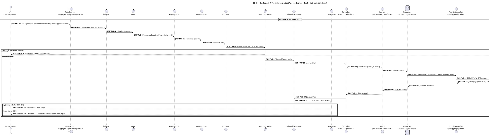
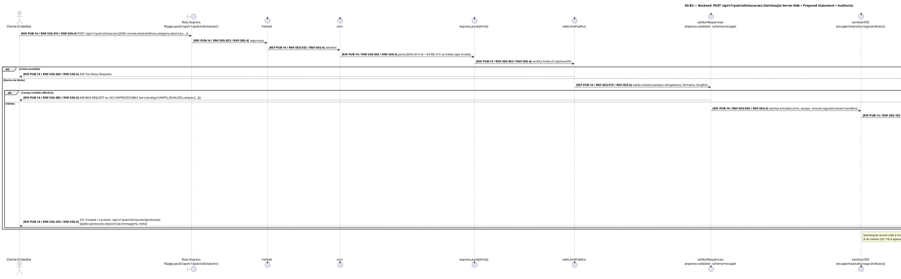
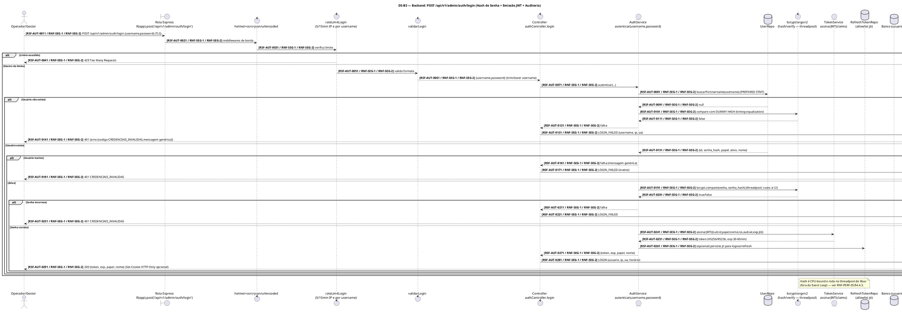
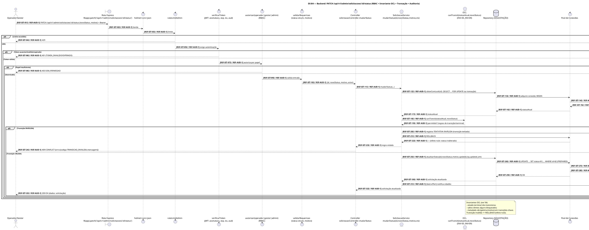
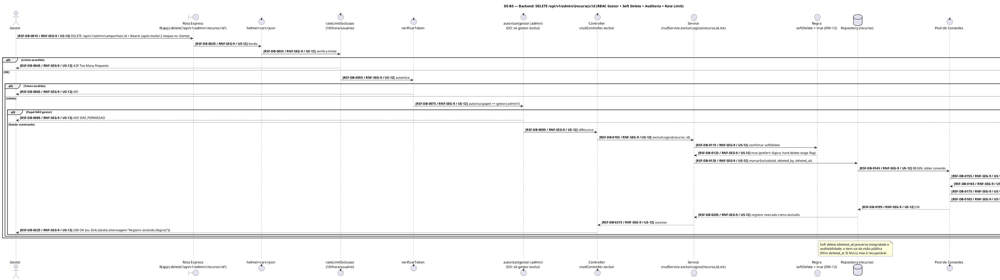
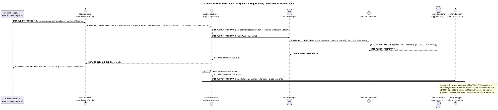
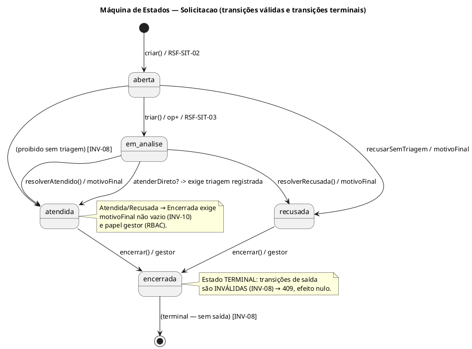

# REQUISITOS DE SISTEMA — SISTEMA *SAÚDE ACESSÍVEL* (SSA)

**Projeto:** Portal Público de Acesso à Rede Municipal de Saúde de Barra do Garças/MT
**Documento:** `requisitos_de_sistema.md` (versão 1.0)
**Normas de referência:** OMG UML 2.5.1 (§17 Sequence Diagram, §11 Class Diagram, §12 Use Case), ISO/IEC/IEEE 29148:2018 (§5.2.2 Requisitos funcionais; §5.3 Requisitos não funcionais), ISO/IEC 25010:2011, FURPS+, OMG Object Constraint Language (OCL 2.5), RFC 9110 (HTTP Semantics), RFC 7519 (JWT), RFC 6749/6750 (OAuth Bearer), OWASP Top 10 2021, NIST SP 800-63B (autenticação)
**Público-alvo:** Arquitetura de Software, Engenharia de Plataforma/DevOps, Segurança da Informação, DBA, Testes/QA, Auditoria técnica
**Complementar a:** `requisitos_de_usuario.md` (perspectiva externa) e `escopo_do_projeto.md` (gerência de projeto)

---

## 0. Controle do Documento

| Campo | Valor |
|---|---|
| Identificador | REQ-SIS-SSA-002 |
| Versão | 1.0 |
| Status | Baseline para Construção |
| Data de emissão | 01/10/2026 |
| Elaborado por | Arquitetura de Software |
| Revisado por | Engenharia de Plataforma (DevOps/SRE) + Segurança da Informação |
| Aprovado por | Coordenação de Informática — Secretaria Municipal de Saúde |
| Convenção de identificadores | `RSF-xx` (Requisito Funcional de Sistema), `RSNF-<CAT>-xx` (Requisito Não Funcional), `RUC-xx` (Requisito de Uso/Configuração), `MID-xx` (Middleware), `RTA-xx` (Rota), `TB-xx` (Tabela), `INV-xx` (Invariante OCL) |
| Taxonomia RSNF | FURPS+ mapeada à ISO/IEC 25010:2011 (Seção 2.2) |

### 0.1 Objetivo e Delimitação deste Documento

Este documento especifica os **requisitos funcionais de sistema (RSF)** e **requisitos não funcionais de sistema (RSNF)** que governam a implementação técnica: rotas HTTP REST, middlewares do Express, contratos JSON, códigos de status, persistência, segurança (criptografia de senha, JWT, sanitização, Prevention de SQLi), concorrência de I/O no Event Loop do Node.js, e pool de conexões. **Não** se repete aqui a narrativa de negócio — ela reside em `requisitos_de_usuario.md`, ao qual este documento se liga por identificadores de rastreio (ver Seção 6).

### 0.2 Stack Tecnológica Normativa (baseline)

| Camada | Tecnologia | Versão mínima | Justificativa arquitetural |
|---|---|---|---|
| Frontend | HTML5 semântico + CSS3 + JavaScript Vanilla (ES6+) | HTML5 (WHATWG), ES2020 | Zero build-step, sem framework, menor superfície de ataque; compatível com navegadores de-ES2018; performance em dispositivos modestos (público-alvo). |
| Backend | Node.js + Express | Node.js ≥ 20 LTS; Express ≥ 4.18 | Runtime assíncrono não-bloqueante (Event Loop), ecossistema maduro, `middlewares` componíveis, suporte consistente a TLS/HTTP/2. |
| Banco de dados | SQLite (dev/embarcado) e PostgreSQL (produção) | SQLite ≥ 3.40; PostgreSQL ≥ 14 | Relacional (modelo transacional ACID), `CHECK`, FKs, índices; Prepared Statements nativos em ambos. |
| Autenticação | bcrypt / argon2id / PBKDF2 + JWT | bcrypt (custo 12) ou argon2id; `jsonwebtoken` | Senhas com hash+salt; token stateless assinado. |
| Validação/Sanitização | `express-validator`, `helmet`, `DOMPurify` (client) | compatível Node 20 | Defesa em profundidade: schema validation + escape + CSP. |
| Testes | `node:test`, `supertest`, Playwright/Cypress | — | Verificação de RSF/RSNF. |
| Infraestrutura | Nginx (proxy reverso/TLS) + PM2/systemd (processo) + NTP | — |.Terminação TLS, rate-limit de borda, gestão de processo. |

### 0.3 Mapeamento FURPS+ → ISO/IEC 25010 (taxonomia canônica adotada)

| Categoria FURPS+ | Característica ISO/IEC 25010 | Sub-características aplicadas neste sistema |
|---|---|---|
| **F**unctionality (Funcionalidade) | Adequação funcional | Completude, correção, conformidade funcional (APIs REST, regras de negócio) |
| **U**sability (Usabilidade) | Usabilidade | Compreensibilidade, aprendizado, operabilidade, acessibilidade, resposta a erro (UI, feedback Toast, mensagens) |
| **R**eliability (Confiabilidade) | Confiabilidade | Maturidade, tolerância a falhas, recuperabilidade, comprovabilidade (auditoria, integridade de dados) |
| **P**erformance (Desempenho) | Desempenho | Tempo de resposta, Throughput, Capacidade de recursos, limite de concorrência (Event Loop não-bloqueante, pool) |
| **S**upportability (Manutenibilidade) | Manutenibilidade | Modularidade, reusabilidade, analisabilidade (logs, auditabilidade), testabilidade, substituibilidade (SQLite↔PostgreSQL) |
| **+R**estrições de projeto (Design) | — | Restrições de plataforma, stack, protocolos (REST, JWT, TLS) |
| **+I**mplementação | — | Tecnologias, ambiente de execução, empacotamento |
| **+I**nterface | — | Contratos de API, CDNs de terceiros, e-mail |
| **+F**ísica | — | Infraestrutura de servidor, banco, rede, armazenamento |

---

## 1. REQUISITOS FUNCIONAIS DE SISTEMA (RSF)

Os RSF especificam o comportamento interno e verificável do sistema: rotas, middlewares, payloads e códigos de status HTTP (RFC 9110). Cada RSF referencia o requisito de usuário (RU) correspondente em `requisitos_de_usuario.md`.

### 1.1 Convenções de API (contrato transversal obrigatório)

| Item | Convenção |
|---|---|
| **Base path público** | `/api/v1/pub/*` |
| **Base path administrativo** | `/api/v1/admin/*` (exige JWT + RBAC) |
| **Autenticação** | `Authorization: Bearer <JWT>` **ou** cookie HTTP-Only `saude_sessao` (ver RNF-SEG-03) |
| **Content-Type de requisição** | `application/json; charset=utf-8` (corpo), `application/x-www-form-urlencoded` aceito apenas no login administrativo |
| **Content-Type de resposta** | `application/json; charset=utf-8`; erros seguem envelope único (abaixo) |
| **Envelope de sucesso** | `{ "dados": <payload>, "meta": { "pagina": n, "total": n, "timestamp": "ISO-8601" } }` |
| **Envelope de erro** | `{ "erro": { "codigo": "STRING_ENUM", "mensagem": "texto amigável pt-BR", "campos": [ { "campo": "...", "mensagem": "..." } ] } }` |
| **Códigos HTTP** | 200 OK, 201 Created (+`Location`), 204 No Content, 304 Not Modified, 400 Bad Request, 401 Unauthorized, 403 Forbidden, 404 Not Found, 405 Method Not Allowed, 409 Conflict, 413 Payload Too Large, 415 Unsupported Media Type, 422 Unprocessable Entity, 429 Too Many Requests (+`Retry-After`), 500 Internal Server Error, 503 Service Unavailable |
| **Idempotência** | `POST` de criação retorna `201` + `Location` + recurso; operações de alteração usam `PUT`/`PATCH` idempotentes; `DELETE` de recurso inexistente retorna `204` (idempotente) |
| **Paginação** | `?page=1&limit=20` (limite máximo 100) para coleções administrativas |
| **Filtros** | `?status=...&q=...&dataDe=...&dataAte=...&especialidade=...` conforme recurso |
| **Versionamento** | URI versionado (`/api/v1`), media type `application/json`; `ETag`/`If-None-Match` para cache de coleções públicas |
| **CORS** | Allowlist explícita de origens (RNF-SEG-11); `Access-Control-Allow-Credentials` apenas com allowlist |
| **Timestamps** | Toda resposta bem-sucedida inclui `meta.timestamp` (ISO-8601 UTC); a UI converte para `dd/mm/aaaa hh:mm` (fuso `America/Cuiaba`, UTC-04:00) |
| **Internacionalização** | Content negotiation não aplicado; idioma fixo `pt-BR` (RNF-USA-08) |
| **Segredos** | Nenhum segredo em código; configuração via `.env` (ver `escopo_do_projeto.md`, Seção 5) |

### 1.2 RSF — Camada de Apresentação (Frontend HTML5/CSS3/JS Vanilla)

| ID | Requisito | Especificação | Verificação | Rastreio |
|---|---|---|---|---|
| RSF-PUB-01 | Consulta pública de postos | `GET /api/v1/pub/postos` retorna coleção de unidades com `id, nome, bairro, status, endereco, telefone, distancia, horario, espera, lotacao, servicos[], lat, lng, obs, aviso`. Resposta paginada (limite 100) e `ETag`. `status ∈ {aberto, fechado, urgencia}`. | Teste de integração; contrato JSON Schema | RU-001 |
| RSF-PUB-02 | Filtro de postos (client-side e server-side) | Filtros `?status=aberto|fechado|urgencia`, `?servico=Odontologia`, `?bairro=...`, `?q=texto`. O frontend também filtra em memória (filtro instantâneo `renderPostos`, `app.js:77–88`). | Teste de integração + UI | RU-002 |
| RSF-PUB-03 | Detalhe de posto | `GET /api/v1/pub/postos/:id` retorna registro único + `servicos[]`. `404` + `NOT_FOUND` se inexistente; `400` + `ID_INVALIDO` se id não numérico. Renderizado em modal (`openPostoModal`, `app.js:100–139`). | Teste de integração | RU-003 |
| RSF-PUB-04 | Rota para posto (terceiro, degradável) | `GET /api/v1/pub/postos/:id/rota` retorna `url` de mapas (https) construída a partir de `lat,lng` (ou endereço). Se serviço externo indisponível, retorna `200` com `{disponivel:false, enderecoTexto:"..."}` — degradação graciosa, sem quebrar a página. | Teste de integração (mock) | RU-004 |
| RSF-PUB-05 | Telefone de posto (link `tel:`) | `GET /api/v1/pub/postos/:id` inclui `telefoneNormalizado` (somente dígitos, E.164 relativo `+5566...`) e `telefoneHref` (`tel:+5566...`) para o link `callPosto` (`app.js:94–98`). | Teste de integração | RU-005 |
| RSF-PUB-06 | Listagem de campanhas com status situacional computado no servidor | `GET /api/v1/pub/campanhas` retorna cada campanha com `status` **calculado no servidor** (fonte temporal do servidor, não do cliente): `ativa` se `inicio/fim` = "Permanente" (NULL) ou `hoje ∈ [inicio, fim]`; `breve` se `hoje < inicio`; `encerrada` se `hoje > fim`. **Ordenação obrigatória:** `{ativa:0, breve:1, encerrada:2}` e, secundariamente, nome. Include `postoLocais[]`. Referência de lógica: `api.js:15–34` (`calcularStatus`). | Teste unitário (data fixa) + integração | RU-006, RU-039 |
| RSF-PUB-07 | Calendário vacinal | `GET /api/v1/pub/calendario-vacinal` retorna faixas etárias ordenadas (`faixa, vacina, doses, obs`). | Teste de integração | RU-007 |
| RSF-PUB-08 | Histórico vacinal (visão informativa) | `GET /api/v1/pub/historico-vacinal` retorna registros (`vacina, dataAplicacao, posto, dose`). **Requisito de privacidade:** neste release é dataset demonstrativo/anônimo (sem vínculo a paciente) — RNF-SEG-08. Se evoluir para dados reais, exige pseudonimização + autenticação (ver Out-of-Scope em `escopo_do_projeto.md`). | Teste de integração | RU-008 |
| RSF-PUB-09 | Profissionais de saúde | `GET /api/v1/pub/profissionais` retorna `nome, especialidade, categoria, horario, posto, disponivel (bool), iniciais`. `categoria ∈ {clinico, pediatra, dentista, cardio, gineco, ...}` (catálogo em `dados.js:91–104`). | Teste de integração | RU-009 |
| RSF-PUB-10 | Filtro de profissionais | `?categoria=...` e `?disponivel=true|false`; equivalência server-side ao filtro client-side (`renderProfissionais`, `app.js:206–222`). | Teste de integração | RU-010 |
| RSF-PUB-11 | Calendário de eventos da saúde | `GET /api/v1/pub/eventos?de=YYYY-MM-DD&ate=YYYY-MM-DD&tipo=campanha|feriado|evento`. `data` armazenada em ISO `YYYY-MM-DD` (comparação lexicográfica segura). Exibida em grade mensal com modal por dia (`renderCalendario`, `openCalModal`, `app.js:225–325`). | Teste de integração | RU-011 |
| RSF-PUB-12 | Busca global | `GET /api/v1/pub/busca?q=termo` retorna itens do índice (`rotulo, pagina, icone`) casados por `LIKE` parametrizado ou índice full-text (ver RSF-DB-03). Debounce de 150 ms no cliente (`app.js:327–352`). | Teste de integração | RU-012 |
| RSF-PUB-13 | Avisos | `GET /api/v1/pub/avisos` retorna `tipo ∈ {success, warn, info}`, `titulo`, `texto`, ordenados por severidade/recência. | Teste de integração | RU-013 |
| RSF-PUB-14 | Registro de solicitação/ouvidoria (público) | `POST /api/v1/pub/solicitacoes` cria solicitação. **Fluxo de validação em camadas:** (1) validação client-side HTML5 + JS (`input`, `blur`, `submit`; campos `required`, `type=email/tel`, `pattern`, `maxlength`); (2) sanitização assíncrona client-side (trim, remoção de caracteres de controle, escape — **não substitui o servidor**); (3) `express-validator` schema no servidor; (4) sanitização server-side (escape/neutralização de `<script>`, atributos `on*`, `javascript:`); (5) persistência via **Prepared Statement**; (6) auditoria append-only. **Respostas:** `201 Created` + `Location: /api/v1/pub/solicitacoes/{protocolo}` + `{protocolo: "<uuid-v4>", statusInicial, mensagem}`; `400` (`VALIDACAO_ENTRADA` / `CAMPO_INVALIDO`); `413` (`PAYLOAD_MUITO_GRANDE`); `415` (`MEDIA_TYPE_NAO_SUPORTADO`); `422` (`REGRA_NEGOCIO`); `429` (`RATE_LIMIT`); `500` (`ERRO_INTERNO`, sem vazamento de pilha). Resposta de sucesso dispara Toast e exibição do protocolo. | Teste de integração; teste de segurança (payloads XSS) | RU-014, RU-018, RU-019 |
| RSF-PUB-15 | Consulta de protocolo (anti-enumeração) | `GET /api/v1/pub/solicitacoes/{protocolo}?email=...` retorna situação. **Enumeração mitigada:** (a) resposta **uniforme** — para protocolo inexistente OU e-mail divergente, retorna **mesmo** `200` com `{encontrado:false, mensagem:"Protocolo não encontrado ou dados não conferem"}` (nunca `404` distinto); (b) rate limiting por IP e por par (IP+protocolo). `403` apenas se a sessão excedeu janela de tentativa. **Nunca** expõe PII de terceiros, nem differentiate status que permita inferir volume. | Teste de integração (casos positivo/negativo equivalentes) + teste de segurança | RU-015 |
| RSF-PUB-16 | Relato de erro de informação (anônimo) | `POST /api/v1/pub/relatos` cria relato anônimo (`descricao` obrigatória, sanitizada; `contexto` opcional: `postoId`/`pagina`). Sem identidade obrigatória (LGPD minimização). `201 Created` + `Location`; `400/422` em validação. Resposta: Toast de confirmação. | Teste de integração | RU-016 |
| RSF-IA-01 | Atendente Virtual baseado em dados locais (somente leitura) | `POST /api/v1/pub/assistente/mensagem {pergunta}` retorna resposta derivada **exclusivamente de dados locais** (postos/campanhas/profissionais/eventos/busca). Intenções reconhecidas: `dentista`, `pediatra`, `cardiologista`, `ginecologista`, `UPA`, `calendário`, `campanha`, `gripe`, `dengue`, `horário`, `histórico`. Resposta: `{texto, sugestoes:[{rotulo,page}], disclaimer:"Atendente local baseado nos dados do app — não substitui orientação médica."}`. **Nunca escreve no banco** (garantia de somente leitura — RSNF-SEG-12). Referência: `iaResponder` (`app.js:423–479`). | Teste de integração (determinístico) | RU-017 |
| RSF-IA-02 | Normalização de pergunta (NLU leve) | Pré-processamento: minúsculas, remoção de diacríticos, remoção de stopwords, detecção de `hoje`/`agora` (data do servidor). Sem chamada a LLM externo (RNF-INT-02, out-of-scope). | Teste unitário | RU-017 |
### 1.3 RSF — Segurança, Autenticação e Autorização

| ID | Requisito | Especificação | Verificação | Rastreio |
|---|---|---|---|---|
| RSF-AUT-01 | Autenticação administrativa (verificação de senha) | `POST /api/v1/admin/auth/login` aceita `username` + `password` (form-urlencoded ou JSON). Fluxo: (1) rate limiting por IP e por `username`; (2) busca do usuário (Prepared Statement); (3) se usuário inexistente, executa **dummy hash** (timing-equalization) para evitar timing-attack; (4) `bcrypt.compare` (ou `argon2.verify`); (5) se válido e `ativo=true`, emite JWT; se inválido, `401` com mensagem **genérica** (`CREDENCIAIS_INVALIDAS`). **Nunca** distingue "usuário inexistente" de "senha errada". Resposta `200 {token, exp, papel, nome}`. Todos os eventos (sucesso/falha) auditados com IP/user-agent. | Teste de integração + teste de segurança (timing, força bruta) | RU-020, US-010 |
| RSF-AUT-02 | Logout | `POST /api/v1/admin/auth/logout` invalida o refresh token/`jti` (allowlist opcional) e registra auditoria. Limpa cookie HTTP-Only (`Max-Age=0`). `204 No Content`. | Teste de integração | RU-022 |
| RSF-JWT-01 | Emissão de JWT (stateless) | `jsonwebtoken.sign` com `HS256` (chave em `.env` `JWT_SECRET`, ≥ 256 bits) **ou** `RS256` (par de chaves). Claims: `sub` (id do usuário), `papel` (role), `nome`, `iat`, `exp`, `iss`, `aud`, `jti`. `exp` curto (padrão 30–60 min; §4.4.2 segurança de sessão — NIST SP 800-63B). Token devolvido em `Authorization: Bearer <token>` **e/ou** cookie `saude_sessao; HttpOnly; Secure; SameSite=Strict; Path=/api`. | Teste de integração; teste de decodificação de claims | RU-020, US-010 |
| RSF-JWT-02 | Validação e renovação de JWT | Middleware `verificarToken`: valida assinatura, `exp`, `iss`, `aud`; rejeita token inválido/expirado com `401 TOKEN_INVALIDO`/`TOKEN_EXPIRADO`. Renovação: `POST /api/v1/admin/auth/refresh` (refresh token opaco de longa duração em allowlist **ou** re-autenticação) emite novo access token. | Teste de integração | RU-021 |
| RSF-RBAC-01 | Autorização por papel (RBAC) | Papéis: `operador` (leitura pública+admin, escrita em CRUD, triagem, mudança de status), `gestor` (todas as de operador + exclusão + homologação), `auditor` (leitura + trilha de auditoria, sem escrita), `admin` (gestão de usuários — restrito). Matriz completa em §1.4. Middleware `autorizar(...papeis)`; negação → `403 SEM_PERMISSAO` (sem revelar existência do recurso além do necessário). | Teste de integração (matriz completa) | RU-023..RU-035, RU-040 |
| RSF-RBAC-02 | Princípio do menor privilégio (IDOR) | Recursos de Solicitação só são acessíveis/admin com `id`/protocolo válido e dentro do escopo; cada chamada verifica o `sub` do token contra o recurso (evita IDOR). `GET/PATCH/DELETE /api/v1/admin/solicitacoes/:id` — `id` inexistente ou de outro tenant → `404 NOT_FOUND` (não `403`, para não confirmar existência). | Teste de segurança (IDOR) | RU-034, RU-035, RU-036 |
| RSF-SEC-01 | Rate limiting (defesa contra força bruta/DoS) | Implementado em `express-rate-limit` (memória para processo único, ou Redis em escala). Limites: login `5 req/15 min` por IP e por `username`; consulta de protocolo `10 req/min` por IP; criação de solicitação `5 req/hora` por IP; exclusões `10 req/hora` por usuário. `429 Too Many Requests` + cabeçalho `Retry-After`. | Teste de integração (limites) | RU-015, RU-020, RU-035 |
| RSF-SEC-02 | Cabeçalhos de segurança e TLS | `helmet` (CSP, HSTS, `X-Content-Type-Options: nosniff`, `X-Frame-Options: DENY`, `Referrer-Policy: no-referrer`, `Permissions-Policy`). TLS obrigatório (HSTS preload após 6 meses; TLS ≥ 1.2). `COOP/COEP` não se aplicam (sem `SharedArrayBuffer`). `CSP` restritiva: `default-src 'self'; script-src 'self'; style-src 'self' 'unsafe-inline'; img-src 'self' data:;` (CDN explicitamente listada se mantida). | Teste de cabeçalhos (curl -I) + scanner | Transversal |
| RSF-SEC-03 | Sanitização ativa contra XSS (defesa em profundidade) | **Cliente:** (a) política CSP; (b) `DOMPurify.sanitize` para qualquer HTML dinâmico inserido via `innerHTML`; (c) **evitar** `innerHTML` com dados não confiáveis — preferir `textContent`/`createElement`; (d) escape de atributos. **Servidor:** (a) `express-validator` (schema, `escape`/`trim`); (b) escape de saída para contextos específicos; (c) resposta JSON (content-type não-executável) + `nosniff`; (d) sanitização de campos ricos (descrições/observações) com allowlist de tags (se necessário). **Referência:** renderização atual de cards usa template literals → migrar para construção com `textContent`/`DOMPurify` (ver RSNF-SEG-05, achado de auditoria). | Teste de segurança (payloads XSS stored/reflected); revisão de código | RU-019, RU-042 |
| RSF-SEC-04 | Proteção contra CSRF | Rotas com efeito via cookie (se opting por cookie) exigem token anti-CSRF (double-submit ou `SameSite=Strict` + Origin check). Rotas via `Authorization: Bearer` (header) são imunes a CSRF. Implementar `Origin`/`Referer` check para métodos não-idempotentes. | Teste de segurança | RU-035, RNF-SEG-05 |
| RSF-SEC-05 | Prevenção de SQL Injection | **Obrigatório:** acesso ao banco **exclusivamente por Prepared Statements** (`db.prepare(sql).run(params)` em SQLite; `pg` com `client.query(text, values)` em PostgreSQL) **ou** ORM/Query Builder parametrizado (Knex/Prisma). **Proibido:** concatenação de strings em SQL. Sanitização de entrada (escape) é medida secundária, **não** substitui parametrização. Revisão de código + SAST (Semgrep rule `sqli`) na CI. | Teste de segurança (payloads `'; DROP TABLE--`, `UNION SELECT`); SAST | Transversal (RSF-DB-01) |
| RSF-SEC-06 | Controle de exposição de dados (Privilégio mínimo em respostas) | Serialização por **allowlist** de campos (evita mass assignment e vazamento de `senha_hash`, `JWT_SECRET`, campos internos). Ex.: login nunca retorna hash; `GET /admin/usuarios` retorna somente campos necessários por papel. | Teste de integração; revisão de schema de resposta | Transversal |

### 1.4 Matriz RBAC (Papel × Permissão) — Especificação de Autorização

| Permissão | `admin` | `gestor` | `operador` | `auditor` | Público (não aut.) |
|---|:--:|:--:|:--:|:--:|:--:|
| Ler dados públicos | ✔ | ✔ | ✔ | ✔ | ✔ |
| Login/logout/refresh | ✔ | ✔ | ✔ | ✔ | ✖ |
| CRUD Postos/Campanhas/Eventos/Profissionais/Avisos/Index | ✔ | ✔ | ✔ | ✖ | ✖ |
| CRUD Serviços/Locais/Calendário/Histórico | ✔ | ✔ | ✔ | ✖ | ✖ |
| Triar solicitação | ✔ | ✔ | ✔ | ✖ | ✖ |
| Alterar status de solicitação | ✔ | ✔ | ✔ | ✖ | ✖ |
| **Excluir registro (soft delete)** | ✔ | ✔ | ✖ | ✖ | ✖ |
| Homologar conteúdo | ✔ | ✔ | ✖ | ✖ | ✖ |
| Exportar relatórios | ✔ | ✔ | ✔ | ✖ | ✖ |
| Consultar trilha de auditoria | ✔ | ✔ | ✖ | ✔ | ✖ |
| Gerenciar usuários/papeis | ✔ | ✖ | ✖ | ✖ | ✖ |
| Registrar solicitação (público) | ✔ | ✔ | ✔ | ✔ | ✔ |
| Consultar protocolo próprio | ✔ | ✔ | ✔ | ✔ | ✔ |

> **Princípio da segregação de funções (SoD):** `operador` não exclui; `auditor` não escreve. A exclusão é privilégio exclusivo de `gestor`/`admin` (Ref.: DS-04, US-012).

### 1.5 RSF — Persistência (Camada de Dados)

| ID | Requisito | Especificação | Verificação | Rastreio |
|---|---|---|---|---|
| RSF-DB-01 | Prepared Statements obrigatório | Toda consulta ao banco relacional usa **prepared statement**/ORM parametrizado. Pool de conexões conforme §4.6. `PRAGMA foreign_keys=ON` (SQLite) e FKs ativas (PostgreSQL). | Teste de segurança; revisão de código | Transversal |
| RSF-DB-02 | Integridade referencial | `PRAGMA foreign_keys=ON` no SQLite; `ON DELETE CASCADE` em `posto_servicos` e `campanha_locais` (ver §5.3). Transações para operações multi-tabela (ex.: alterar status + auditoria). | Teste de integridade | Transversal |
| RSF-DB-03 | Índices de performance | Índices em colunas de filtro/ordenação/join: `postos(status)`, `postos(bairro)`, `campanhas(inicio,fim)`, `eventos(data)`, `eventos(tipo)`, `profissionais(categoria)`, `profissionais(posto)`, `historico_vacinal(data_aplicacao)`, `solicitacoes(protocolo) UNIQUE`, `solicitacoes(status)`, `solicitacoes(criado_em)`, `auditoria(usuario_id)`, `auditoria(entidade,entidade_id)`, `auditoria(criado_em)`. `FTS5` opcional em `busca(rotulo)`. Detalhamento em §5.4. | `EXPLAIN QUERY PLAN`; teste de carga | Transversal |
| RSF-DB-04 | Isolamento transacional | Nível mínimo `READ COMMITTED` (PostgreSQL) / serializável por lock em SQLite (singleton writer). Operações de escrita de solicitações/auditoria em transação explícita (`BEGIN/COMMIT/ROLLBACK`). | Teste de concorrência | Transversal |
| RSF-DB-05 | Soft delete | Exclusão de domínio prefere **soft delete** (coluna `deleted_at` + `deleted_by` em tabelas aplicáveis) com exclusão de registros públicos (filtro `deleted_at IS NULL`). Hard delete somente por `gestor` e quando a política permitir, com auditoria. Ver `escopo_do_projeto.md` §7.2 (RNF-SEG). | Teste de integração | RU-035, RSNF-SEG-09 |

### 1.6 RSF — Middlewares do Express (Pipeline Requisito por Contexto)

| Ordem | Contexto Público (Leitura) | Contexto Público (Escrita) | Contexto Administrativo |
|---|---|---|---|
| 1 | `helmet` (cabeçalhos segurança) | `helmet` | `helmet` |
| 2 | `cors` (allowlist; sem credenciais p/ público) | `cors` (allowlist) | `cors` (allowlist + `Allow-Credentials` p/ cookie) |
| 3 | `express.json({limit:'64kb'})` | `express.json({limit:'64kb'})` + `express.urlencoded({extended:false, limit:'64kb'})` | idem |
| 4 | `compression` (gzip) | `compression` | `compression` |
| 5 | `morgan` (log de acesso) | `morgan` | `morgan` |
| 6 | `cachePublico` (ETag/`max-age`) | `rateLimitPublico` | `rateLimitAdmin` |
| 7 | — | `validarRequericao` (express-validator, sanitização) | `verificarToken` (JWT) |
| 8 | — | — | `autorizar(...papeis)` (RBAC) |
| 9 | `tratarErros` (envelope de erro, 404/500) | `tratarErros` | `tratarErros` (não vaza stack) |
| 10 | `logAuditoria` (leitura pública opcional; gravação) | `logAuditoria` (append-only) | `logAuditoria` (append-only) |

> **Princípio:** middlewares são **funções de callback** `(req,res,next)` executadas pelo Event Loop; `next(err)` propaga ao handler de erro. Sanitização/validação client-side é UX; a autoritativa é server-side (RSF-SEC-03). 

### 1.7 RSF — Auditoria (Trilha Append-Only)

| ID | Requisito | Especificação | Verificação | Rastreio |
|---|---|---|---|---|
| RSF-AUD-01 | Registro de auditoria de escrita | **Toda** escrita de sucesso (criar/alterar/excluir/login/triagem/homologação) grava evento append-only em `auditoria`: `{usuario_id, usuario_nome, papel, acao (CREATE|UPDATE|DELETE|LOGIN|LOGOUT|LOGIN_FAILED|STATUS_CHANGE|HOMOLOGATE|EXPORT), entidade, entidade_id, campos_alterados (JSON diff, sem valores sensíveis), ip, user_agent, resultado, criado_em, correlation_id}`. Escrita é **fire-and-forget** após commit da transação de negócio (ou na mesma transação, conforme criticidade — §5.3). | Teste de integração (contagem/presença de eventos) | RU-014..RU-040 |
| RSF-AUD-02 | Auditoria de leitura sensível | Leituras administrativas (lista de solicitações, de usuários, de auditoria) podem gerar log de acesso (rastreabilidade de "quem viu o quê"). Configurável. | Teste | RU-036 |
| RSF-AUD-03 | Imutabilidade da trilha | Nenhum `UPDATE`/`DELETE` em `auditoria` exposto por API. Retenção mínima conforme RNF-CONF-06. `Append-only` garantido por design (sem rota de escrita) e por permissões (somente `INSERT`). | Teste de segurança (tentar alterar/eliminar) + revisão | RU-036, US-013 |

### 1.8 RSF — Regras de Negócio e Situações (OCL)

| ID | Requisito | Especificação | Verificação | Rastreio |
|---|---|---|---|---|
| RSF-SIT-01 | Situação de campanha | Conforme RSF-PUB-06. Invariantes em §4 (INV-01..). Fonte temporal: relógio do servidor (RNF-CONF-04). | Teste unitário (datas fixas) | RU-006, RU-039, US-014 |
| RSF-SIT-02 | Máquina de estados de solicitação (transições válidas) | Estados: `aberta → em_analise → atendida`; `aberta|em_analise → recusada`; `atendida|recusada → encerrada`. Estados **terminais** (`encerrada`, e opcionalmente `cancelada`) **sem saída**. **Proibido** reabrir/editar de terminal; proibido pular etapa (ex.: `aberta → atendida` direto exige justificativa → permitido como `atendida` apenas se triagem registrada). Regras em OCL (INV-05..INV-09, §4). Transição inválida → `409 TRANSICAO_INVALIDA` (efeito nulo). | Teste unitário (OCL) + integração | RU-033, RU-034, US-011 |
| RSF-SIT-03 | Triagem de solicitação | `PATCH /api/v1/admin/solicitacoes/:id/triagem` define `categoria`, `prioridade ∈ {baixa, normal, alta, urgente}`, `unidadeResponsavelId`, `prazoAtendimento`; muda status `aberta → em_analise`; exige RBAC `operador+`; audita. | Teste de integração | RU-033 |
### 1.9 RSF — Tratamento de Erros e Observabilidade

| ID | Requisito | Especificação | Verificação | Rastreio |
|---|---|---|---|---|
| RSF-ERR-01 | Envelope de erro uniforme | Handler de erro final (`(err,req,res,next)`) converte toda exceção em `{erro:{codigo,mensagem,campos?}}` com o HTTP adequado (400/401/403/404/409/413/415/422/429/500/503). Mensagens em **pt-BR**, sem stack trace/pilha/SQL em produção (RNF-SEG-06). Erros inesperados → `500 ERRO_INTERNO` + `correlation_id` (para suporte). Frontend exibe Toast com `mensagem` (segura). | Teste de integração (matriz de erros) | RU-040, US-005, US-011, US-012 |
| RSF-ERR-02 | Códigos de erro canônicos | `VALIDACAO_ENTRADA`, `CAMPO_INVALIDO`, `CREDENCIAIS_INVALIDAS`, `TOKEN_INVALIDO`, `TOKEN_EXPIRADO`, `SEM_PERMISSAO`, `NAO_ENCONTRADO`, `TRANSICAO_INVALIDA`, `CONFLITO`, `RATE_LIMIT`, `MEDIA_TYPE_NAO_SUPORTADO`, `PAYLOAD_MUITO_GRANDE`, `ERRO_INTERNO`, `INDISPONIVEL`. | Teste | Transversal |
| RSF-ERR-03 | 404 e 405 | Rota inexistente → `404` + `NAO_ENCONTRADO`; método não permitido na rota → `405`. | Teste | Transversal |
| RSF-LOG-01 | Logs estruturados | `morgan` (acesso) + logger estruturado (nível, msg, meta, correlation_id) em stdout; em produção, log rotation. Nunca logar senha, token, `senha_hash`, PII completa (mascaramento). | Revisão de log; teste | RNF-SEG-06, RNF-CONF-05 |

---

## 2. REQUISITOS NÃO FUNCIONAIS (RSNF) — TAXONOMIA FURPS+ / ISO/IEC 25010

### 2.1 RSNF de Segurança (S — Security) — FURPS+ "S" de Supportability + ISO/IEC 25010 Adequação/Confiabilidade de segurança

| ID | Requisito | Categoria 25010 | Métrica / Critério de Aceitação | Verificação | Rastreio |
|---|---|---|---|---|---|
| RNF-SEG-01 | **Criptografia de senhas com algoritmo seguro** (bcrypt / argon2id / PBKDF2 com salt aleatório) | Adequação de segurança | Senhas **nunca** em texto claro nem reversíveis. Armazenamento: `bcrypt` (custo ≥ 12, salt por senha gerado automaticamente) **ou** `argon2id` (m=19456 KiB, t=2, p=1 — OWASP) **ou** `PBKDF2-HMAC-SHA256` (≥ 310.000 iterações, salt 16 bytes). **Requisito de salt aleatório por usuário** (não global). Verificação de senha com **tempo constante** (`bcrypt.compare`; dummy hash p/ usuário inexistente). Migration de senha para re-hash no login (rehash on login). | Revisão de código; teste de round-trip; benchmark de custo; inspeção de `usuario.senha_hash` (só hash+params) | RU-020, US-010 |
| RNF-SEG-02 | **Autenticação/autorização stateless via JWT** (`Authorization: Bearer <token>` ou cookie HTTP-Only) | Adequação de segurança | Token assinado (HS256/RS256), claims `sub,papel,iss,aud,iat,exp,jti`; `exp` ≤ 60 min; assinatura verificada em toda rota protegida; revogação por `jti`/allowlist p/ casos críticos (logout, troca de senha); `aud`/`iss` validados. Cookie: `HttpOnly` (inacessível a JS — mitiga roubo via XSS), `Secure` (só HTTPS), `SameSite=Strict` (mitiga CSRF). | Teste de integração (401 em token inválido/expirado/ausente); verificação de atributos de cookie | RU-020..RU-022, US-010 |
| RNF-SEG-03 | **Sanitização ativa contra XSS** | Adequação de segurança | `express-validator` (validação/escape no servidor) + `DOMPurify`/`textContent` (cliente) + CSP (script-src sem `unsafe-eval`) + `nosniff` + escape de saída. **Defesa em profundidade:** cliente (UX) **e** servidor (autoritativo). Payload stored/reflected XSS em descrições/campos ricos — nenhum `alert`/`document.cookie`/fetch-permissivo executado. | Teste de segurança (XSS stored/reflected/DOM); scanner CSP; revisão | RU-019, RSF-SEC-03 |
| RNF-SEG-04 | **Prevenção de SQL Injection** | Adequação de segurança | **Somente** Prepared Statements/ORM parametrizado. `grep` de concatenação em SQL = 0 ocorrência (code review + regra CI). Payloads `'; DROP TABLEposto;--`, `1 OR 1=1`, `UNION SELECT` **não** alteram o banco. `PRAGMA foreign_keys=ON`. | Teste de segurança; SAST; `EXPLAIN` | RSF-SEC-05, RSF-DB-01 |
| RNF-SEG-05 | Proteção contra CSRF | Adequação de segurança | Métodos não-idempotentes: ou header `Bearer` (imune) ou token anti-CSRF/double-submit + `SameSite=Strict` + check de `Origin`. | Teste | RSF-SEC-04 |
| RNF-SEG-06 | Não vazamento de informação em erros | Adequação de segurança | Respostas de erro sem stack trace, SQL, caminho de arquivo, stack de dependência. `500` → só `codigo` + `mensagem` genérica + `correlation_id`. | Teste de integração | RSF-ERR-01, RNF-LOG-01 |
| RNF-SEG-07 | Consentimento e finalidade (LGPD — Lei nº 13.709/2018) | Adequidade de segurança / Privacidade | Campos de PII com finalidade declarada + checkbox de consentimento; Privacy Notice acessível; dados coletados limitados ao necessário (minimização). | Revisão; teste de UI | RU-044, US-016 |
| RNF-SEG-08 | Pseudonimização e minimização de PII | Privacidade | Solicitação: nome/e-mail/telefone minimizados; protocolo UUID não vincula dados pessoais em log (log usa `protocolo` ou id, não PII). Histórico vacinal (público) é dataset **demonstrativo/anônimo** (sem identificador real). Ativos de risco: consentimento, finalidade, retenção, segurança. | Revisão; teste | RSF-PUB-08, RU-044 |
| RNF-SEG-09 | Integridade de soft delete (recuperabilidade) | Adequação de segurança | Exclusão de domínio = soft delete (coluna `deleted_at`/`deleted_by`); item excluído some da visão pública mas permanece recuperável por `gestor` (compliance/auditoria). | Teste | RSF-DB-05, RU-035 |
| RNF-SEG-10 | Anti-enumeração (consulta de protocolo/login) | Adequação de segurança | Resposta **uniforme** para sucesso/falha (login: "credenciais inválidas"; protocolo: "não encontrado ou dados não conferem"); rate limiting; **sem** differences de timing/estrutura que confirmem existência. | Teste de segurança | RSF-PUB-15, RSF-AUT-01, RSF-SEC-01 |
| RNF-SEG-11 | CORS e superfície de ataque | Adequação de segurança | Allowlist de origens explícita; `Access-Control-Allow-Credentials` apenas p/ allowlist; preflight `OPTIONS` cacheado; nenhuma API sensível acessível cross-origin. | Teste de cabeçalhos | RSF-SEC-02 |
| RNF-SEG-12 | Privilégio mínimo e separação de funções | Adequação de segurança | Matriz RBAC (§1.4) aplicada; `operador` não exclui; `auditor` não escreve; assistants/IA somente leitura; principle of least privilege em seleção de campos. | Teste (matriz) | RSF-RBAC-01/02, RSF-IA-01 |
| RNF-SEG-13 | Proteção de dados em repouso e trânsito | Adequação de segurança | Trânsito: TLS 1.2+ obrigatório, HSTS. Repouso: hash de senhas (RNF-SEG-01); dados sensíveis de solicitação: considerar encrypt-at-rest (volume do BD) ou, no mínimo, backup cifrado (§4.7). Segredos em `.env` fora do repositório (§5 implantação). | Revisão de config; inspeção de `.env` não versionado | RNF-SEG-01, RNF-CONF-06 |
| RNF-SEG-14 | Dependências seguras | Adequação de segurança | `npm audit` sem vulnerabilidades *high/critical* em runtime; dependências pinadas (lockfile); SCA no pipeline. | `npm audit`; CI | Transversal |

### 2.2 RSNF de Desempenho (P — Performance)

| ID | Requisito | Métrica / Critério de Aceitação | Verificação | Rastreio |
|---|---|---|---|---|
| RNF-PERF-01 | Tempo de resposta de rotas públicas (p95) | `GET /api/v1/pub/*` p95 < 200 ms (carga nominal), p99 < 400 ms, em hardware de referência documentado. `POST /solicitacoes` p95 < 500 ms. | Teste de carga (k6/Artillery) | RSF-PUB-* |
| RNF-PERF-02 | Tempo de resposta de rotas administrativas (p95) | `GET/PATCH /api/v1/admin/*` p95 < 300 ms; `POST /login` p95 < 600 ms (custo de hash argon2/bcrypt — ver RNF-PERF-05). | Teste de carga | RSF-ADM-* |
| RNF-PERF-03 | Payload enxuto e cache | Respostas públicas com campos estritamente necessários (allowlist); `ETag`/`304`; `Cache-Control: public, max-age=60` (público) — reduz payload e latência percebida. `compression` (gzip/brotli) ativo. | Teste de carga; verificação de headers | RSF-SEC-06, §1.1 |
| RNF-PERF-04 | **Concorrência de I/O não bloqueante (Event Loop)** | Toda operação de I/O (BD, rede, arquivo, e-mail) é **assíncrona** (`await`/Promises/callbacks). **Nenhuma** operação bloqueante (CPU-bound pesada ou I/O síncrono — p.ex., `fs.readFileSync` em request path, laço CPU sem `yield`) no Event Loop em caminho de requisição. Impacto: uma requisição lenta de BD/e-mail **não** bloqueia outras. | Teste de concorrência (N requisições simultâneas → p95 estável); revisão de código (sem `*Sync` em handler); monitorar `eventLoopLag` (RNF-CONF-05) | §4.4, §4.6 |
| RNF-PERF-05 | Custo de criptografia vs. responsividade | Hash de senha (`bcrypt`/`argon2id`) é CPU-intensivo: p95 de `/login` aceitável mesmo assim; paralelismo do hash dimensionado para não saturar o Event Loop (`bcrypt` usa `libuv` threadpool; limitar concorrência p/ não estourar o pool — §4.4.3). | Teste de carga de `/login`; ajuste de threadpool | RNF-SEG-01, RNF-PERF-02 |
| RNF-PERF-06 | Escala e pool de conexões | Pool dimensionado (SQLite: 1 writer; PostgreSQL: `max` conforme CPU, ex.: `max=10–20`, `min=2`; timeout de conexão/acquire). Throughput ≥ 200 req/s (público) em hardware de referência. | Teste de carga; métricas de pool | §4.6 |
| RNF-PERF-07 | Frontend responsivo | UI (render de listas/grades) < 100 ms perceived; sem travamento em dispositivos modestos; carregamento inicial < 2.5 s (LCP em 3G). | Teste de dispositivo/Lighthouse | RSF-PUB-* (frontend) |
| RNF-PERF-08 | Limite de payload e de coleção | `413` se body > 64 KB; paginação com `limit` máximo 100 (evita materializar coleções grandes — pressão de memória/Event Loop). | Teste | §1.1, RNF-PERF-06 |

### 2.3 RSNF de Confiabilidade (R — Reliability)

| ID | Requisito | Métrica / Critério de Aceitação | Verificação | Rastreio |
|---|---|---|---|---|
| RNF-CONF-01 | Disponibilidade | Uptime alvo ≥ 99,5% (mês) para rotas públicas; servidor Node gerenciado por PM2/systemd com **auto-restart**; health-check `GET /api/v1/health` (liveness/readiness) para o proxy. | Monitoramento; teste de failover | §4.7 implantação |
| RNF-CONF-02 | Tolerância a falhas de dependências | Falha do serviço de mapas/e-mail/CDN **não** derruba o portal (degradação graciosa — §2.6); e-mail em fila com retry; mapas retornam fallback textual. | Teste de resiliência (derrubar dependência) | RNF-INT-01/02, RSF-PUB-04 |
| RNF-CONF-03 | Integridade e atomicidade de dados | Operações multi-tabela em transação (alterar status + auditoria; excluir + auditoria). Em falha, `ROLLBACK` (sem estado parcial). | Teste de falha/rollback | RSF-DB-04, RSF-AUD-01 |
| RNF-CONF-04 | Determinismo temporal | Cálculos situacionais (campanhas) usam o **relógio do servidor** (NTP), nunca o do cliente, para consistência. Fuso configurado (`TZ=America/Cuiaba`). | Teste (data fixa, mock de relógio) | RSF-SIT-01 |
| RNF-CONF-05 | Observabilidade e detecção | `eventLoopLag` e uso do Event Loop monitorados (alerta se > 100 ms); log estruturado com `correlation_id` ponta a ponta; health-check. | Dashboard/monitoramento; alerta | RNF-PERF-04, RSF-LOG-01 |
| RNF-CONF-06 | Durabilidade e backup | Backup diário do banco (SQLite: cópia consistente via `VACUUM INTO`/API de backup; PostgreSQL: `pg_dump`), retenção ≥ 30 dias, cópia off-site/homologada; **restauração testada** trimestralmente. | Teste de restauração | RNF-SEG-13 |
| RNF-CONF-07 | Compatibilidade e portabilidade de BD | Código de acesso ao BD isolado (adapter/repository) permite SQLite ↔ PostgreSQL sem alterar regras de negócio (evita lock-in); DDL duplo documentado (§5.2/§5.3). | Teste de contrato de repositório nas duas engines | RNF-SUP-02 |

### 2.4 RSNF de Usabilidade (U — Usability) — ISO/IEC 25010 Usabilidade

| ID | Requisito | Métrica / Critério de Aceitação | Verificação | Rastreio |
|---|---|---|---|---|
| RNF-USA-01 | Design responsivo / mobile-first | Layout funcional em ≥ 360 px de largura; sem rolagem horizontal; menu colapsável (hambúrguer) funcional; testado em Chrome/Firefox/Safari mobile. | Teste de viewport | RU-041, US-015 |
| RNF-USA-02 | Feedback não bloqueante (Toast/DOM) | Sucesso/erro/aviso comunicados via Toast acessível (`aria-live`), duração ~2,8 s (`showToast`, `app.js:36–44`); erros críticos com mensagem persistente. | Teste de UI + leitor de tela | RU-019, RU-040 |
| RNF-USA-03 | Acessibilidade de formulário (HTML5 semântico) | Labels associados, `required`, agrupamentofieldset, ordem de tabulação lógica, `aria-describedby` para erros; foco visível. | Auditoria de acessibilidade | RU-018, US-005 |
| RNF-USA-04 | Busca acessível | Busca com *autocomplete* navegável por teclado (`aria-activedescendant`/listbox), resultados announced, debounce sem travar. | Teste de teclado/leitor | RU-012 |
| RNF-USA-05 | Linguagem e mensagens | pt-BR; mensagens de erro-actionable ("Corrija o campo e-mail"); datas em `dd/mm/aaaa`; sem jargão. | Revisão de conteúdo | RU-045, RU-040 |
| RNF-USA-06 | Target size / foco | Alvos de toque ≥ 44×44 px; foco de teclado sempre visível. | Auditoria | RU-041/043 |
| RNF-USA-07 | Conformidade WCAG 2.1 AA | Contraste ≥ 4.5:1 (texto normal), ≥ 3:1 (texto grande/UI); estado não só por cor; `prefers-reduced-motion` respeitado. | axe/Lighthouse + revisão | RU-043 |
| RNF-USA-08 | Idioma e localização | `lang="pt-BR"`; formatação local de números/datas; fuso `America/Cuiaba`. | Revisão | RU-045 |
| RNF-USA-09 | Orientação e descoberta (affordance) | CTAs rotulados (`"Rota"`, `"Ligar"`, `"Enviar"`, `"Excluir"`), ícones com texto/`aria-label`; modal com título/fechamento evidente; estado vazio orienta ação. | Teste de usabilidade | Transversal |
| RNF-USA-10 | Transparency do assistente virtual | Disclaimer **sempre** visível no painel do Atendente Virtual: não substitui orientação médica (`index.html:245`); nenhuma suggestion de diagnóstico/tratamento. | Revisão de conteúdo | RU-017 |

### 2.5 RSNF de Arquitetura / Manutenibilidade (A — arquitetura; S — Supportability)

| ID | Requisito | Métrica / Critério de Aceitação | Verificação | Rastreio |
|---|---|---|---|---|
| RNF-ARQ-01 | Arquitetura em camadas | Frontend: HTML/CSS/JS separados; Backend: **Controller → Service/Model → Repository(DB)**; middleware de concerns transversais (auth, sanitização, auditoria, erro). Baixo acoplamento; DI simples. | Revisão de arquitetura; diagrama de componentes (`escopo_do_projeto.md` §4) | Transversal |
| RNF-ARQ-02 | Contrato de API versionado e documentado | Prefixo `/api/v1`; contrato estável; documentação (OpenAPI/Swagger) gerada e versionada; envelope e códigos de status uniformes (§1.1). | Teste de contrato; OpenAPI lint | §1.1 |
| RNF-ARQ-03 | Separação de responsabilidades | Domínio (regras/OCL) livre de HTTP/Express; Repository isola SQL; Controller só orquestra (não contém regra de negócio). | Revisão | RNF-SUP-01 |
| RNF-SUP-01 | Modularidade e testabilidade | Módulos coesos; **injeção de dependências** (repositório, serviço de e-mail, relógio) para **mock em teste**; cobertura unitária ≥ 80% em domínio/regras OCL. | Testes; relatório de cobertura | RNF-CONF-04 |
| RNF-SUP-02 | Substituibilidade e portabilidade | Troca SQLite ↔ PostgreSQL por configuração (`.env`/driver) sem alterar domínio; SDL equivalente (§5.2/§5.3). | Teste de contrato | RNF-CONF-07 |
| RNF-SUP-03 | Configuração por ambiente | Configuração externalizada (`.env` + dotenv): porta, DSN do BD, `JWT_SECRET`, drivers, SMTP, chaves. Nenhum segredo hard-coded; `.env` **não** versionado (`.gitignore`). | Revisão de repo; inspeção | RNF-SEG-13, §5 |
| RNF-SUP-04 | Analisabilidade e auditabilidade | Logs estruturados; `correlation_id`; trilha de auditoria consultável por filtro (RU-036); mensagens de erro com código estável. | Teste | RSF-LOG-01, RSF-AUD-01 |
| RNF-ARQ-04 | Compatibilidade de runtime (Node) | Alvo: Node.js LTS; sem APIs experimentais; `package.json` com `engines`; dependências auditadas. `npm start` reproduz o ambiente. | CI; `npm audit` | RNF-SEG-14 |
| RNF-ARQ-05 | Idempotência e resiliência de escrita | Operações de escrita idempotentes (`PUT`/`PATCH`); cliente pode repetir com segurança; criam-se com `Idempotency-Key` (opcional). | Teste | §1.1 |

### 2.6 RSNF de Interface / Integração (I)

| ID | Requisito | Critério de Aceitação | Verificação | Rastreio |
|---|---|---|---|---|
| RNF-INT-01 | Integração com serviço de mapas (terceiro, degradável) | Rota/url gerada sem quebrar o fluxo se o serviço estiver indisponível (fallback: endereço em texto + link para serviço de mapa padrão). Sem hard-dependency. | Teste de resiliência | RSF-PUB-04, RU-004 |
| RNF-INT-02 | Integração de e-mail (SMTP/API, transacional, degradável) | Envio de confirmação de protocolo/notificação em **fila** com retry e backoff; falha de e-mail **não** faz `rollback` da solicitação (é best-effort após commit); template pt-BR. | Teste de resiliência | RSF-PUB-14, RNF-CONF-02 |
| RNF-INT-03 | Uso de CDN de terceiros (recursos estáticos) | Ícones/estilos externos via CDN com **fallback local**; CSP compatível; o sistema funciona sem internet externa ao CDN (graceful). | Teste offline/CDN-blocked | Ator AT-13; §2 RNF-CONF-02 |
| RNF-INT-04 | Independência de framework de interface | Frontend sem *framework* (JavaScript ES6+) — sem etapa de construção (*build*); compatibilidade com navegadores *evergreen*. | Revisão | RNF-ARQ-01 |

### 2.7 RSNF de Restrições de Implementação / Física

| ID | Requisito | Critério | Verificação |
|---|---|---|---|
| RNF-IMP-01 | Stack obrigatória | Node.js + Express + banco relacional (SQLite/PostgreSQL) com Prepared Statements; frontend HTML5/CSS3/JS Vanilla. Desvios exigem aprovação (change control — `escopo_do_projeto.md` §9). | Revisão |
| RNF-IMP-02 | Ambiente de execução | Processo único Node.js gerenciado (PM2/systemd) + proxy Nginx TLS; `.env` para segredos; relógio NTP. | Inspeção | 
| RNF-PHY-01 | Recursos de servidor | CPU/RAM/disco dimensionados para a carga alvo (§4.7, RNF-PERF-06); disco com espaço para BD + backups. | Dimensionamento |

---

## 3. DIAGRAMAS DE SEQUÊNCIA DINÂMICOS DE BACKEND (PlantUML)

Os diagramas detalham o **fluxo interno** do backend: `Rota Express → Middlewares (Auth/Sanitização) → Controller → Service/Model → Banco de Dados → Trilha de Auditoria`. Conformidade: UML 2.5.1 §17.2 (Sequence Diagram).

### 3.1 DS-B1 — Requisição Pública de Leitura (GET /api/v1/pub/postos)



### 3.2 DS-B2 — Criação de Solicitação Pública (POST /api/v1/pub/solicitacoes) — Foco: Sanitização + Prepared Statement + Auditoria



### 3.3 DS-B3 — Autenticação Administrativa (POST /api/v1/admin/auth/login) — Foco: Hash + JWT + Auditoria



### 3.4 DS-B4 — Alteração de Status de Solicitação (PATCH /api/v1/admin/solicitacoes/:id/status) — Foco: OCL + Transação + Auditoria



### 3.5 DS-B5 — Exclusão Segura (DELETE /api/v1/admin/:recurso/:id) — Foco: RBAC (gestor) + Soft Delete + Auditoria



### 3.6 DS-B6 — Auditoria Append-Only (Fluxo interno do logAuditoria)



---

## 4. DIAGRAMA ESTRUTURAL DE CLASSES DE DOMÍNIO E CONTROLADORES (com invariantes OCL)

Diagrama de Classes UML 2.5.1 (§11) com **invariantes OCL** (Object Constraint Language 2.5) para as regras de transição de status e de domínio.

### 4.1 Invariantes OCL (Normativos)

| ID | Classe | Invariante OCL | Significado |
|---|---|---|---|
| INV-01 | `Posto` | `inv statusValido: self.status &lt;&gt; null and Set{'aberto','fechado','urgencia'}->includes(self.status)` | `status` ∈ {aberto, fechado, urgencia} (CHECK do DDL). |
| INV-02 | `Posto` | `inv coordValidas: (self.lat = null and self.lng = null) or (self.lat &lt;&gt; null and self.lng &lt;&gt; null and self.lat &gt;= -90.0 and self.lat &lt;= 90.0 and self.lng &gt;= -180.0 and self.lng &lt;= 180.0)` | Coordenadas válidas e pareadas (lat/lng ambos nulos ou ambos válidos). |
| INV-03 | `Campanha` | `inv datasCoerentes: (self.inicio = null and self.fim = null) or (self.inicio &lt;&gt; null and self.fim &lt;&gt; null and self.inicio &lt;= self.fim)` | Campanha permanente (ambos nulos) ou com início ≤ fim. |
| INV-04 | `Campanha` | `inv statusSituacionalCoerente: self.statusSituacional in {'ativa','breve','encerrada'}` | Status situacional sempre num conjunto fechado. |
| INV-05 | `Solicitacao` | `inv statusInicial: self.status = 'aberta'` | Toda solicitação nasce `aberta` (created). |
| INV-06 | `Solicitacao` | `inv statusValido: self.status &lt;&gt; null and Set{'aberta','em_analise','atendida','recusada','encerrada'}->includes(self.status)` | `status` ∈ conjunto de estados (CHECK do DDL). |
| INV-07 | `Solicitacao` | `inv transicoesValidas: self.tramitacao->forall(t \| t.estadoNovo in self.estados Permitidos(t.estadoAnterior))` | Cada passo da tramitação respeita as transições permitidas. |
| INV-08 | `Solicitacao` | `inv estadosTerminaisSemSaida: Set{'encerrada'}->forAll(e \| e.transicoesSaida->isEmpty())` | `encerrada` é terminal (sem transições de saída). |
| INV-09 | `Solicitacao` | `inv transicaoInvalidaEfeitoNulo: when not self.canTransit(novo) then self.status = self.estadoAnterior endif` | Transição inválida não altera o estado (efeito nulo, garantido por rollback na §4.2). |
| INV-10 | `Solicitacao` | `inv motivoObrigatorioEmFechamento: (self.status &lt;&gt; 'aberta' and self.status &lt;&gt; 'em_analise') implies (self.motivoFinalizacao &lt;&gt; null and self.motivoFinalizacao.trim().size() &gt; 0)` | Transições para estado final exigem `motivoFinalizacao` não vazio. |
| INV-11 | `Profissional` | `inv categoriaValida: Set{'clinico','pediatra','dentista','cardio','gineco','fisio','psi','outro'}->includes(self.categoria)` | `categoria` no catálogo de filtros do frontend. |
| INV-12 | `EntidadeAuditavel` | `inv softDeletePadrao: self.deleted = false or self.deletedBy &lt;&gt; null and self.deletedAt &lt;&gt; null` | Se `deleted=true`, então `deletedBy` e `deletedAt` obrigatórios (rastreabilidade da exclusão). |
| INV-13 | `EntidadeAuditavel` | `inv visivelSeNaoExcluido: not self.deleted implies self.visiblePublica` | Entidade não excluída é visível publicamente. |
| INV-14 | `Evento` | `inv tipoEventoValido: Set{'campanha','feriado','evento'}->includes(self.tipo)` | `tipo` ∈ {campanha, feriado, evento} (CHECK). |
| INV-15 | `Aviso` | `inv tipoAvisoValido: Set{'success','warn','info'}->includes(self.tipo)` | `tipo` ∈ {success, warn, info} (CHECK). |
| INV-16 | `Evento` | `inv dataValidaFormato: self.data.matches('^[0-9]{4}-[0-9]{2}-[0-9]{2}$')` | Data em ISO `YYYY-MM-DD`. |

> **Nota de notação OCL:** em OCL, os conjuntos literais escrevem-se `Set{'a','b'}->includes(x)` e as comparações de string usam `<>` para diferença. As invariantes acima são as formas canônicas válidas; não há placeholders.

### 4.2 Máquina de Estados e Regra `canTransit` (OCL — pré/pós-condições)



**Conceito OCL `canTransit(estadoAtual, novoStatus)` — pré-condições (pré-condições p/ pré-condição de método):**

```ocl
context Solicitacao::canTransit(novo : Status) : Boolean
pre: self.status <> null
body:
  -- estados terminais não podem sair
  if self.status = 'encerrada' then
    result = false
  -- transições válidas
  elseif (self.status = 'aberta' and novo = 'em_analise')
     or (self.status = 'em_analise' and (novo = 'atendida' or novo = 'recusada'))
     or (self.status = 'atendida' and novo = 'encerrada')
     or (self.status = 'recusada' and novo = 'encerrada')
     or (self.status = 'aberta' and novo = 'recusada') then
    result = true
  else
    result = false
  endif
post: canTransit(novo) implies (self.status' = novo and self.motivo or self.motivoFinalizacao <> null when novo in Set{'atendida','recusada','encerrada'})
```

**Pré-condições de negócio Complementares (as constraints do diagrama):**
- Transições para `atendida`/`recusada`/`encerrada` **exigem** `motivo` não vazio (INV-10).
- Transições são autorizadas apenas por papéis `operador|gestor|admin` (§1.4).
- Toda transição gera evento de auditoria `STATUS_CHANGE` (RSF-AUD-01).

### 4.3 Diagrama de Classes de Domínio e Controladores (PlantUML)

```plantuml
@startuml diagrama_classes_ssa
' ===============================================================
' Figura 4.2 — Diagrama Estrutural de Classes (Domínio + Controladores)
' UML 2.5.1 §11 com invariantes OCL
' ===============================================================
title Diagrama de Classes — Domínio e Controladores — Sistema Saúde Acessível (UML 2.5.1 + OCL)

' ---------- PACOTE DOMÍNIO ----------
package "<<domain>> Domínio" {

  entity "Posto" as Posto {
    + id : Integer
    + nome : String
    + bairro : String
    + status : PostoStatus
    + endereco : String
    + telefone : String
    + lat, lng : Real
    + obs : String
    + aviso : Boolean
    + deletedAt, deletedBy : DateTime
    --
    -- OCL inv statusValido: status in Set{'aberto','fechado','urgencia'}
    -- OCL inv coordValidas: (lat = lng = null) or (lat >= -90.0 and lat <= 90.0 and lng >= -180.0 and lng <= 180.0)
    + listarServicos() : List<String>
    + calcularAbertoAgora() : Boolean
  }

  entity "PostoStatus" as PostoStatus <<enumeration>> {
    aberto
    fechado
    urgencia
  }

  entity "Servico" as Servico {
    + id : Integer
    + postoId : Integer
    + nome : String
  }

  entity "Campanha" as Campanha {
    + id : Integer
    + nome : String
    + icone : String
    + descricao : String
    + inicio : Date
    + fim : Date
    + deletedAt : DateTime
    --
    -- OCL inv datasCoerentes: (inicio = fim = null) or (inicio <= fim)
    + statusSituacional(hoje : Date) : CampanhaStatus
      -- OCL statusSituacional (corpo do método):
    -- se (inicio = null and fim = null) then 'ativa'
    -- elsif (hoje < inicio) then 'breve'
    -- elsif (hoje > fim) then 'encerrada'
    -- else 'ativa'
  }

  entity "CampanhaStatus" as CampStatus <<enumeration>> {
    ativa
    breve
    encerrada
  }

  entity "Evento" as Evento {
    + id : Integer
    + data : Date
    + titulo : String
    + tipo : EventoTipo
    + descricao : String
    --
    -- OCL inv dataValidaFormato: data.matches('^[0-9]{4}-[0-9]{2}-[0-9]{2}$')
    -- OCL inv tipoValido: tipo in Set{'campanha','feriado','evento'}
  }

  enum "EventoTipo" as EventoTipo {
    campanha
    feriado
    evento
  }

  entity "Profissional" as Profissional {
    + id : Integer
    + nome : String
    + especialidade : String
    + categoria : Categoria
    + horario : String
    + posto : String
    + disponivel : Boolean
    + iniciais : String
    --
    -- OCL inv categoriaValida: categoria in Set{'clinico','pediatra','dentista','cardio','gineco','fisio','psi','outro'}
  }

  enum "Categoria" as Categoria {
    clinico
    pediatra
    dentista
    cardio
    gineco
    fisio
    psi
    outro
  }

  entity "Aviso" as Aviso {
    + id : Integer
    + tipo : AvisoTipo
    + titulo : String
    + texto : String
    --
    -- OCL inv tipoValido: tipo in Set{'success','warn','info'}
  }

  enum "AvisoTipo" as AvisoTipo {
    success
    warn
    info
  }

  entity "Busca" as Busca <<Index>> {
    + id : Integer
    + rotulo : String
    + pagina : String
    + icone : String
  }

  entity "Solicitacao" as Solicitacao {
    + id : Integer
    + protocolo : UUID
    + nome, email, telefone, cpfOpcional : String
    + categoria : CategoriaSolicitacao
    + descricao : String
    + status : SolicitacaoStatus
    + prioridade : Prioridade
    + unidadeResponsavelId : Integer
    + motivo, motivoFinalizacao : String
    + criadoEm, atualizadoEm, deletedAt : DateTime
    --
    -- OCL inv statusInicial: status = 'aberta'
    -- OCL inv statusValido: status in Set{'aberta','em_analise','atendida','recusada','encerrada'}
    -- OCL inv transicoesValidas: tramitacao->forAll(p | self.transicoesPermitidas(p.de)->includes(p.para))
    -- OCL inv estadosTerminaisSemSaida: Set{'encerrada'}->forAll(e | e.transicoesSaida->isEmpty())
    -- OCL inv motivoObrigatorioEmFechamento: (status <> 'aberta' and status <> 'em_analise') implies (motivoFinalizacao <> null and motivoFinalizacao.trim().size() > 0)
    + canTransit(novo : SolicitacaoStatus) : Boolean
    + triar(...) / + mudarStatus(...) / + finalizar(...)
  }

  enum "SolicitacaoStatus" as SolStatus {
    aberta
    em_analise
    atendida
    recusada
    encerrada
  }

  enum "Prioridade" as Prioridade {
    baixa
    normal
    alta
    urgente
  }

  entity "Tramitacao" as Tramitacao <<ValueObject>> {
    + de : SolicitacaoStatus
    + para : SolicitacaoStatus
    + autorId, autorNome : Integer/String
    + motivo : String
    + em : DateTime
  }

  entity "Relato" as Relato {
    + id : Integer
    + descricao : String
    + contexto (postoId/pagina) : String
    + criadoEm : DateTime
  }

  entity "Usuario" as Usuario <<EntidadeDeSeguranca>> {
    + id : Integer
    + username : String
    + senhaHash : String
    -- OCL inv senhaHashValido: senhaHash <> null and senhaHash.trim().size() > 0
    -- formato = hash + salt + params (bcrypt/argon2/PBKDF2)
    + papel : Papel
    + ativo : Boolean
    + criadoEm : DateTime
  }

  enum "Papel" as Papel {
    admin
    gestor
    operador
    auditor
  }

  entity "Auditoria" as Auditoria <<AppendOnly>> {
    + id : Integer
    + usuarioId, usuarioNome, papel : Integer/String/Papel
    + acao : Acao
    + entidade, entidadeId : String/Integer
    + camposAlterados : String (JSON)
    + ip, userAgent : String
    + resultado : String
    + criadoEm, correlationId : DateTime/String
    --
    -- OCL inv: append-only (sem update/delete expostos)
  }

  enum "Acao" as Acao {
    CREATE
    UPDATE
    DELETE
    LOGIN
    LOGIN_FAILED
    LOGOUT
    STATUS_CHANGE
    HOMOLOGATE
    EXPORT
  }
}

' ---------- PACOTE PERSISTÊNCIA (REPOSITORY) ----------
package "<<persistence>> Repositórios" {
  interface "IRepository" as IRepo <<interface>> {
    + findAll(filtros) : List
    + findById(id) : T
    + insert(entidade) : T
    + update(entidade) : T
    + softDelete(id, por) : Boolean
  }
  class "PostoRepository" as PostoRepo
  class "CampanhaRepository" as CampanhaRepo
  class "SolicitacaoRepository" as SolicitacaoRepo
  class "EventoRepository" as EventoRepo
  class "ProfissionalRepository" as ProfRepo
  class "UsuarioRepository" as UsuarioRepo
  class "AuditoriaRepository" as AudRepo
  PostoRepo ..|> IRepo
  SolicitacaoRepo ..|> IRepo
}

' ---------- PACOTE SERVIÇOS (APLICAÇÃO) ----------
package "<<application>> Serviços" {
  class "PostoService" as PostoService {
    + listar(filtros) : Page<Posto>
    + obter(id) : Posto
  }
  class "CampanhaService" as CampanhaService {
    + listarComStatus(hoje) : List<Campanha>
  }
  class "SolicitacaoService" as SolService {
    + criar(dados, ctx) : Solicitacao
    + triar(id, dados, ctx) : Solicitacao
    + mudarStatus(id, novo, motivo, ctx) : Solicitacao
    -- OCL : mudarStatus valida canTransit; inválida => 409 efeito nulo
  }
  class "AuthService" as AuthService {
    + autenticar(username, senha) : Usuario
    + emitirToken(usuario) : Token
  }
  class "AuditoriaService" as AudService {
    + registrar(evento) : void
  }
}

' ---------- PACOTE CONTROLLERS (PRESENTAÇÃO HTTP) ----------
package "<<presentation>> Controllers" {
  class "postoController" as PostoCtrl {
    + listar(req,res) : 200/400
    + obter(req,res) : 200/404
  }
  class "campanhaController" as CampCtrl {
    + listar(req,res) : 200 (com statusSituacional)
  }
  class "solicitacaoController" as SolCtrl {
    + criar(req,res) : 201/400/422
    + consultar(req,res) : 200 (uniforme)
    + triar(req,res) : 200/403
    + mudarStatus(req,res) : 200/409/403
  }
  class "authController" as AuthCtrl {
    + login(req,res) : 200/401/429
    + refresh(req,res) : 200/401
    + logout(req,res) : 204
  }
  class "crudController" as CrudCtrl {
    + listar/criar/editar/excluir(req,res) : CRUD
  }
  class "auditoriaController" as AudCtrl {
    + listar(req,res) : 200 (somente leitura)
  }
}

' ---------- PACOTE MIDDLEWARES (INTERFACE WEB) ----------
package "<<interface>> Middlewares" {
  class "verificarToken" as MwJWT <<middleware>>
  class "autorizar" as MwRBAC <<middleware>>
  class "validarRequericao" as MwValid <<middleware>>
  class "sanitizarXSS" as MwXSS <<middleware>>
  class "rateLimit" as MwRate <<middleware>>
  class "tratarErros" as MwErr <<middleware>>
  class "logAuditoria" as MwAudit <<middleware>>
}

' ---------- ASSOCIAÇÕES E DEPENDÊNCIAS ----------
Posto "1" o-- "0..*" Servico : "prestacao"
Campanha "1" o-- "0..*" Servico : "disponivelEm" (referência)
Solicitacao "1" *-- "0..*" Tramitacao : "historico (ValueObject)"
Posto --> PostoStatus
Campanha --> CampStatus
Evento --> EventoTipo
Profissional --> Categoria
Aviso --> AvisoTipo
Solicitacao --> SolStatus
Solicitacao --> Prioridade
Usuario --> Papel
Auditoria --> Acao

Servico --> Posto : postoId
SolicitacaoRepo ..|> IRepo

PostoCtrl ..> PostoService : usa
CampCtrl ..> CampanhaService : usa
SolCtrl ..> SolService : usa
AuthCtrl ..> AuthService : usa
CrudCtrl ..> PostoService : usa
CrudCtrl ..> CampanhaService : usa
AudCtrl ..> AudService : usa

PostoService ..> PostoRepo : persiste
CampanhaService ..> CampanhaRepo : persiste
SolService ..> SolicitacaoRepo : persiste
AuthService ..> UsuarioRepo : persiste
AudService ..> AudRepo : persiste

PostoService ..> IRepo : <<interface>>

PostoCtrl ..> MwJWT : roteia (express)
SolCtrl ..> MwJWT : roteia
SolCtrl ..> MwRBAC : roteia
AuthCtrl ..> MwRate : roteia
CrudCtrl ..> MwXSS : roteia
CrudCtrl ..> MwValid : roteia
AudCtrl ..> MwRBAC : roteia

note right of Solicitacao
  <<OCL>> Regras de transição (INV-05..INV-10)
  implementadas em Solicitacao::canTransit
  (pré/pós-condições OCL). Transição inválida
  => rollback (efeito nulo) + HTTP 409.
end note

note bottom of Usuario
  <<security>> senhaHash usa bcrypt/argon2/PBKDF2
  com salt aleatório por usuário (RNF-SEG-01).
  Verificação em tempo constante.
end note

@enduml
```



---

## 5. DICIONÁRIO TÉCNICO DE DADOS (DDL)

### 5.1 Convenções de Modelagem

| Convenção | Regra |
|---|---|
| Chave primária | `id INTEGER PRIMARY KEY` (SQLite) / `BIGSERIAL` (PostgreSQL) |
| Nomenclatura | `snake_case`, singular (`posto`, `campanha`), sem acento e sem cedilha |
| Textos longos | `TEXT` (SQLite) / `VARCHAR(n)`/`TEXT` (PostgreSQL) |
| Booleanos | `INTEGER` 0/1 com `CHECK (x IN (0,1))` (SQLite) / `BOOLEAN` (PostgreSQL) |
| Datas | `TEXT` ISO `YYYY-MM-DD` (SQLite) / `DATE` (PostgreSQL) |
| Datas-hora | `TEXT` ISO-8601 UTC (SQLite) / `TIMESTAMPTZ` (PostgreSQL) |
| Enumerados | `CHECK (col IN (...))` como integridade de domínio no banco (§5.4) |
| Chaves estrangeiras | `REFERENCES tabela(id) ON DELETE CASCADE|RESTRICT|SET NULL` conforme §5.3 |
| Soft delete | colunas `deleted_at TEXT/TIMESTAMPTZ NULL`, `deleted_by INTEGER NULL REFERENCES usuario(id)` |
| Auditoria temporal | `criado_em`, `atualizado_em` com `DEFAULT CURRENT_TIMESTAMP` |
| Rastreabilidade | Trilha de auditoria em `auditoria` (append-only) |
| Exclusão lógica | Consultas públicas aplicam `WHERE deleted_at IS NULL` |

### 5.2 DDL — Dialeto SQLite 3.40+ (Desenvolvimento / Embarcado / Instância Única)

```sql
-- ============================================================
-- SAÚDE ACESSÍVEL — Esquema Físico (SQLite)
-- Compatível com o schema pré-existente (banco.sql) e estendido
-- com as entidades de solicitação, usuários e auditoria.
-- ============================================================
PRAGMA foreign_keys = ON;              -- RNF-CONF-03 / RSF-DB-02
PRAGMA journal_mode = WAL;             -- concorrência leitura/escrita
PRAGMA busy_timeout = 5000;            -- espera por lock (ms)
PRAGMA synchronous = NORMAL;           -- trade-off durabilidade/desempenho

-- ---------- MÓDULO 1: POSTOS DE SAÚDE ----------
CREATE TABLE IF NOT EXISTS postos (
  id         INTEGER PRIMARY KEY,
  nome       TEXT NOT NULL,
  bairro     TEXT,
  status     TEXT NOT NULL DEFAULT 'aberto'
             CHECK (status IN ('aberto','fechado','urgencia')),   -- INV-01
  endereco   TEXT,
  telefone   TEXT,
  distancia  TEXT,
  horario    TEXT,
  espera     TEXT,
  lotacao    TEXT,
  lat        REAL CHECK (lat IS NULL OR (lat >= -90.0 AND lat <= 90.0)),
  lng        REAL CHECK (lng IS NULL OR (lng >= -180.0 AND lng <= 180.0)),
  obs        TEXT,
  aviso      INTEGER NOT NULL DEFAULT 0 CHECK (aviso IN (0,1)),
  deleted_at TEXT,                      -- soft delete (RSF-DB-05)
  deleted_by INTEGER REFERENCES usuario(id) ON DELETE SET NULL,
  criado_em  TEXT NOT NULL DEFAULT (datetime('now')),
  atualizado_em TEXT
);
CREATE INDEX IF NOT EXISTS ix_postos_status   ON postos(status)   WHERE deleted_at IS NULL;
CREATE INDEX IF NOT EXISTS ix_postos_bairro   ON postos(bairro)   WHERE deleted_at IS NULL;
CREATE INDEX IF NOT EXISTS ix_postos_avisados ON postos(aviso);

CREATE TABLE IF NOT EXISTS posto_servicos (
  id       INTEGER PRIMARY KEY AUTOINCREMENT,
  posto_id INTEGER NOT NULL REFERENCES postos(id) ON DELETE CASCADE,
  nome     TEXT NOT NULL,
  UNIQUE (posto_id, nome)
);

-- ---------- MÓDULO 2: CAMPANHAS DE VACINAÇÃO ----------
-- inicio/fim NULL = campanha permanente (INV-03)
CREATE TABLE IF NOT EXISTS campanhas (
  id         INTEGER PRIMARY KEY,
  nome       TEXT NOT NULL,
  icone      TEXT,
  descricao  TEXT,
  inicio     TEXT CHECK (inicio IS NULL OR inicio GLOB '[0-9][0-9][0-9][0-9]-[0-9][0-9]-[0-9][0-9]'),
  fim        TEXT CHECK (fim    IS NULL OR fim    GLOB '[0-9][0-9][0-9][0-9]-[0-9][0-9]-[0-9][0-9]'),
  -- coerência: permanente (ambos NULL) OU com ambas informadas (INV-03)
  CHECK ((inicio IS NULL AND fim IS NULL) OR (inicio IS NOT NULL AND fim IS NOT NULL AND inicio <= fim)),
  homologada INTEGER NOT NULL DEFAULT 0 CHECK (homologada IN (0,1)),
  deleted_at TEXT,
  deleted_by INTEGER REFERENCES usuario(id) ON DELETE SET NULL,
  criado_em  TEXT NOT NULL DEFAULT (datetime('now')),
  atualizado_em TEXT
);
CREATE INDEX IF NOT EXISTS ix_campanhas_periodo ON campanhas(inicio, fim);

CREATE TABLE IF NOT EXISTS campanha_locais (
  id           INTEGER PRIMARY KEY AUTOINCREMENT,
  campanha_id  INTEGER NOT NULL REFERENCES campanhas(id) ON DELETE CASCADE,
  local        TEXT NOT NULL,
  UNIQUE (campanha_id, local)
);

-- ---------- MÓDULO 3: CALENDÁRIO VACINAL ----------
CREATE TABLE IF NOT EXISTS calendario_vacinal (
  id     INTEGER PRIMARY KEY AUTOINCREMENT,
  ordem  INTEGER NOT NULL DEFAULT 0,
  faixa  TEXT NOT NULL,
  vacina TEXT NOT NULL,
  doses  TEXT,
  obs    TEXT,
  deleted_at TEXT
);

-- ---------- MÓDULO 4: HISTÓRICO VACINAL ----------
CREATE TABLE IF NOT EXISTS historico_vacinal (
  id             INTEGER PRIMARY KEY AUTOINCREMENT,
  titular_ref    TEXT,               -- pseudônimo do titular (RNF-SEG-08); NULL = registro demonstrativo
  vacina         TEXT NOT NULL,
  data_aplicacao TEXT NOT NULL
                 CHECK (data_aplicacao GLOB '[0-9][0-9][0-9][0-9]-[0-9][0-9]-[0-9][0-9]'),
  posto          TEXT,
  dose           TEXT,
  deleted_at     TEXT
);
CREATE INDEX IF NOT EXISTS ix_historico_data ON historico_vacinal(data_aplicacao);

-- ---------- MÓDULO 5: PROFISSIONAIS DE SAÚDE ----------
CREATE TABLE IF NOT EXISTS profissionais (
  id             INTEGER PRIMARY KEY AUTOINCREMENT,
  nome           TEXT NOT NULL,
  especialidade  TEXT NOT NULL,
  categoria      TEXT NOT NULL
                 CHECK (categoria IN ('clinico','pediatra','dentista','cardio','gineco','fisio','psi','outro')), -- INV-11
  horario        TEXT,
  posto          TEXT,
  disponivel     INTEGER NOT NULL DEFAULT 1 CHECK (disponivel IN (0,1)),
  iniciais       TEXT,
  deleted_at     TEXT,
  deleted_by     INTEGER REFERENCES usuario(id) ON DELETE SET NULL,
  criado_em      TEXT NOT NULL DEFAULT (datetime('now'))
);
CREATE INDEX IF NOT EXISTS ix_prof_cat   ON profissionais(categoria) WHERE deleted_at IS NULL;
CREATE INDEX IF NOT EXISTS ix_prof_posto ON profissionais(posto)     WHERE deleted_at IS NULL;

-- ---------- MÓDULO 6: CALENDÁRIO DA SAÚDE (EVENTOS) ----------
CREATE TABLE IF NOT EXISTS eventos (
  id          INTEGER PRIMARY KEY AUTOINCREMENT,
  data        TEXT NOT NULL
              CHECK (data GLOB '[0-9][0-9][0-9][0-9]-[0-9][0-9]-[0-9][0-9]'),   -- INV-16
  titulo      TEXT NOT NULL,
  tipo        TEXT NOT NULL CHECK (tipo IN ('campanha','feriado','evento')),     -- INV-14
  descricao   TEXT,
  deleted_at  TEXT
);
CREATE INDEX IF NOT EXISTS ix_eventos_data ON eventos(data)   WHERE deleted_at IS NULL;
CREATE INDEX IF NOT EXISTS ix_eventos_tipo ON eventos(tipo)   WHERE deleted_at IS NULL;

-- ---------- MÓDULO 7: AVISOS E ÍNDICE DE BUSCA ----------
CREATE TABLE IF NOT EXISTS avisos (
  id         INTEGER PRIMARY KEY AUTOINCREMENT,
  tipo       TEXT NOT NULL CHECK (tipo IN ('success','warn','info')),            -- INV-15
  titulo     TEXT NOT NULL,
  texto      TEXT,
  ordem      INTEGER NOT NULL DEFAULT 0,
  deleted_at TEXT
);

CREATE TABLE IF NOT EXISTS busca (
  id         INTEGER PRIMARY KEY AUTOINCREMENT,
  rotulo     TEXT NOT NULL,
  pagina     TEXT NOT NULL,
  icone      TEXT,
  deleted_at TEXT
);
CREATE INDEX IF NOT EXISTS ix_busca_rotulo ON busca(rotulo);

-- ---------- MÓDULO 8: SOLICITAÇÕES / OUVIDORIA (novo) ----------
CREATE TABLE IF NOT EXISTS solicitacoes (
  id                  INTEGER PRIMARY KEY AUTOINCREMENT,
  protocolo           TEXT NOT NULL UNIQUE,               -- UUID v4 (RNF-SEG-08)
  nome                TEXT NOT NULL,
  email               TEXT NOT NULL,
  telefone            TEXT,
  categoria           TEXT NOT NULL
                      CHECK (categoria IN ('solicitacao_atendimento','ouvidoria','relato_informacao','denuncia','duvida')),
  descricao           TEXT NOT NULL CHECK (length(descricao) BETWEEN 10 AND 5000),
  unidade_id          INTEGER REFERENCES postos(id) ON DELETE SET NULL,
  status              TEXT NOT NULL DEFAULT 'aberta'
                      CHECK (status IN ('aberta','em_analise','atendida','recusada','encerrada')),  -- INV-06
  prioridade          TEXT NOT NULL DEFAULT 'normal'
                      CHECK (prioridade IN ('baixa','normal','alta','urgente')),
  responsavel_id      INTEGER REFERENCES usuario(id) ON DELETE SET NULL,
  motivo              TEXT,
  motivo_finalizacao  TEXT,
  criado_em           TEXT NOT NULL DEFAULT (datetime('now')),
  atualizado_em       TEXT,
  deleted_at          TEXT,
  deleted_by          INTEGER REFERENCES usuario(id) ON DELETE SET NULL
);
CREATE INDEX IF NOT EXISTS ix_sol_protocolo  ON solicitacoes(protocolo);
CREATE INDEX IF NOT EXISTS ix_sol_status     ON solicitacoes(status) WHERE deleted_at IS NULL;
CREATE INDEX IF NOT EXISTS ix_sol_criado     ON solicitacoes(criado_em);
CREATE INDEX IF NOT EXISTS ix_sol_unidade    ON solicitacoes(unidade_id);

CREATE TABLE IF NOT EXISTS solicitacao_tramitacoes (
  id             INTEGER PRIMARY KEY AUTOINCREMENT,
  solicitacao_id INTEGER NOT NULL REFERENCES solicitacoes(id) ON DELETE CASCADE,
  estado_de      TEXT NOT NULL CHECK (estado_de  IN ('aberta','em_analise','atendida','recusada','encerrada')),
  estado_para    TEXT NOT NULL CHECK (estado_para IN ('aberta','em_analise','atendida','recusada','encerrada')),
  autor_id       INTEGER REFERENCES usuario(id) ON DELETE SET NULL,
  autor_nome     TEXT,
  motivo         TEXT,
  criado_em      TEXT NOT NULL DEFAULT (datetime('now'))
);
CREATE INDEX IF NOT EXISTS ix_tram_sol ON solicitacao_tramitacoes(solicitacao_id, criado_em);

CREATE TABLE IF NOT EXISTS relatos (
  id          INTEGER PRIMARY KEY AUTOINCREMENT,
  descricao   TEXT NOT NULL CHECK (length(descricao) BETWEEN 5 AND 2000),
  posto_id    INTEGER REFERENCES postos(id) ON DELETE SET NULL,
  pagina      TEXT,
  criado_em   TEXT NOT NULL DEFAULT (datetime('now'))
);

-- ---------- MÓDULO 9: USUÁRIOS, PAPÉIS E SESSÕES ----------
CREATE TABLE IF NOT EXISTS usuario (
  id            INTEGER PRIMARY KEY AUTOINCREMENT,
  username      TEXT NOT NULL UNIQUE,
  nome          TEXT NOT NULL,
  email         TEXT NOT NULL UNIQUE,
  senha_hash    TEXT NOT NULL,          -- bcrypt/argon2id/PBKDF2 + salt por usuário (RNF-SEG-01)
  papel         TEXT NOT NULL CHECK (papel IN ('admin','gestor','operador','auditor')),
  ativo         INTEGER NOT NULL DEFAULT 1 CHECK (ativo IN (0,1)),
  tentativas_falhas INTEGER NOT NULL DEFAULT 0,
  bloqueado_ate TEXT,
  senha_alterada_em TEXT,
  criado_em     TEXT NOT NULL DEFAULT (datetime('now')),
  atualizado_em TEXT
);
CREATE INDEX IF NOT EXISTS ix_usuario_papel ON usuario(papel, ativo);

CREATE TABLE IF NOT EXISTS refresh_tokens (
  jti        TEXT PRIMARY KEY,          -- id do token (revogação)
  usuario_id INTEGER NOT NULL REFERENCES usuario(id) ON DELETE CASCADE,
  expira_em  TEXT NOT NULL,
  revogado   INTEGER NOT NULL DEFAULT 0 CHECK (revogado IN (0,1)),
  criado_em  TEXT NOT NULL DEFAULT (datetime('now')),
  ip         TEXT,
  user_agent TEXT
);
CREATE INDEX IF NOT EXISTS ix_rt_usuario ON refresh_tokens(usuario_id, revogado);

-- ---------- MÓDULO 10: TRILHA DE AUDITORIA (append-only) ----------
CREATE TABLE IF NOT EXISTS auditoria (
  id                INTEGER PRIMARY KEY AUTOINCREMENT,
  usuario_id        INTEGER REFERENCES usuario(id) ON DELETE SET NULL,
  usuario_nome      TEXT,
  papel             TEXT,
  acao              TEXT NOT NULL
                    CHECK (acao IN ('CREATE','UPDATE','DELETE','LOGIN','LOGIN_FAILED','LOGOUT',
                                    'STATUS_CHANGE','HOMOLOGATE','EXPORT','READ')),
  entidade          TEXT NOT NULL,
  entidade_id       TEXT,
  campos_alterados  TEXT,               -- JSON (diff; sem valores sensíveis — RNF-SEG-08)
  valor_anterior    TEXT,               -- opcional, mascarado
  valor_novo        TEXT,               -- opcional, mascarado
  ip                TEXT,
  user_agent        TEXT,
  resultado         TEXT NOT NULL DEFAULT 'sucesso' CHECK (resultado IN ('sucesso','falha','negado')),
  motivo            TEXT,
  correlation_id    TEXT,
  criado_em         TEXT NOT NULL DEFAULT (datetime('now'))
);
-- Append-only: nenhuma FK com ON DELETE CASCADE aqui; FK de usuario é SET NULL.
CREATE INDEX IF NOT EXISTS ix_aud_usuario  ON auditoria(usuario_id, criado_em);
CREATE INDEX IF NOT EXISTS ix_aud_entidade ON auditoria(entidade, entidade_id);
CREATE INDEX IF NOT EXISTS ix_aud_data     ON auditoria(criado_em);
CREATE INDEX IF NOT EXISTS ix_aud_acao     ON auditoria(acao);

-- Triggers de proteção da trilha (append-only no próprio banco)
CREATE TRIGGER IF NOT EXISTS trg_auditoria_imutavel_update
BEFORE UPDATE ON auditoria
BEGIN
  SELECT RAISE(ABORT, 'auditoria: trilha append-only — UPDATE proibido');
END;

CREATE TRIGGER IF NOT EXISTS trg_auditoria_imutavel_delete
BEFORE DELETE ON auditoria
WHEN (SELECT COUNT(*) FROM auditoria) > 0   -- permite apenas limpeza por retenção controlada
BEGIN
  SELECT RAISE(ABORT, 'auditoria: trilha append-only — DELETE proibido');
END;

-- ---------- VIEWS DE APOIO ----------
CREATE VIEW IF NOT EXISTS vw_postos_publicos AS
SELECT p.*, GROUP_CONCAT(s.nome, ', ') AS servicos
FROM postos p
LEFT JOIN posto_servicos s ON s.posto_id = p.id
WHERE p.deleted_at IS NULL
GROUP BY p.id;

CREATE VIEW IF NOT EXISTS vw_solicitacoes_publico AS
SELECT s.id, s.protocolo, s.status, s.categoria, s.prioridade, s.unidade_id,
       s.criado_em, s.atualizado_em
FROM solicitacoes s
WHERE s.deleted_at IS NULL;

CREATE VIEW IF NOT EXISTS vw_solicitacao_tramitacao AS
SELECT t.solicitacao_id, t.estado_de, t.estado_para, t.autor_nome, t.motivo, t.criado_em
FROM solicitacao_tramitacoes t
JOIN solicitacoes s ON s.id = t.solicitacao_id
WHERE s.deleted_at IS NULL
ORDER BY t.criado_em DESC;
```

### 5.3 DDL — Dialeto PostgreSQL 14+ (Produção)

```sql
-- ============================================================
-- SAÚDE ACESSÍVEL — Esquema Físico (PostgreSQL 14+)
-- ============================================================
CREATE EXTENSION IF NOT EXISTS "pgcrypto";      -- gen_random_uuid() (UUID v4 nativo)
SET TIME ZONE 'UTC';

-- ---------- MÓDULO 1: POSTOS ----------
CREATE TABLE IF NOT EXISTS postos (
  id             BIGSERIAL PRIMARY KEY,
  nome           VARCHAR(150) NOT NULL,
  bairro         VARCHAR(80),
  status         VARCHAR(20) NOT NULL DEFAULT 'aberto'
                 CHECK (status IN ('aberto','fechado','urgencia')),
  endereco       TEXT,
  telefone       VARCHAR(20),
  distancia      VARCHAR(20),
  horario        VARCHAR(120),
  espera         VARCHAR(40),
  lotacao        VARCHAR(30),
  lat            NUMERIC(9,6)  CHECK (lat IS NULL OR (lat >= -90  AND lat <= 90)),
  lng            NUMERIC(9,6)  CHECK (lng IS NULL OR (lng >= -180 AND lng <= 180)),
  obs            TEXT,
  aviso          BOOLEAN NOT NULL DEFAULT FALSE,
  deleted_at     TIMESTAMPTZ,
  deleted_by     BIGINT,
  criado_em      TIMESTAMPTZ NOT NULL DEFAULT now(),
  atualizado_em  TIMESTAMPTZ,
  CONSTRAINT ck_postos_coord_par CHECK ((lat IS NULL) = (lng IS NULL))
);
CREATE INDEX IF NOT EXISTS ix_postos_status ON posts(status) WHERE deleted_at IS NULL;
CREATE INDEX IF NOT EXISTS ix_postos_bairro ON postos(bairro) WHERE deleted_at IS NULL;
CREATE INDEX IF NOT EXISTS ix_postos_geo    ON postos USING gist (point(lng, lat));

CREATE TABLE IF NOT EXISTS posto_servicos (
  id       BIGSERIAL PRIMARY KEY,
  posto_id BIGINT NOT NULL REFERENCES postos(id) ON DELETE CASCADE,
  nome     VARCHAR(80) NOT NULL,
  CONSTRAINT uq_posto_servico UNIQUE (posto_id, nome)
);

-- ---------- MÓDULO 2: CAMPANHAS ----------
CREATE TABLE IF NOT EXISTS campanhas (
  id             BIGSERIAL PRIMARY KEY,
  nome           VARCHAR(150) NOT NULL,
  icone          VARCHAR(16),
  descricao      TEXT,
  inicio         DATE,
  fim            DATE,
  homologada     BOOLEAN NOT NULL DEFAULT FALSE,
  deleted_at     TIMESTAMPTZ,
  deleted_by     BIGINT,
  criado_em      TIMESTAMPTZ NOT NULL DEFAULT now(),
  atualizado_em  TIMESTAMPTZ,
  CONSTRAINT ck_camp_datas CHECK (
    (inicio IS NULL AND fim IS NULL) OR (inicio IS NOT NULL AND fim IS NOT NULL AND inicio <= fim)
  )
);
CREATE INDEX IF NOT EXISTS ix_campanhas_periodo ON campanhas(inicio, fim);

CREATE TABLE IF NOT EXISTS campanha_locais (
  id           BIGSERIAL PRIMARY KEY,
  campanha_id  BIGINT NOT NULL REFERENCES campanhas(id) ON DELETE CASCADE,
  local        VARCHAR(120) NOT NULL,
  CONSTRAINT uq_camp_local UNIQUE (campanha_id, local)
);

-- ---------- MÓDULO 3/4: CALENDÁRIO E HISTÓRICO VACINAL ----------
CREATE TABLE IF NOT EXISTS calendario_vacinal (
  id     BIGSERIAL PRIMARY KEY,
  ordem  INTEGER NOT NULL DEFAULT 0,
  faixa  VARCHAR(60) NOT NULL,
  vacina VARCHAR(200) NOT NULL,
  doses  VARCHAR(120),
  obs    TEXT,
  deleted_at TIMESTAMPTZ
);

CREATE TABLE IF NOT EXISTS historico_vacinal (
  id             BIGSERIAL PRIMARY KEY,
  titular_ref    VARCHAR(64),
  vacina         VARCHAR(120) NOT NULL,
  data_aplicacao DATE NOT NULL,
  posto          VARCHAR(150),
  dose           VARCHAR(60),
  deleted_at     TIMESTAMPTZ
);
CREATE INDEX IF NOT EXISTS ix_historico_data ON historico_vacinal(data_aplicacao);

-- ---------- MÓDULO 5: PROFISSIONAIS ----------
CREATE TABLE IF NOT EXISTS profissionais (
  id            BIGSERIAL PRIMARY KEY,
  nome          VARCHAR(150) NOT NULL,
  especialidade VARCHAR(120) NOT NULL,
  categoria     VARCHAR(20) NOT NULL
                CHECK (categoria IN ('clinico','pediatra','dentista','cardio','gineco','fisio','psi','outro')),
  horario       VARCHAR(120),
  posto         VARCHAR(150),
  disponivel    BOOLEAN NOT NULL DEFAULT TRUE,
  iniciais      VARCHAR(4),
  deleted_at    TIMESTAMPTZ,
  deleted_by    BIGINT,
  criado_em     TIMESTAMPTZ NOT NULL DEFAULT now()
);
CREATE INDEX IF NOT EXISTS ix_prof_cat   ON profissionais(categoria) WHERE deleted_at IS NULL;
CREATE INDEX IF NOT EXISTS ix_prof_posto ON profissionais(posto)     WHERE deleted_at IS NULL;

-- ---------- MÓDULO 6: EVENTOS ----------
CREATE TABLE IF NOT EXISTS eventos (
  id         BIGSERIAL PRIMARY KEY,
  data       DATE NOT NULL,
  titulo     VARCHAR(200) NOT NULL,
  tipo       VARCHAR(20) NOT NULL CHECK (tipo IN ('campanha','feriado','evento')),
  descricao  TEXT,
  deleted_at TIMESTAMPTZ
);
CREATE INDEX IF NOT EXISTS ix_eventos_data ON eventos(data) WHERE deleted_at IS NULL;
CREATE INDEX IF NOT EXISTS ix_eventos_tipo ON eventos(tipo) WHERE deleted_at IS NULL;

-- ---------- MÓDULO 7: AVISOS E BUSCA ----------
CREATE TABLE IF NOT EXISTS avisos (
  id         BIGSERIAL PRIMARY KEY,
  tipo       VARCHAR(10) NOT NULL CHECK (tipo IN ('success','warn','info')),
  titulo     VARCHAR(150) NOT NULL,
  texto      TEXT,
  ordem      INTEGER NOT NULL DEFAULT 0,
  deleted_at TIMESTAMPTZ
);

CREATE TABLE IF NOT EXISTS busca (
  id         BIGSERIAL PRIMARY KEY,
  rotulo     VARCHAR(120) NOT NULL,
  pagina     VARCHAR(40) NOT NULL,
  icone      VARCHAR(60),
  deleted_at TIMESTAMPTZ
);
-- Índice full-text (performance da busca — RSF-DB-03)
CREATE INDEX IF NOT EXISTS ix_busca_rotulo_trgm ON busca USING gin (rotulo gin_trgm_ops);

-- ---------- MÓDULO 8: SOLICITAÇÕES ----------
CREATE TABLE IF NOT EXISTS solicitacoes (
  id                 BIGSERIAL PRIMARY KEY,
  protocolo          UUID NOT NULL UNIQUE DEFAULT gen_random_uuid(),
  nome               VARCHAR(150) NOT NULL,
  email              VARCHAR(180) NOT NULL,
  telefone           VARCHAR(20),
  categoria          VARCHAR(30) NOT NULL
                     CHECK (categoria IN ('solicitacao_atendimento','ouvidoria','relato_informacao','denuncia','duvida')),
  descricao          TEXT NOT NULL CHECK (char_length(descricao) BETWEEN 10 AND 5000),
  unidade_id         BIGINT REFERENCES postos(id) ON DELETE SET NULL,
  status             VARCHAR(20) NOT NULL DEFAULT 'aberta'
                     CHECK (status IN ('aberta','em_analise','atendida','recusada','encerrada')),
  prioridade         VARCHAR(10) NOT NULL DEFAULT 'normal'
                     CHECK (prioridade IN ('baixa','normal','alta','urgente')),
  responsavel_id     BIGINT REFERENCES usuario(id) ON DELETE SET NULL,
  motivo             TEXT,
  motivo_finalizacao TEXT,
  criado_em          TIMESTAMPTZ NOT NULL DEFAULT now(),
  atualizado_em      TIMESTAMPTZ,
  deleted_at         TIMESTAMPTZ,
  deleted_by         BIGINT,
  -- INV-10: estado final exige motivo de finalização
  CONSTRAINT ck_sol_motivo_final CHECK (
    status IN ('aberta','em_analise') OR (motivo_finalizacao IS NOT NULL AND char_length(trim(motivo_finalizacao)) > 0)
  )
);
CREATE INDEX IF NOT EXISTS ix_sol_status  ON solicitacoes(status) WHERE deleted_at IS NULL;
CREATE INDEX IF NOT EXISTS ix_sol_criado  ON solicitacoes(criado_em DESC);
CREATE INDEX IF NOT EXISTS ix_sol_unidade ON solicitacoes(unidade_id);
CREATE INDEX IF NOT EXISTS ix_sol_email    ON solicitacoes(email);

CREATE TABLE IF NOT EXISTS solicitacao_tramitacoes (
  id             BIGSERIAL PRIMARY KEY,
  solicitacao_id BIGINT NOT NULL REFERENCES solicitacoes(id) ON DELETE CASCADE,
  estado_de      VARCHAR(20) NOT NULL,
  estado_para    VARCHAR(20) NOT NULL,
  autor_id       BIGINT REFERENCES usuario(id) ON DELETE SET NULL,
  autor_nome     VARCHAR(150),
  motivo         TEXT,
  criado_em      TIMESTAMPTZ NOT NULL DEFAULT now(),
  CONSTRAINT ck_tram_estados CHECK (
    estado_de   IN ('aberta','em_analise','atendida','recusada','encerrada') AND
    estado_para IN ('aberta','em_analise','atendida','recusada','encerrada')
  )
);
CREATE INDEX IF NOT EXISTS ix_tram_sol ON solicitacao_tramitacoes(solicitacao_id, criado_em DESC);

CREATE TABLE IF NOT EXISTS relatos (
  id         BIGSERIAL PRIMARY KEY,
  descricao  TEXT NOT NULL CHECK (char_length(descricao) BETWEEN 5 AND 2000),
  posto_id   BIGINT REFERENCES postos(id) ON DELETE SET NULL,
  pagina     VARCHAR(40),
  criado_em  TIMESTAMPTZ NOT NULL DEFAULT now()
);

-- ---------- MÓDULO 9: USUÁRIOS E SESSÕES ----------
CREATE TABLE IF NOT EXISTS usuario (
  id                 BIGSERIAL PRIMARY KEY,
  username           VARCHAR(60) NOT NULL UNIQUE,
  nome               VARCHAR(150) NOT NULL,
  email              VARCHAR(180) NOT NULL UNIQUE,
  senha_hash         TEXT NOT NULL,
  papel              VARCHAR(15) NOT NULL CHECK (papel IN ('admin','gestor','operador','auditor')),
  ativo              BOOLEAN NOT NULL DEFAULT TRUE,
  tentativas_falhas  SMALLINT NOT NULL DEFAULT 0,
  bloqueado_ate      TIMESTAMPTZ,
  senha_alterada_em  TIMESTAMPTZ,
  criado_em          TIMESTAMPTZ NOT NULL DEFAULT now(),
  atualizado_em      TIMESTAMPTZ
);
CREATE INDEX IF NOT EXISTS ix_usuario_papel ON usuario(papel, ativo);

CREATE TABLE IF NOT EXISTS refresh_tokens (
  jti        UUID PRIMARY KEY,
  usuario_id BIGINT NOT NULL REFERENCES usuario(id) ON DELETE CASCADE,
  expira_em  TIMESTAMPTZ NOT NULL,
  revogado   BOOLEAN NOT NULL DEFAULT FALSE,
  criado_em  TIMESTAMPTZ NOT NULL DEFAULT now(),
  ip         INET,
  user_agent TEXT
);
CREATE INDEX IF NOT EXISTS ix_rt_usuario ON refresh_tokens(usuario_id) WHERE NOT revogado;

-- ---------- MÓDULO 10: AUDITORIA (append-only) ----------
CREATE TABLE IF NOT EXISTS auditoria (
  id               BIGSERIAL PRIMARY KEY,
  usuario_id       BIGINT REFERENCES usuario(id) ON DELETE SET NULL,
  usuario_nome     VARCHAR(150),
  papel            VARCHAR(15),
  acao             VARCHAR(20) NOT NULL
                   CHECK (acao IN ('CREATE','UPDATE','DELETE','LOGIN','LOGIN_FAILED','LOGOUT',
                                   'STATUS_CHANGE','HOMOLOGATE','EXPORT','READ')),
  entidade         VARCHAR(40) NOT NULL,
  entidade_id      VARCHAR(40),
  campos_alterados JSONB,
  valor_anterior   JSONB,
  valor_novo       JSONB,
  ip               INET,
  user_agent       TEXT,
  resultado        VARCHAR(10) NOT NULL DEFAULT 'sucesso'
                   CHECK (resultado IN ('sucesso','falha','negado')),
  motivo           TEXT,
  correlation_id   UUID,
  criado_em        TIMESTAMPTZ NOT NULL DEFAULT now()
);
CREATE INDEX IF NOT EXISTS ix_aud_usuario  ON auditoria(usuario_id, criado_em DESC);
CREATE INDEX IF NOT EXISTS ix_aud_entidade ON auditoria(entidade, entidade_id);
CREATE INDEX IF NOT EXISTS ix_aud_data     ON auditoria(criado_em DESC);
CREATE INDEX IF NOT EXISTS ix_aud_acao     ON auditoria(acao);

-- Proteção append-only no próprio banco (revoga UPDATE/DELETE do app)
REVOKE UPDATE, DELETE ON TABLE auditoria FROM PUBLIC;

-- ---------- CHAVES E FKs TARDIAS (evita dependência de ordem de criação) ----------
ALTER TABLE postos           ADD CONSTRAINT fk_postos_deleted_by   FOREIGN KEY (deleted_by)   REFERENCES usuario(id) ON DELETE SET NULL;
ALTER TABLE campanhas        ADD CONSTRAINT fk_camp_deleted_by     FOREIGN KEY (deleted_by)   REFERENCES usuario(id) ON DELETE SET NULL;
ALTER TABLE profissionais    ADD CONSTRAINT fk_prof_deleted_by     FOREIGN KEY (deleted_by)   REFERENCES usuario(id) ON DELETE SET NULL;
ALTER TABLE solicitacoes     ADD CONSTRAINT fk_sol_deleted_by     FOREIGN KEY (deleted_by)   REFERENCES usuario(id) ON DELETE SET NULL;

-- ---------- VIEWS ----------
CREATE OR REPLACE VIEW vw_postos_publicos AS
SELECT p.*, COALESCE(array_agg(s.nome) FILTER (WHERE s.nome IS NOT NULL), '{}') AS servicos
FROM postos p LEFT JOIN posto_servicos s ON s.posto_id = p.id
WHERE p.deleted_at IS NULL
GROUP BY p.id;

CREATE OR REPLACE VIEW vw_solicitacao_tramitacao AS
SELECT t.solicitacao_id, t.estado_de, t.estado_para, t.autor_nome, t.motivo, t.criado_em
FROM solicitacao_tramitacoes t
JOIN solicitacoes s ON s.id = t.solicitacao_id
WHERE s.deleted_at IS NULL;
```

### 5.4 Regras de Integridade de Domínio Implementadas no Banco (constraints)

| Constraint | Tabela | Expressão | Invariante OCL |
|---|---|---|---|
| `ck_postos_status` | `postos` | `status IN ('aberto','fechado','urgencia')` | INV-01 |
| `ck_postos_lat` / `ck_postos_lng` | `postos` | Faixa válida -90..90 / -180..180 | INV-02 |
| `ck_postos_coord_par` | `postos` (PG) | `(lat IS NULL) = (lng IS NULL)` | INV-02 (paridade) |
| `ck_camp_datas` | `campanhas` | Ambas nulas (permanente) OU ambas presentes com `inicio <= fim` | INV-03 |
| `ck_prof_categoria` | `profissionais` | `categoria IN (...)` | INV-11 |
| `ck_evento_data` | `eventos` | Formato `YYYY-MM-DD` | INV-16 |
| `ck_evento_tipo` | `eventos` | `tipo IN ('campanha','feriado','evento')` | INV-14 |
| `ck_avisos_tipo` | `avisos` | `tipo IN ('success','warn','info')` | INV-15 |
| `ck_sol_status` | `solicitacoes` | `status IN (...)` | INV-06 |
| `ck_sol_categoria` | `solicitacoes` | Categoria no enum de solicitação | — |
| `ck_sol_descricao` | `solicitacoes` | `length(descricao) BETWEEN 10 AND 5000` | — |
| `ck_sol_motivo_final` | `solicitacoes` (PG) | Estado final ⇒ `motivo_finalizacao` não vazio | INV-10 |
| `uq_sol_protocolo` | `solicitacoes` | `protocolo UNIQUE` (UUID v4) | RNF-SEG-08 |
| `uq_posto_servico` | `posto_servicos` | `UNIQUE (posto_id, nome)` | — |
| `uq_camp_local` | `campanha_locais` | `UNIQUE (campanha_id, local)` | — |
| `ck_auditoria_append_only` | `auditoria` | Triggers (SQLite) / `REVOKE` (PG) | RSF-AUD-03 |
| `ck_booleano` | todas com flag | `CHECK (x IN (0,1))` (SQLite) | — |

### 5.5 Dicionário de Dados por Entidade (descrição semântica)

| Tabela | Descrição | Campos-chave | Cardinalidade |
|---|---|---|---|
| `postos` | Unidades de saúde da rede municipal (UBS, UPA, CEM). | `id` (PK), `status`, `lat/lng` | 1:N `posto_servicos`; 1:N `solicitacoes` |
| `posto_servicos` | Serviços prestados por unidade (relação N:N resolvida). | `id` (PK), `posto_id` (FK) | N:1 `postos` |
| `campanhas` | Campanhas de vacinação e ações de saúde, com período ou permanentes. | `id` (PK), `inicio/fim` | 1:N `campanha_locais` |
| `campanha_locais` | Unidades/regiões onde a campanha ocorre. | `id` (PK), `campanha_id` (FK), `local` | N:1 `campanhas` |
| `calendario_vacinal` | Faixas etárias, vacinas, doses e observações (PNI). | `id` (PK), `ordem` | Independente |
| `historico_vacinal` | Registros de vacinação (demonstrativos/pseudonimizados). | `id` (PK), `data_aplicacao` | Independente |
| `profissionais` | Profissionais de saúde, especialidade, disponibilidade. | `id` (PK), `categoria` | Independente (referência textual a posto) |
| `eventos` | Eventos, campanhas e feriados do calendário da saúde. | `id` (PK), `data`, `tipo` | Independente |
| `avisos` | Avisos/Saúde em destaque na home. | `id` (PK), `tipo` | Independente |
| `busca` | Índice de busca global (rótulo→página). | `id` (PK), `rotulo` | Independente |
| `solicitacoes` | Solicitações de atendimento/ouvidoria/denúncias. | `id` (PK), `protocolo` (UNIQUE) | 1:N `solicitacao_tramitacoes` |
| `solicitacao_tramitacoes` | Histórico de transições de status (imutável por concepção). | `id` (PK), `solicitacao_id` (FK) | N:1 `solicitacoes` |
| `relatos` | Relatos anônimos de erro de informação. | `id` (PK) | N:1 `postos` |
| `usuario` | Usuários administrativos (operador/gestor/auditor/admin). | `id` (PK), `username` (UNIQUE), `senha_hash` | 1:N `auditoria`, `solicitacoes` |
| `refresh_tokens` | Allowlist de refresh tokens (revogação). | `jti` (PK), `usuario_id` (FK) | N:1 `usuario` |
| `auditoria` | Trilha de auditoria append-only. | `id` (PK) | N:1 `usuario` (SET NULL) |

---

## 6. CONTRATOS DE API RESTful

### 6.1 Rotas Públicas (sem autenticação) — `GET/POST /api/v1/pub/*`

| # | Método | Rota | Descrição | Query/Body | Resposta 200/201 | Erros | RSF |
|---|---|---|---|---|---|---|---|
| P-01 | GET | `/pub/health` | Health-check (liveness/readiness) | — | `200 {status:"ok", uptime, db:"ok"}` | `503` (DB indisponível) | RNF-CONF-01 |
| P-02 | GET | `/pub/postos` | Lista unidades | `?status&servico&bairro&q&page&limit` | `200 {dados:[Posto], meta}` | `400` | RSF-PUB-01, 02 |
| P-03 | GET | `/pub/postos/:id` | Detalhe de unidade | path `id` | `200 {dados:Posto}` | `400 ID_INVALIDO`, `404 NAO_ENCONTRADO` | RSF-PUB-03, 05 |
| P-04 | GET | `/pub/postos/:id/rota` | URL de rota (terceiro, degradável) | — | `200 {dados:{url,disponivel,enderecoTexto}}` | `404` | RSF-PUB-04 |
| P-05 | GET | `/pub/campanhas` | Campanhas com status situacional | `?status` | `200 {dados:[Campanha+status]}` | — | RSF-PUB-06 |
| P-06 | GET | `/pub/campanhas/:id` | Detalhe de campanha | — | `200` | `404` | RSF-PUB-06 |
| P-07 | GET | `/pub/calendario-vacinal` | Calendário vacinal (PNI) | — | `200 {dados:[...]}` | — | RSF-PUB-07 |
| P-08 | GET | `/pub/historico-vacinal` | Histórico vacinal (demonstrativo) | `?titularRef` | `200 {dados:[...]}` | — | RSF-PUB-08 |
| P-09 | GET | `/pub/profissionais` | Profissionais | `?categoria&disponivel` | `200 {dados:[...]}` | `400` | RSF-PUB-09, 10 |
| P-10 | GET | `/pub/eventos` | Eventos do calendário | `?de&ate&tipo` | `200 {dados:[...]}` | `400 DATA_INVALIDA` | RSF-PUB-11 |
| P-11 | GET | `/pub/busca` | Busca global | `?q` (≥2 chars) | `200 {dados:[...]}` | `400` | RSF-PUB-12 |
| P-12 | GET | `/pub/avisos` | Avisos | `?tipo` | `200 {dados:[...]}` | — | RSF-PUB-13 |
| P-13 | POST | `/pub/solicitacoes` | Cria solicitação/ouvidoria | body: `{nome*, email*, telefone?, categoria*, descricao*, unidadeId?, aceitaDados:bool}` | `201` + `Location` `{dados:{protocolo,statusInicial,mensagem}}` | `400`, `413`, `415`, `422`, `429`, `500` | RSF-PUB-14 |
| P-14 | GET | `/pub/solicitacoes/:protocolo?email=` | Consulta de protocolo (uniforme) | query `email` | `200 {dados:{encontrado:bool, ...}}` (mesma forma para sucesso/falha) | `429` | RSF-PUB-15 |
| P-15 | POST | `/pub/relatos` | Relato anônimo | body `{descricao*, postoId?, pagina?}` | `201` + `Location` | `400`, `422`, `429` | RSF-PUB-16 |
| P-16 | POST | `/pub/assistente/mensagem` | Atendente virtual (somente leitura) | body `{pergunta}` | `200 {dados:{texto,sugestoes,disclaimer}}` | `400`, `422` | RSF-IA-01, 02 |
| P-17 | GET | `/pub/meta/schema` | Metadados de versão/licença/disclaimer | — | `200 {dados:{versao,licenca,disclaimer,fontes}}` | — | RNF-USA-10 |

**Exemplo de payload P-13 (criar solicitação):**
```json
POST /api/v1/pub/solicitacoes
Content-Type: application/json
{ "nome": "Maria de Souza", "email": "maria@exemplo.com.br",
  "telefone": "(66) 99999-0000", "categoria": "solicitacao_atendimento",
  "descricao": "Não consegui atendimento na UBS Centro há 3 dias.",
  "unidadeId": 1, "aceitaDados": true }

HTTP/1.1 201 Created
Location: /api/v1/pub/solicitacoes/8f2c1d9e-4a7b-4c11-9f0e-2b6a5d3c7e10
{ "dados": { "protocolo": "8f2c1d9e-4a7b-4c11-9f0e-2b6a5d3c7e10",
             "statusInicial": "aberta",
             "mensagem": "Solicitação registrada. Guarde o número de protocolo." },
  "meta": { "timestamp": "2026-10-01T12:00:00.000Z" } }
```

**Exemplo de resposta de erro P-13 (422):**
```json
HTTP/1.1 422 Unprocessable Entity
{ "erro": { "codigo": "REGRA_NEGOCIO",
            "mensagem": "Confira os campos destacados.",
            "campos": [ { "campo": "descricao", "mensagem": "Descreva o problema com ao menos 10 caracteres." } ] },
  "meta": { "timestamp": "2026-10-01T12:00:00.000Z" } }
```

### 6.2 Rotas Administrativas Protegidas — `/api/v1/admin/*` (JWT + RBAC)

| # | Método | Rota | RBAC mínimo | Descrição | Corpo | Resposta | Erros | RSF |
|---|---|---|---|---|---|---|---|---|
| A-01 | POST | `/admin/auth/login` | público (rate-limited) | Autentica e emite JWT | `{username,password}` (form ou JSON) | `200 {token,exp,papel,nome}` + `Set-Cookie` opcional | `400`, `401`, `429` | RSF-AUT-01, RSF-JWT-01 |
| A-02 | POST | `/admin/auth/refresh` | JWT válido | Renova access token | `{refreshToken?}` | `200 {token,exp}` | `401`, `429` | RSF-JWT-02 |
| A-03 | POST | `/admin/auth/logout` | autenticado | Revoga refresh/jti, audita | — | `204` | `401` | RSF-AUT-02 |
| A-04 | GET | `/admin/auth/me` | autenticado | Dados do usuário corrente | — | `200 {dados:{id,username,nome,papel}}` | `401` | RSF-RBAC-01 |
| A-05 | POST | `/admin/auth/alterar-senha` | autenticado | Troca de senha | `{senhaAtual,novaSenha}` | `200` | `400`,`401`,`422` | RNF-SEG-01 |
| A-06 | GET | `/admin/painel` | autenticado | Métricas/resumo do painel | — | `200 {dados:{contagens...}}` | `401`,`403` | RSNF-SUP-04 |
| A-07 | GET | `/admin/postos` | `operador+` | Lista paginada (inclusive registros excluídos logicamente, via filtro) | `?status&q&incluirExcluidos&page&limit` | `200 {dados,meta}` | `400`,`401`,`403` | RSF-RBAC-01 |
| A-08 | POST | `/admin/postos` | `operador+` | Cria posto | `{nome*,status*,...}` | `201` + `Location` | `400`,`403`,`422` | RSF-PUB-01 (escrita), RSF-SEC-03 |
| A-09 | PUT | `/admin/postos/:id` | `operador+` | Atualiza posto (idempotente) | campos | `200 {dados}` | `400`,`403`,`404`,`422` | RSF-RBAC-01 |
| A-10 | DELETE | `/admin/postos/:id` | **`gestor`** | Soft delete de posto | header `X-Confirmacao-Token` | `200/204` | `401`,`403`,`404`,`409`,`429` | RSF-DB-05, RSF-SEC-01 |
| A-11 | GET/POST/PUT/DELETE | `/admin/postos/:id/servicos[/:sid]` | `operador+` | CRUD de serviços do posto | `{nome*}` | `200/201/204` | `400`,`403`,`404` | RSF-PUB-03 |
| A-12 | GET/POST/PUT/DELETE | `/admin/campanhas[/:id]` | `operador+` | CRUD de campanhas (valida INV-03) | `{nome*,inicio,fim,...}` | `200/201/204` | `400`,`403`,`404`,`422` | RSF-PUB-06 |
| A-13 | POST | `/admin/campanhas/:id/locais` | `operador+` | Vincula local | `{local*}` | `201` | `400`,`403`,`409` | RSF-PUB-06 |
| A-14 | DELETE | `/admin/campanhas/:id/locais/:lid` | `operador+` | Desvincula local | — | `204` | `403`,`404` | RSF-PUB-06 |
| A-15 | GET/POST/PUT/DELETE | `/admin/calendario-vacinal[/:id]` | `operador+` | CRUD do calendário vacinal | `{faixa*,vacina*,...}` | `200/201/204` | `400`,`403` | RSF-PUB-07 |
| A-16 | GET/POST/PUT/DELETE | `/admin/historico-vacinal[/:id]` | `operador+` | CRUD do histórico (pseudonimizado) | `{vacina*,dataAplicacao*,...}` | `200/201/204` | `400`,`403`,`422` | RSF-PUB-08 |
| A-17 | GET/POST/PUT/DELETE | `/admin/profissionais[/:id]` | `operador+` | CRUD de profissionais (INV-11) | `{nome*,especialidade*,categoria*}` | `200/201/204` | `400`,`403`,`422` | RSF-PUB-09 |
| A-18 | GET/POST/PUT/DELETE | `/admin/eventos[/:id]` | `operador+` | CRUD de eventos (INV-14, INV-16) | `{data*,titulo*,tipo*,...}` | `200/201/204` | `400`,`403`,`422` | RSF-PUB-11 |
| A-19 | GET/POST/PUT/DELETE | `/admin/avisos[/:id]` | `operador+` | CRUD de avisos (INV-15) | `{tipo*,titulo*,texto}` | `200/201/204` | `400`,`403` | RSF-PUB-13 |
| A-20 | GET/POST/PUT/DELETE | `/admin/busca[/:id]` | `operador+` | CRUD do índice de busca | `{rotulo*,pagina*,icone}` | `200/201/204` | `400`,`403` | RSF-PUB-12 |
| A-21 | GET | `/admin/solicitacoes` | `operador+` | Lista solicitações (filtros/paginação) | `?status&prioridade&unidadeId&de&ate&page&limit` | `200 {dados,meta}` | `400`,`403` | RSF-SIT-02 |
| A-22 | GET | `/admin/solicitacoes/:id` | `operador+` | Detalhe + tramitações | — | `200 {dados:{solicitacao,tramitacoes[]}}` | `403`,`404` | RSF-SIT-02 |
| A-23 | PATCH | `/admin/solicitacoes/:id/triagem` | `operador+` | Triagem (unidade/prioridade) — `aberta→em_analise` | `{prioridade*,unidadeResponsavelId*,categoria?}` | `200` | `400`,`403`,`409`,`422` | RSF-SIT-03 |
| A-24 | PATCH | `/admin/solicitacoes/:id/status` | `operador+` | Transição de status (INV-05..INV-10) | `{novoStatus*,motivo?}` | `200 {dados}` | `400`,`403`,`404`,`409`,`422` | RSF-SIT-02, RSNF-SEG-12 |
| A-25 | DELETE | `/admin/solicitacoes/:id` | **`gestor`** | Soft delete de solicitação | `X-Confirmacao-Token` | `200/204` | `403`,`404`,`429` | RSF-DB-05 |
| A-26 | GET | `/admin/relatos` | `operador+` | Lista relatos anônimos | `?page&limit` | `200` | `403` | RSF-PUB-16 |
| A-27 | GET | `/admin/auditoria` | `gestor`/`auditor` | Trilha append-only (filtros) | `?usuarioId&acao&entidade&entidadeId&de&ate&page&limit` | `200 {dados,meta}` | `400`,`403` | RSF-AUD-01, 02 |
| A-28 | GET | `/admin/auditoria/exportar` | `gestor` | Exporta trilha (CSV/JSON) | mesmos filtros | `200` (arquivo) `+ Content-Disposition` | `403`,`413` | RU-038, RSF-AUD-02 |
| A-29 | POST | `/admin/campanhas/:id/homologar` | `gestor` | Homologa conteúdo | `{versao,observacao}` | `200` | `403`,`404` | RU-037, RSF-SIT-01 |
| A-30 | POST | `/admin/eventos/:id/homologar` | `gestor` | Homologa evento | idem | `200` | `403`,`404` | RU-037 |
| A-31 | GET | `/admin/relatorios/solicitacoes` | `operador+` | Relatório agregados (volume/status/SLA) | `?de&ate&unidadeId` | `200 {dados:{resumo,porStatus,porUnidade,sla}}` | `400`,`403` | RU-038 |
| A-32 | GET/POST/PUT/DELETE | `/admin/usuarios[/:id]` | **`admin`** | Gestão de usuários/papéis | `{username*,nome*,email*,papel*,senhaInicial*}` | `200/201/204` | `400`,`403`,`422` | RSF-RBAC-01 |
| A-33 | POST | `/admin/usuarios/:id/reset-senha` | `admin` | Redefine senha (gera aleatória forte) | — | `200 {senhaTemporaria}` (uso único) | `403`,`404` | RNF-SEG-01 |
| A-34 | PATCH | `/admin/usuarios/:id/ativar` | `admin` | Ativa/desativa usuário | `{ativo:bool}` | `200` | `403` | RSF-RBAC-01 |

**Cabeçalhos e convenções obrigatórios (todas as rotas admin):**
- Requisição: `Authorization: Bearer <JWT>` **ou** cookie `saude_sessao` (HttpOnly) + `X-CSRF-Token` (se cookie).
- Resposta: `X-Request-Id`/`correlation_id`, `Cache-Control: no-store` (dados administrativos).
- `Allow-Origin` conforme allowlist; `Vary: Authorization`.

### 6.3 Códigos de Status HTTP — Matriz de Aplicação

| Código | Quando ocorre | Envelope `erro.codigo` (exemplo) | RSF |
|---|---|---|---|
| 200 OK | Leitura/alteração bem-sucedida | — | — |
| 201 Created | Recurso criado (com `Location`) | — | RSF-PUB-14 |
| 204 No Content | Exclusão/ação sem corpo de retorno | — | RSF-DB-05 |
| 304 Not Modified | Cache ETF válido (recurso público) | — | RNF-PERF-03 |
| 400 Bad Request | Parâmetro/campo malformado | `VALIDACAO_ENTRADA`, `CAMPO_INVALIDO`, `ID_INVALIDO`, `DATA_INVALIDA` | RSF-ERR-02 |
| 401 Unauthorized | Sem token/inválido/expirado ou credenciais inválidas | `TOKEN_INVALIDO`, `TOKEN_EXPIRADO`, `CREDENCIAIS_INVALIDAS` | RSF-AUT-01, RSF-JWT-02 |
| 403 Forbidden | Papel insuficiente (autenticado, sem permissão) | `SEM_PERMISSAO` | RSF-RBAC-01 |
| 404 Not Found | Recurso inexistente (ou IDOR mascarado como 404) | `NAO_ENCONTRADO` | RSF-RBAC-02 |
| 405 Method Not Allowed | Método não suportado na rota | `METODO_NAO_PERMITIDO` | RSF-ERR-03 |
| 409 Conflict | Transição de estado inválida (INV) ou unicidade violada | `TRANSICAO_INVALIDA`, `CONFLITO` | RSF-SIT-02 |
| 413 Payload Too Large | Body > 64 KB | `PAYLOAD_MUITO_GRANDE` | RNF-PERF-08 |
| 415 Unsupported Media Type | `Content-Type` não suportado | `MEDIA_TYPE_NAO_SUPORTADO` | RSF-ERR-02 |
| 422 Unprocessable Entity | Regra de negócio/semântica violada | `REGRA_NEGOCIO` | RSF-ERR-02 |
| 429 Too Many Requests | Rate limit excedido (com `Retry-After`) | `RATE_LIMIT` | RSF-SEC-01 |
| 500 Internal Server Error | Falha inesperada (sem vazamento) | `ERRO_INTERNO` | RNF-SEG-06 |
| 503 Service Unavailable | Dependência crítica indisponível (DB) | `INDISPONIVEL` | RNF-CONF-02 |

---

## 7. MATRIZ DE RASTREABILIDADE TÉCNICA BIDIRECIONAL

### 7.1 Rastreabilidade de Usuário → Sistema (RU/US ↔ RSF/RSNF)

| Requisito de Usuário (Arquivo 1) | Requisito de Sistema (Arquivo 2) | Rota(s) | Tabela(s) |
|---|---|---|---|
| RU-001..RU-003 (postos) | RSF-PUB-01..03 | P-02, P-03 | `postos`, `posto_servicos` |
| RU-004, RU-005 (rota/tel) | RSF-PUB-04, 05 | P-03, P-04 | `postos` |
| RU-006 (campanhas) | RSF-PUB-06, RSF-SIT-01 | P-05, P-06, A-12 | `campanhas`, `campanha_locais` |
| RU-007 (calendário vacinal) | RSF-PUB-07 | P-07, A-15 | `calendario_vacinal` |
| RU-008 (histórico) | RSF-PUB-08 | P-08, A-16 | `historico_vacinal` |
| RU-009, RU-010 (profissionais) | RSF-PUB-09, 10 | P-09, A-17 | `profissionais` |
| RU-011 (eventos) | RSF-PUB-11 | P-10, A-18 | `eventos` |
| RU-012 (busca) | RSF-PUB-12 | P-11, A-20 | `busca` |
| RU-013 (avisos) | RSF-PUB-13 | P-12, A-19 | `avisos` |
| RU-014, RU-018, RU-019 (formulário/sanitização) | RSF-PUB-14, RNF-SEG-03, RSF-SEC-03 | P-13 | `solicitacoes`, `auditoria` |
| RU-015 (protocolo) | RSF-PUB-15, RNF-SEG-10, RSF-SEC-01 | P-14 | `solicitacoes`, `solicitacao_tramitacoes` |
| RU-016 (relato) | RSF-PUB-16 | P-15, A-26 | `relatos` |
| RU-017 (IA) | RSF-IA-01, 02, RNF-SEG-12 | P-16 | (somente leitura) `*` |
| RU-020, RU-021, RU-022 (login/refresh/logout) | RSF-AUT-01/02, RSF-JWT-01/02, RNF-SEG-01/02 | A-01..A-05 | `usuario`, `refresh_tokens`, `auditoria` |
| RU-023, RU-024 (CRUD posto/serviços) | RSF-RBAC-01, RSF-SAN, RSF-DB-01 | A-07..A-11 | `postos`, `posto_servicos` |
| RU-025, RU-026 (campanhas/locais) | RSF-SIT-01, RSF-DB-02 | A-12..A-14 | `campanhas`, `campanha_locais` |
| RU-027, RU-028 (calendário/histórico) | RSF-PUB-07/08 | A-15, A-16 | `calendario_vacinal`, `historico_vacinal` |
| RU-029 (profissionais) | RSF-PUB-09 | A-17 | `profissionais` |
| RU-030 (eventos) | RSF-SIT-01, RSF-PUB-11 | A-18 | `eventos` |
| RU-031, RU-032 (avisos/busca) | RSF-PUB-13/12 | A-19, A-20 | `avisos`, `busca` |
| RU-033 (triagem) | RSF-SIT-03 | A-23 | `solicitacoes`, `solicitacao_tramitacoes` |
| RU-034 (status) | RSF-SIT-02, RSF-AUD-01, INV-05..10 | A-24 | `solicitacoes`, `solicitacao_tramitacoes`, `auditoria` |
| RU-035 (exclusão segura) | RSF-DB-05, RSF-SEC-01, RNF-SEG-09, INV-12/13 | A-10, A-25 | (soft delete) + `auditoria` |
| RU-036 (auditoria) | RSF-AUD-01/02/03, RNF-SUP-04 | A-27, A-28 | `auditoria` |
| RU-037 (homologação) | RSF-SIT-01 | A-29, A-30 | `campanhas`, `eventos`, `auditoria` |
| RU-038 (relatórios) | RSNF-SUP-04 | A-28, A-31 | (consulta agregada) `*` |
| RU-039 (status campanha) | RSF-SIT-01 | P-05, A-12 | `campanhas` |
| RU-040 (erros HTTP) | RSF-ERR-01/02/03, RNF-SEG-06 | transversal | — |
| RU-041, RU-043, RU-045 (acessibilidade/idioma) | RNF-USA-01/03/05/06/07/08 | frontend | — |
| RU-044 (consentimento) | RNF-SEG-07/08, RSF-PUB-14 | P-13 | `solicitacoes` |

### 7.2 Rastreabilidade de Sistema → Usuário (RSF ↔ RU) e Rastreabilidade de Requisitos Não Funcionais

| RSF/RSNF | Requisito de Usuário correspondente | Evidência/Verificação |
|---|---|---|
| RSF-PUB-14 | RU-014, RU-018, RU-019, RU-044 | Teste de integração + teste XSS |
| RSF-SEC-01 | RU-015, RU-020, RU-035 | Teste de limite |
| RSF-SEC-03 / RNF-SEG-03 | RU-019, RU-042 | Teste XSS + revisão |
| RSF-SEC-05 / RNF-SEG-04 | transversal (SQLi) | SAST + teste de payload |
| RNF-SEG-01 | RU-020, RU-037 (gestor) | Revisão de hash + benchmark |
| RNF-SEG-02 | RU-020, RU-021, RU-022 | Teste de token |
| RNF-SIT-02 / INV-05..10 | RU-033, RU-034, US-011 | Teste de OCL/transições |
| RSF-DB-05 / RNF-SEG-09 | RU-035, US-012 | Teste de soft delete |
| RSF-AUD-01..03 | RU-036, US-013 | Teste de auditoria |
| RNF-PERF-04 (§4.4 Event Loop) | transversal (desempenho de todas as rotas) | Teste de concorrência |
| RNF-USA-01..10 | RU-041, RU-043, RU-045, RU-019 | Auditoria de acessibilidade/UI |

### 7.3 Matriz de Rastreabilidade de Dados (Tabela ↔ Entidade ↔ API)

| Tabela | Entidade de Domínio (UML) | API pública | API administrativa | Soft delete | Auditoria |
|---|---|---|---|:--:|:--:|
| `postos` + `posto_servicos` | `Posto`, `Servico` | P-02, P-03, P-04 | A-07..A-11 | ✔ | ✔ |
| `campanhas` + `campanha_locais` | `Campanha` | P-05, P-06 | A-12..A-14, A-29 | ✔ | ✔ |
| `calendario_vacinal` | (entidade `CalendarioVacinal`) | P-07 | A-15 | ✔ | ✔ |
| `historico_vacinal` | (entidade `HistoricoVacinal`) | P-08 | A-16 | ✔ | ✔ |
| `profissionais` | `Profissional` | P-09 | A-17 | ✔ | ✔ |
| `eventos` | `Evento` | P-10 | A-18, A-30 | ✔ | ✔ |
| `avisos` | `Aviso` | P-12 | A-19 | ✔ | ✔ |
| `busca` | `Busca` | P-11 | A-20 | ✔ | ✔ |
| `solicitacoes` + `solicitacao_tramitacoes` | `Solicitacao`, `Tramitacao` | P-13, P-14 | A-21..A-25 | ✔ | ✔ |
| `relatos` | `Relato` | P-15 | A-26 | — | ✔ |
| `usuario` | `Usuario` | — | A-01..A-05, A-32..A-34 | — | ✔ |
| `refresh_tokens` | (entidade `RefreshToken`) | — | A-02, A-03 | — | ✔ |
| `auditoria` | `Auditoria` (append-only) | — | A-27, A-28 | — (imutável) | — |

---

## 8. ARQUITETURA DE RUNTIME NODE.JS — CONCORRÊNCIA DE I/O E POOL

### 8.1 Modelo de concorrência adotado

| Aspecto | Decisão | Justificativa / Requisito |
|---|---|---|
| Modelo | **Assíncrono orientado a eventos (single-thread + libuv)**; handlers `(req,res,next)` não bloqueiam; I/O de BD/rede/e-mail via Promises/`await` ou callbacks. | RNF-PERF-04 |
| Operações bloqueantes proibidas em request path | `fs.readFileSync`, `crypto.pbkdf2Sync` (heavy), laços CPU-bound, `execSync` **não** usados no caminho de requisição. Hash usa variante **async** (`bcrypt.hash`/`argon2.hash` via threadpool). | RNF-PERF-04, RNF-PERF-05 |
| Threadpool do libuv | Dimensionada (`UV_THREADPOOL_SIZE`, padrão 4 → avaliar 8–16) para operações de hash/fs; hash **limitado por semáforo** para não saturar. | RNF-PERF-05 |
| Monitoramento de Event Loop | Métrica `eventLoopLag` (histórico); alerta se p95 > 100 ms; somada em health-check. | RNF-CONF-05 |
| Backpressure | `stream`/limites de payload (`64kb`), paginação obrigatória, filas para e-mail. | RNF-PERF-08 |
| CPU-bound (relatórios grandes) | Se necessário, executado em **worker thread** ou processo filho (`worker_threads`) para não bloquear o Event Loop. | RNF-PERF-04 |
| Reversão/streaming | Streaming de respostas grandes (exportação) com `res.write` + backpressure. | RNF-PERF-08 |

### 8.2 Gerenciamento do Pool de Conexões

| Engine | Estratégia | Parâmetros | Justificativa |
|---|---|---|---|
| **SQLite** | Conexão **única** de escrita (singleton) + `busy_timeout=5000`; WAL para leituras concorrentes; `PRAGMA foreign_keys=ON`. | `maxOpen=1` (escrita), WAL | Escrita serializada pelo próprio SQLite; evita `SQLITE_BUSY`; simplicidade para instância única. |
| **PostgreSQL** | Pool com `pg.Pool` (ou `pg-pool`); conexão-por-request via `pool.connect()` (devolvida ao final, `finally`). | `max` = `2 × CPUs` (teto 20), `min` = 2, `idleTimeoutMillis` = 30 s, `connectionTimeoutMillis` = 5 s, `statement_timeout` = 5 s | Evita conexões ociosas em excesso e saturação; contenção previsível. |
| Transações | `BEGIN/COMMIT/ROLLBACK` explícitos com `client` dedicado (`pool.connect()` → `BEGIN` … `COMMIT` → `release()`); `ROLLBACK` em erro (RSNF-CONF-03). | — | Atomicidade (status + auditoria). |
| Higiene | Todo `pool.connect()` emparelhado com `release()` (em `finally`); sem *leak* de conexão; monitorar `idleCount`/`waitingCount`. | — | Confiabilidade (RSNF-CONF-01). |

### 8.3 Pipeline Típico de uma Requisição (encadeamento de middlewares e camadas)

```
Cliente
  → [Nginx/TLS] (RNF-SEG-02, RNF-IMP-02)
  → express app
      → helmet → cors → json(64kb) → compression → morgan
      → rateLimit (público/admin)
      → verificarToken (JWT)          [rotas admin]
      → autorizar(...papeis)          [RBAC]
      → validarRequericao (express-validator + escape)
      → sanitizarXSS (defesa em profundidade)
      → Controller (orquestra; sem regra de negócio)
          → Service (regra de negócio + OCL + auditoria)
              → Repository (Prepared Statement / ORM)
                  → Pool de Conexões → Banco de Dados
          → AuditoriaService → INSERT em auditoria (append-only)
      → tratarErros (envelope de erro, HTTP adequado)
  → resposta JSON (gzip) + headers de segurança
```

---

## 9. CONFORMIDADE, RASTREABILIDADE E REFERÊNCIAS

### 9.1 Checklist de Conformidade (autoauditoria do Arquivo 2)

| Item | Norma | Status | Evidência |
|---|---|---|---|
| RSF com rotas, middlewares, payloads, status HTTP | ISO/IEC/IEEE 29148:2018 §5.2.2; RFC 9110 | ✔ | Seções 1.1–1.9, 6.1–6.3 |
| Criptografia de senha (bcrypt/argon2/PBKDF2 + salt) | RNF-SEG-01; OWASP ASVS V2 | ✔ | Seção 2.1 |
| Autenticação/autorização JWT (Bearer/cookie HTTP-Only) | RNF-SEG-02; RFC 7519/6750 | ✔ | Seção 1.3, 2.1 |
| Sanitização XSS (express-validator/DOMPurify/escape) | RNF-SEG-03 | ✔ | Seção 1.3 (RSF-SEC-03), 2.1 |
| Prevenção de SQLi (Prepared Statements/ORM) | RNF-SEG-04; OWASP ASVS V5 | ✔ | Seção 1.3 (RSF-SEC-05), 1.5, 8 |
| Concorrência de I/O não bloqueante (Event Loop) | RNF-PERF-04 | ✔ | Seção 8.1 |
| Pool de conexões | RNF-PERF-06 | ✔ | Seção 8.2 |
| RSNF por FURPS+/ISO 25010 (segurança, performance, confiabilidade, usabilidade, arquitetura) | ISO/IEC 25010:2011 | ✔ | Seções 2.1–2.7 |
| DS backend dinâmicos (rota→middleware→controller→service→BD→auditoria) | UML 2.5.1 §17.2 | ✔ | Seção 3 (DS-B1..B6) |
| Diagrama de classes + invariantes OCL para transições | UML 2.5.1 §11; OCL 2.5 | ✔ | Seção 4 (INV-01..16, Figura 4.1, 4.2) |
| Dicionário técnico com DDL (PK/FK, CHECK, defaults, índices) | ISO/IEC/IEEE 29148:2018 §5.3 | ✔ | Seção 5 (SQLite + PostgreSQL) |
| Contratos REST (rotas públicas/admin) + rastreabilidade bidirecional | RFC 9110; ISO/IEC/IEEE 29148:2018 §6.2 | ✔ | Seções 6.1–6.3, 7.1–7.3 |

### 9.2 Referências

1. **OMG.** *UML 2.5.1 Specification* (2017) — §11 (Class Diagrams), §14 (State Machines), §17 (Interaction).
2. **OMG.** *Object Constraint Language (OCL) 2.5 Specification*.
3. **ISO/IEC/IEEE 29148:2018.** *Requirements engineering* — §5.2, §5.3, §6.2.
4. **ISO/IEC 25010:2011.** *SQuaRE — System and software quality models*.
5. **RFC 9110.** *HTTP Semantics*; **RFC 9111.** *HTTP Caching*; **RFC 7519.** *JSON Web Token (JWT)*; **RFC 6750.** *OAuth 2.0 Bearer Token Usage*.
6. **OWASP Top 10 (2021)** e **OWASP ASVS v4.0.3** (criptografia, XSS, SQLi, sessão).
7. **NIST SP 800-63B.** *Digital Identity Guidelines — Authentication and Lifecycle Management*.
8. **Lei nº 13.709/2018 (LGPD).**
9. **Node.js Documentation.** *Event Loop, Timers, and `process.nextTick()`*; *libuv threadpool*; *`cluster`/PM2*.
10. **PostgreSQL Documentation** (MVCC, isolamento, pool) e **SQLite Documentation** (WAL, `busy_timeout`, triggers).
11. **Artefatos do projeto:** `index.html`, `app.js`, `api.js`, `dados.js`, `banco.sql` (referência de dados e lógica de `calcularStatus`).

---

## 10. HISTÓRICO DE REVISÕES

| Versão | Data | Autor | Descrição da Alteração |
|---|---|---|---|
| 1.0 | 01/10/2026 | Arquitetura de Software | Emissão inicial — baseline de requisitos de sistema do SSA, com revisão de consistência textual e de notação PlantUML. |

---

*Fim do documento `requisitos_de_sistema.md`.*
