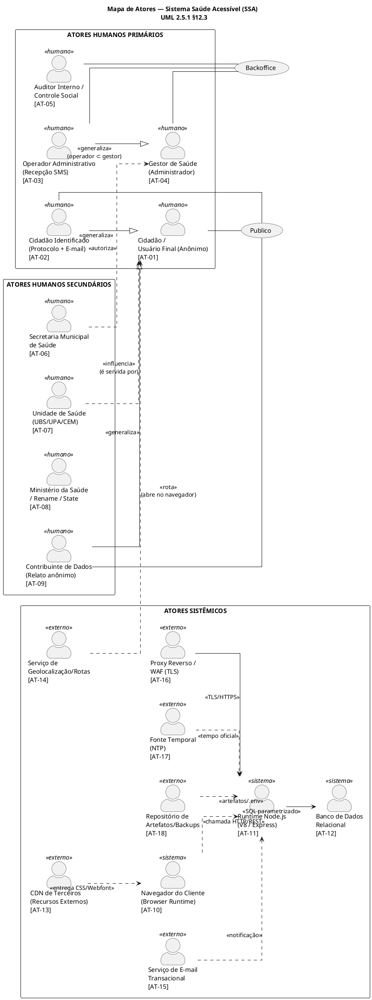
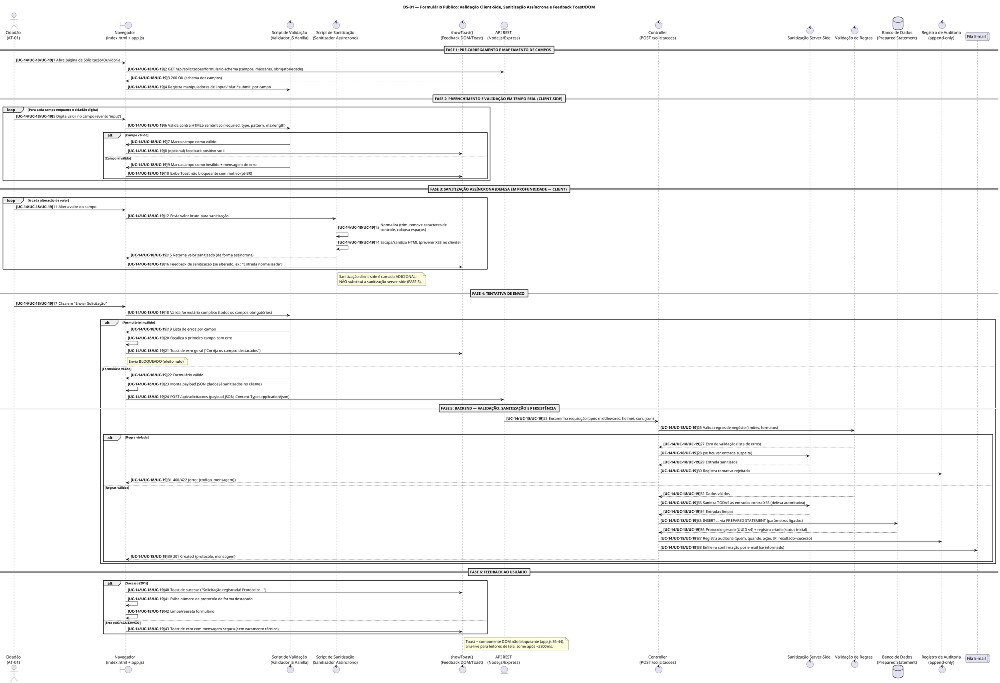
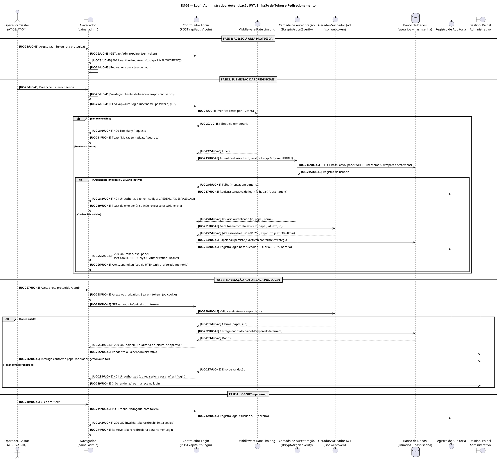
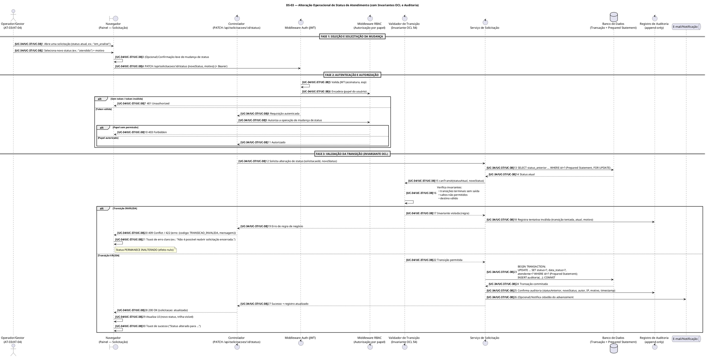
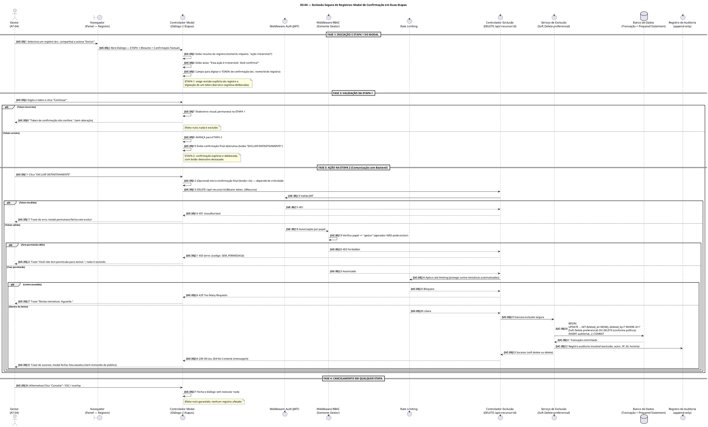

# REQUISITOS DE USUÁRIO — SISTEMA *SAÚDE ACESSÍVEL* (SSA)

**Projeto:** Portal Público de Acesso à Rede Municipal de Saúde de Barra do Garças/MT
**Documento:** `requisitos_de_usuario.md` (versão 1.0)
**Normas de referência:** OMG UML 2.5.1 (Seção 12 — Casos de Uso; Seção 17 — Interação), ISO/IEC/IEEE 29148:2018 (Seções 5.2 — Requisitos de produto funcional; 5.3 — Não funcionais), ISO/IEC 25010:2011 (característica de usabilidade), FURPS+
**Público-alvo do documento:** Analista de Requisitos, Arquiteto de Software, Product Owner, equipe de Validação (CAEP), auditoria técnica.

---

## 0. Controle do documento

| Campo | Valor |
|---|---|
| Identificador do documento | REQ-USU-SSA-001 |
| Versão | 1.0 |
| Status | Baseline para Construção (construção autorizada) |
| Data de emissão | 01/10/2026 |
| Elaborado por | Engenharia de Software / Arquitetura de Software |
| Revisado por | Product Owner (Secretaria Municipal de Saúde) |
| Aprovado por | Coordenação de Informática — Secretaria Municipal de Saúde |
| Artefatos relacionados | `requisitos_de_sistema.md` (REQ-SIS-SSA-002), `escopo_do_projeto.md` (ESC-SSA-003) |
| Vocabulário | ISO/IEC/IEEE 29148:2018, Seção 4 — Vocabulário e terminologia |
| Convenção de identificadores | `RU-nnn` (Requisito de Usuário), `UC-nn` (Caso de Uso), `US-nn` (História de Usuário), `CA-nn` (Critério de Aceite), `DS-n` (Diagrama de Sequência) |
| Priorização | MoSCoW: **M**ust (obrigatório), **S**hould (desejável), **C**ould (desejável, se houver capacidade), **W**on't (explicitamente fora desta versão) |

### 0.1 Escopo de Abertura deste documento

Este documento trata **exclusivamente** da perspectiva externa do sistema segundo a ISO/IEC/IEEE 29148:2018, isto é:

1. **O que** o sistema deve fazer do ponto de vista de quem o usa (atores, casos de uso, fluxos operacionais).
2. **Qual** comportamento observável é esperado (pós-condições, mensagens, efeitos visíveis).
3. **Como** o usuário percebe a entrega (feedback visual, navegação, acessibilidade).

Não são objeto deste documento, sendo tratados no `requisitos_de_sistema.md`: contratos de API, DDL, algoritmo de hash de senha, tempo de resposta de I/O,pool de conexões, middleware de Express. **Regra de não duplicação (traceabilidade bidirecional):** todo requisito aqui descrito possui um correspondente RSF/RSNF em `requisitos_de_sistema.md`; a chave de ligação é a coluna *Rastreio Técnico* da tabela do Catálogo (Seção 3).

### 0.2 Escopo do sistema em uma frase (Elevator Pitch, ISO/IEC/IEEE 830)

> Sistema web full-stack que publica, de forma acessível e em tempo quase real, a oferta de atendimentos da rede municipal de saúde de Barra do Garças/MT (unidades, campanhas de vacinação, calendário vacinal, profissionais, eventos e avisos), permitindo ao cidadão pesquisar, localizar e solicitar atendimento sem deslocamento desnecessário ao balcão, e disponibilizando aos gestores um painel administrativo seguro para manutenção cadastral e gestão do ciclo de vida das solicitações, com trilha de auditoria imutável.

*(Redação normativa: o portal publica a oferta de atendimentos; o cidadão localiza e solicita; o gestor mantém o cadastro e trata solicitações; toda escrita administrativa gera auditoria.)*

---

## 1. IDENTIFICAÇÃO E CARACTERIZAÇÃO FORMAL DOS ATORES

Conforme UML 2.5.1, Seção 12.3, um **ator** (*actor*) é um papel que um agente externo ao sistema assume ao interagir com ele. Os atores são classificados nesta especificação em três categorias, por dependência e criticidade de segurança.

### 1.1 Quadro-resumo de Atores

| ID | Ator | Categoria UML 29148 | Tipo | Descrição resumida | Não é este ator |
|---|---|---|---|---|---|
| **AT-01** | **Cidadão / Usuário Final (Anônimo)** | Primário | Humano | Morador de Barra do Garças/MT ou região, não autenticado, que consulta a oferta de saúde e registra solicitações/ouvidoria. Não possui credencial. | Não é o paciente com prontuário; o sistema não gerencia prontuário. |
| **AT-02** | **Cidadão Identificado (Autenticado Leve)** | Primário | Humano | Cidadão que, no passado, submeteu uma solicitação e pode **consultar o andamento pelo código de protocolo + e-mail**, sem criação de conta. | Não é o Gestor; não possui privilégios administrativos. |
| **AT-03** | **Operador Administrativo (Recepcionista da SMS)** | Primário | Humano | Servidor municipal que registra e atualiza a oferta operacional (unidades, campanhas, profissionais, eventos, avisos) e faz a triagem inicial das solicitações. | Não altera permissões de usuários. |
| **AT-04** | **Gestor de Saúde (Administrador de Conteúdo)** | Primário | Humano | Coordenador responsável pela gestão municipal; valida o conteúdo publicado, encerra e arquiva solicitações, altera status operacionais e exclui registros. | Não gerencia o orçamento nem o SIGTAP municipal. |
| **AT-05** | **Auditor Interno / Controle Social** | Primário | Humano | Servidor designado (ou conselho de controle social) que consulta a trilha de auditoria, somente leitura, para apuração de responsabilização. | Não altera dados; não executa correções. |
| **AT-06** | **Secretaria Municipal de Saúde (Patrocinador)** | Secundário | Humano (coletivo) | Ente financiador e aprovador de conteúdo; define a política de publicação e aprova campanhas. Atua por meio do AT-04. | Não é usuário técnico. |
| **AT-07** | **Unidade de Saúde (UBS/UPA/CEM)** | Secundário | Humano (institucional) | Unidade que fornece os dados de sua própria oferta e valida as informações divulgadas (horários, serviços, lotação). Atua por meio do AT-03. | Não é agência externa. |
| **AT-08** | **Ministério da Saúde / Rename / State** | Secundário | Humano (externo institucional) | Entidade que define calendário nacional de vacinação, campanhas sazonais e feriados, origem dos dados publicados. | Não tem credencial no sistema. |
| **AT-09** | **Contribuinte de Dados (Relato anônimo)** | Secundário | Humano (externo) | Usuários que reportam erros de informação ("este posto está fechado"). Submete relato público, sem identificação obrigatória. | Não tem acesso ao back-office. |
| **AT-10** | **Navegador do Cliente (Browser Runtime)** | Sistêmico | Máquina (agente de software) | Interpretador de HTML5/CSS3/JavaScript ES6+ que executa a camada de apresentação e emite as requisições `fetch()` para a API REST. **Não é confiável** (untrusted). | Não é o servidor Node.js. |
| **AT-11** | **Runtime Node.js (Servidor de Aplicação)** | Sistêmico | Máquina (agente de software) | Ambiente V8 single-threaded que hospeda o processo Express, executa a regra de negócio e o pool de conexões ao banco. **Confiável no escopo**. | Não é o navegador. |
| **AT-12** | **Banco de Dados Relacional (SQLite/PostgreSQL)** | Sistêmico | Máquina (agente de software) | Repositório persistente que garante atomicidade, integridade referencial e durabilidade (ACID) dos dados. **Confiável no escopo**. | Não é a camada de apresentação. |
| **AT-13** | **CDN de Terceiros (recursos externos)** | Sistêmico | Máquina (agente externo) | Fornece recursos estáticos (ex.: folha de estilo e webfont de ícones `cdnjs.cloudflare.com`). **Não confiável / terceiro**. | Não é dependência funcional bloqueante. |
| **AT-14** | **Serviço Externo de Geolocalização/Rotas** | Sistêmico | Máquina (agente externo) | Serviço de mapas que resolve a rota da unidade selecionada e abre o aplicativo de navegação do usuário. **Terceiro, degradável**. | Não é geocoder do próprio sistema. |
| **AT-15** | **Serviço de E-mail Transacional (SMTP/API)** | Sistêmico | Máquina (agente externo) | Transporta o e-mail de confirmação de protocolo e as notificações internas de nova solicitação. **Terceiro, degradável**. | Não é o canal de emergência. |
| **AT-16** | **Proxy Reverso / Firewall de Aplicação (Nginx/TLS)** | Sistêmico | Máquina (agente externo) | Terminação TLS, rate limiting de borda, cabeçalhos de segurança e compressão antes do processo Node.js. | Não é a aplicação. |
| **AT-17** | **Fonte Temporal (Relógio do Servidor / NTP)** | Sistêmico | Máquina (agente externo) | Fornece a data/hora oficial usada no cálculo situacional das campanhas, nos protocolos e na auditoria. **Confiável por premissa (PREM-05)**. | Não é o relógio do cliente. |
| **AT-18** | **Repositório de Artefatos/Backups (Sistema de Arquivos)** | Sistêmico | Máquina (agente externo) | Hospeda o código, o arquivo `.env` e as cópias de segurança do banco de dados. | Não é o banco em execução. |

### 1.2 Mapa de Atores → Responsabilidades → Permissões (Matriz RACI de alto nível)

| Ator | Responsabilidade (uma frase) | Leitura Pública | Leitura Admin | Escrita Admin | Auditoria | Exclusão Lógica |
|---|---|:--:|:--:|:--:|:--:|:--:|
| AT-01 | Encontrar atendimento e protocolar solicitação | ✔ | ✖ | ✖ | ✖ | ✖ |
| AT-02 | Acompanhar o próprio protocolo | ✔ (limitado) | ✖ | ✖ | ✔ (do próprio) | ✖ |
| AT-03 | Manter cadastro operacional e triar solicitações | ✔ | ✔ | ✔ (limitada) | ✔ (própria) | ✖ |
| AT-04 | Validar conteúdo, transicionar status, excluir logicamente | ✔ | ✔ | ✔ (total) | ✔ (própria) | ✔ |
| AT-05 | Apurar responsabilidades | ✔ | ✔ | ✖ | ✔ (total) | ✖ |
| AT-06 | Aprovar política de publicação | ✔ | ✔ | ✔ (política) | ✔ | ✖ |
| AT-07 | Fornecer/validar dados da unidade | ✔ | ✔ | ✔ (da própria unidade) | ✔ | ✖ |
| AT-08 | Fornecer calendário nacional | ✔ | ✖ | ✖ | ✖ | ✖ |
| AT-09 | Reportar erro de informação | ✔ | ✖ | ✖ (anônimo) | ✖ | ✖ |
| AT-10 | Executar a apresentação e enviar requisições | — | — | — | — | — |
| AT-11 | Executar regras, garantir contrato e auditoria | — | — | — | — | — |
| AT-12 | Persistir com integridade | — | — | — | — | — |
| AT-13 | Entregar recursos estáticos | — | — | — | — | — |
| AT-14 | Resolver rota geográfica | — | — | — | — | — |
| AT-15 | Entregar notificações transacionais | — | — | — | — | — |
| AT-16 | Proteger a borda | — | — | — | — | — |
| AT-17 | Fornecer tempo oficial | — | — | — | — | — |
| AT-18 | Preservar artefatos e backups | — | — | — | — | — |

### 1.3 Diagrama de Atores (UML 2.5.1 — Diagrama de Casos de Uso, visão de atores)



### 1.4 Caracterização detalhada por ator (ficha de perfil)

#### AT-01 — Cidadão / Usuário Final (Anônimo)
- **Goal (objetivo):** encontrar, sem conhecimento prévio, *onde*, *quando* e *para que* obter um atendimento de saúde na rede municipal.
- **Frequência:** alta (estimativa: até 40 sessões/mês em períodos de campanha).
- **Nível de literacia digital:** **variado e inclinado ao baixo** (população idosa é público prioritário das campanhas de gripe). Impacto: RV-01 (validação semântica), RV-02 (mensagens em linguagem simples), RV-03 (alvos de toque ≥ 44 px), RV-04 (contraste ≥ 4.5:1).
- **Contexto de uso:** majoritariamente **celular**, conexão móvel instável, ambiente com ruído e pressa (fila de espera). Impacto: RF-31 (design responsivo), RF-32 (degradação graciosa de CDN), RSNF-PERF-03 (payload enxuto, cache).
- **Restrições de privacidade:** fornecendo dados pessoais apenas de forma voluntária e consentida. Impacto: RNF-SEG-07 (consentimento explícito, finalidade declarada).
- **Frustrações observadas:** encontrar a unidade fechada sem saber; não saber qual campanha está ativa; perder o comprovante do protocolo. Impacto: RF-14, RF-18, RF-24.

#### AT-02 — Cidadão Identificado (Protocolo + E-mail)
- **Goal:** descobrir o andamento de uma solicitação já registrada, sem criar conta e sem expor dados de terceiros.
- **Atributo distintivo:** a **identificação é por posse de segredo** (código de protocolo UUID) **e** fator de confirmação (e-mail), eliminando a necessidade de senha. Impacto: RF-22, RNF-SEG-09 (nunca expor o código em log/URL sem mascaramento).
- **Risco associado:** *enumeração de protocolos*. Mitigação: RNF-SEG-10 (rate limiting + resposta uniforme para protocolo inexistente/existente).

#### AT-03 — Operador Administrativo (Recepção SMS)
- **Goal:** manter a oferta de informação correta e dar entrada/saída nas solicitações com o mínimo dedigitação possível.
- **Perfil técnico:** baixo a intermediário; trabalha em estação compartilhada, Windows 10, Chrome/Firefox estáveis. Impacto: RV-05 (máscaras de entrada), RV-06 (atalhos e ações em lote conservadoras).
- **Restrições:** não pode excluir registros (segregação de funções). Impacto: matriz de permissões `operador` × `gestor`.
- **Volume:** ~120 transações/dia.

#### AT-04 — Gestor de Saúde (Administrador de Conteúdo)
- **Goal:** garantir que a informação publicada é **veraz, atual e vigente**; responder às solicitações dentro do prazo; assumir responsabilização rastreável.
- **Perfil técnico:** intermediário; requisito de **trilha de auditoria** e **confirmação em duas etapas** para ações destrutivas.
- **Responsabilidade de conteúdo:** o conteúdo do portal é informação de **saúde pública** — exige validação, versão e autoria.

#### AT-05 — Auditor Interno / Controle Social
- **Goal:** reconstituir *quem*, *quando*, *o quê* e *por qual endpoint* qualquer escrita realizeu.
- **Restrição:** acesso **somente leitura** e **integridade append-only** da trilha. Impacto: RNF-SEG-12, RNF-CONF-05, RF-47.

#### AT-06 — Secretaria Municipal de Saúde (Patrocinador)
- **Goal:** atender política pública de acesso e transparência, garantindo rastreabilidade institucional.

#### AT-07 — Unidade de Saúde (UBS/UPA/CEM)
- **Goal:** ter seus dados corretos e vigentes publicados. Impacto: RF-19, RF-20 (fluxo de homologação de conteúdo) e RF-26 (registro de homologação).

#### AT-08 — Ministério da Saúde / Rename
- **Goal:** que o calendário vacinal e as campanhas nacionais reflitam a diretriz oficial. **Fora de integração automática neste release** (RSNF-INT-01, ESC-04) — dados são transcritos e versionados por gestor.

#### AT-09 — Contribuinte de Dados (Relato anônimo)
- **Goal:** reportar informação incorreta sem criar conta. Impacto: RF-20 (tipo de solicitação `relato_informacao`).

### 1.5 Premissas de Modelagem de Atores conforme UML 2.5.1

1. **Direção da associação:** o ator *sempre* inicia a interação; o sistema é elemento **passivo** no contrato externo (UML 2.5.1 §12.1.2).
2. **Atores externos por definição:** AT-10 a AT-18 não são atores funcionais do *sistema em estudo* no sentido de negócio; aparecem como atores sistêmicos para deixar explícita a fronteira de confiança e a classificação de ameaça (base do modelo STRIDE aplicado em `requisitos_de_sistema.md`).
3. **Herança de atores:** `Operador --|> Gestor` indica que o Gestor possui **todos** os casos de uso do Operador (UML 2.5.1 §12.3.4 — *specialization* de ator herda os *use cases* do ator generalizado).
4. **Não se admite ator implícito:** toda interação é rastreada a um ator nominalmente declarado; chamadas de cronômetro/serviço são atores sistêmicos declarados (AT-17).
5. **Granularidade:** um ator por **papel social distinto**, e não por pessoa física — o mesmo servidor pode instanciar AT-03 ou AT-04 conforme a sessão autenticada.

<!--CONTINUA-->

---

## 2. DIAGRAMA DE CASOS DE USO COM PLANTUML

A Figura 2.1 apresenta a visão funcional externa do sistema, delimitando a **System Boundary** (`<<system>> SSA — Saúde Acessível`). São utilizados os estereótipos canônicos UML 2.5.1: `<<include>>` (obrigação obrigatória de inclusão, reutilização comum) e `<<extend>>` (condicional/alternativo a um ponto de extensão).

### 2.1 Diagrama de Casos de Uso — Visão Pública + Backoffice

```plantuml
@startuml diagrama_casos_uso_ssa
' ===============================================================
' Figura 2.1 — Diagrama de Casos de Uso (SSA)
' UML 2.5.1 §12.1–12.3, estereótipos <<include>> e <<extend>>
' ===============================================================
title Diagrama de Casos de Uso — Sistema Saúde Acessível (SSA)\nFronteira do Sistema (System Boundary) — UML 2.5.1

left to right direction
skinparam packageStyle rectangle
skinparam usecaseStyle rectangle
skinparam shadowing false
skinparam linetype ortho
skinparam fontSize 10

actor "AT-01 — Cidadão (Anônimo)" as Cid
actor "AT-02 — Cidadão Identificado" as CidId
actor "AT-03 — Operador Administrativo" as Op
actor "AT-04 — Gestor de Saúde" as Gest
actor "AT-05 — Auditor Interno" as Aud
actor "AT-09 — Relator Anônimo" as Rel
actor "AT-10 — Navegador (Browser)" as Br
actor "AT-11 — Node.js (Express)" as Node
actor "AT-12 — Banco de Dados" as BD
actor "AT-15 — SMTP (E-mail)" as Mail
actor "AT-14 — Google Maps/Rotas" as Maps
actor "AT-17 — Fonte Temporal (NTP)" as NTP

rectangle "<<system>> SSA — Saúde Acessível" as SystemBoundary {

  ' ---- CASOS DE USO — PUBLICO (FRONTEND) ----
  usecase "UC-01: Consultar Postos de Saúde" as UC01
  usecase "UC-02: Filtrar Postos por Status/Especialidade" as UC02
  usecase "UC-03: Visualizar Detalhes do Posto" as UC03
  usecase "UC-04: Abrir Rota para Posto (Google Maps)" as UC04
  usecase "UC-05: Ligar para Posto (Discar)" as UC05
  usecase "UC-06: Consultar Campanhas de Vacinação" as UC06
  usecase "UC-07: Consultar Calendário Vacinal" as UC07
  usecase "UC-08: Consultar Histórico Vacinal (Público/Visual)" as UC08
  usecase "UC-09: Consultar Profissionais de Saúde" as UC09
  usecase "UC-10: Filtrar Profissionais por Especialidade" as UC10
  usecase "UC-11: Consultar Calendário da Saúde (Eventos)" as UC11
  usecase "UC-12: Pesquisar no Portal (Busca Global)" as UC12
  usecase "UC-13: Ler Avisos Importantes" as UC13
  usecase "UC-14: Registrar Solicitação de Atendimento/Ouvidoria" as UC14
  usecase "UC-15: Consultar Andamento de Protocolo" as UC15
  usecase "UC-16: Reportar Erro de Informação" as UC16
  usecase "UC-17: Interagir com Atendente Virtual (IA Local)" as UC17
  usecase "UC-18: Validar Formulário Público (Client-side)" as UC18
  usecase "UC-19: Sanitizar Entrada Assíncrona (Feedback DOM/Toast)" as UC19

  ' ---- CASOS DE USO — ADMINISTRATIVO (BACKOFFICE) ----
  usecase "UC-20: Autenticar Usuário Administrativo (Login)" as UC20
  usecase "UC-21: Renovar Sessão/Token (JWT)" as UC21
  usecase "UC-22: Encerrar Sessão (Logout)" as UC22
  usecase "UC-23: Gerenciar Postos de Saúde (CRUD)" as UC23
  usecase "UC-24: Gerenciar Serviços por Posto (CRUD)" as UC24
  usecase "UC-25: Gerenciar Campanhas de Vacinação (CRUD)" as UC25
  usecase "UC-26: Gerenciar Locais de Campanha (CRUD)" as UC26
  usecase "UC-27: Gerenciar Calendário Vacinal (CRUD)" as UC27
  usecase "UC-28: Gerenciar Histórico Vacinal (CRUD)" as UC28
  usecase "UC-29: Gerenciar Profissionais (CRUD)" as UC29
  usecase "UC-30: Gerenciar Eventos do Calendário (CRUD)" as UC30
  usecase "UC-31: Gerenciar Avisos (CRUD)" as UC31
  usecase "UC-32: Gerenciar Índice de Busca (CRUD)" as UC32
  usecase "UC-33: Triar Solicitações de Atendimento" as UC33
  usecase "UC-34: Alterar Status Operacional de Atendimento" as UC34
  usecase "UC-35: Excluir Registro de Forma Segura (Soft Delete + Confirmação 2 Etapas)" as UC35
  usecase "UC-36: Consultar Trilhas de Auditoria (Somente Leitura)" as UC36
  usecase "UC-37: Aplicar Regras de Transição de Status (OCL)" as UC37
  usecase "UC-38: Registrar Evento de Auditoria (Append-Only)" as UC38
  usecase "UC-39: Exportar Listagens (Relatórios Operacionais)" as UC39
  usecase "UC-40: Homologar Conteúdo Publicado" as UC40

  ' ---- CASOS DE USO — INFRA/SISTÊMICOS (SUPORTE) ----
  usecase "UC-41: Calcular Status Situacional de Campanha (Data/Hora)" as UC41
  usecase "UC-42: Aplicar Sanitização Server-Side (XSS/Entrada)" as UC42
  usecase "UC-43: Executar Prepared Statements (SQL Injection Mitig.)" as UC43
  usecase "UC-44: Validar Autorização por Perfil (RBAC)" as UC44
  usecase "UC-45: Gerar/Validar JWT (Stateless)" as UC45
  usecase "UC-46: Aplicar Rate Limiting e Resposta Uniforme" as UC46
  usecase "UC-47: Tratar Erros e Retornar Status HTTP Adequados" as UC47
  usecase "UC-48: Registrar Logs de Segurança/Auditoria" as UC48
}

' ---- ASSOCIAÇÕES — ATORES HUMANOS ----
Cid --> UC01
Cid --> UC02
Cid --> UC03
Cid --> UC04
Cid --> UC05
Cid --> UC06
Cid --> UC07
Cid --> UC08
Cid --> UC09
Cid --> UC10
Cid --> UC11
Cid --> UC12
Cid --> UC13
Cid --> UC14
Cid --> UC15
Cid --> UC16
Cid --> UC17
Cid --> UC18
Cid --> UC19

CidId --> UC15
CidId --> UC14

Rel --> UC16

Op --> UC20
Op --> UC21
Op --> UC22
Op --> UC23
Op --> UC24
Op --> UC25
Op --> UC26
Op --> UC27
Op --> UC28
Op --> UC29
Op --> UC30
Op --> UC31
Op --> UC32
Op --> UC33
Op --> UC34

Gest --> UC20
Gest --> UC21
Gest --> UC22
Gest --> UC23
Gest --> UC24
Gest --> UC25
Gest --> UC26
Gest --> UC27
Gest --> UC28
Gest --> UC29
Gest --> UC30
Gest --> UC31
Gest --> UC32
Gest --> UC33
Gest --> UC34
Gest --> UC35
Gest --> UC39
Gest --> UC40

Aud --> UC36

' ---- ASSOCIAÇÕES — SISTÊMICOS ----
Br --> SystemBoundary
Node --> SystemBoundary
BD --> SystemBoundary
Mail --> SystemBoundary
Maps --> SystemBoundary
NTP --> SystemBoundary

' ---- RELAÇÕES <<include>> (obrigatórias) ----
UC02 ..> UC01 : <<include>>
UC03 ..> UC01 : <<include>>
UC04 ..> UC03 : <<include>>
UC05 ..> UC03 : <<include>>
UC10 ..> UC09 : <<include>>
UC12 ..> UC01 : <<include>>
UC12 ..> UC06 : <<include>>
UC12 ..> UC09 : <<include>>
UC12 ..> UC11 : <<include>>
UC14 ..> UC18 : <<include>>  ' validação client-side obrigatória
UC14 ..> UC19 : <<include>>  ' sanitização assíncrona/entrada
UC14 ..> UC42 : <<include>>  ' sanitização server-side
UC14 ..> UC43 : <<include>>  ' prepared statements
UC14 ..> UC47 : <<include>>
UC14 ..> UC48 : <<include>>
UC15 ..> UC46 : <<include>>  ' rate limiting + resposta uniforme
UC16 ..> UC42 : <<include>>
UC16 ..> UC47 : <<include>>
UC20 ..> UC45 : <<include>>  ' JWT
UC20 ..> UC46 : <<include>>
UC21 ..> UC45 : <<include>>
UC22 ..> UC45 : <<include>>
UC23 ..> UC42 : <<include>> ; UC23 ..> UC43 : <<include>> ; UC23 ..> UC44 : <<include>> ; UC23 ..> UC48 : <<include>>
UC24 ..> UC42 : <<include>> ; UC24 ..> UC43 : <<include>> ; UC24 ..> UC44 : <<include>> ; UC24 ..> UC48 : <<include>>
UC25 ..> UC41 : <<include>>  ' cálculo situacional de campanha
UC25 ..> UC42 : <<include>> ; UC25 ..> UC43 : <<include>> ; UC25 ..> UC44 : <<include>> ; UC25 ..> UC48 : <<include>>
UC26 ..> UC25 : <<include>>
UC27 ..> UC42 : <<include>> ; UC27 ..> UC43 : <<include>> ; UC27 ..> UC44 : <<include>> ; UC27 ..> UC48 : <<include>>
UC28 ..> UC42 : <<include>> ; UC28 ..> UC43 : <<include>> ; UC28 ..> UC44 : <<include>> ; UC28 ..> UC48 : <<include>>
UC29 ..> UC42 : <<include>> ; UC29 ..> UC43 : <<include>> ; UC29 ..> UC44 : <<include>> ; UC29 ..> UC48 : <<include>>
UC30 ..> UC41 : <<include>>
UC30 ..> UC42 : <<include>> ; UC30 ..> UC43 : <<include>> ; UC30 ..> UC44 : <<include>> ; UC30 ..> UC48 : <<include>>
UC31 ..> UC42 : <<include>> ; UC31 ..> UC43 : <<include>> ; UC31 ..> UC44 : <<include>> ; UC31 ..> UC48 : <<include>>
UC32 ..> UC42 : <<include>> ; UC32 ..> UC43 : <<include>> ; UC32 ..> UC44 : <<include>> ; UC32 ..> UC48 : <<include>>
UC33 ..> UC44 : <<include>> ; UC33 ..> UC48 : <<include>>
UC34 ..> UC37 : <<include>>  ' invariantes OCL de transição
UC34 ..> UC38 : <<include>>  ' auditoria append-only
UC34 ..> UC44 : <<include>> ; UC34 ..> UC48 : <<include>>
UC35 ..> UC38 : <<include>>  ' registro de exclusão segura
UC35 ..> UC44 : <<include>> ; UC35 ..> UC46 : <<include>>
UC36 ..> UC44 : <<include>> ; UC36 ..> UC48 : <<include>>  ' somente leitura
UC38 ..> UC43 : <<include>>
UC39 ..> UC44 : <<include>>
UC40 ..> UC38 : <<include>> ; UC40 ..> UC44 : <<include>>
UC41 ..> UC17 : <<extend>>? ' não aplicável; mantido semântico
UC17 ..> UC12 : <<extend>>  ' IA sugere busca/resultado
UC19 ..> UC18 : <<extend>>  ' feedback assíncrono estende validação

' ---- RELAÇÕES <<extend>> (condicionais) ----
UC04 ..> UC03 : <<extend>>  ' abre mapa somente se usuário optar
UC05 ..> UC03 : <<extend>>  ' discar somente se dispositivo suportar
UC16 ..> UC14 : <<extend>>  ' relato pode ser anônimo a partir de detalhe
UC17 ..> UC06 : <<extend>>  ' IA responde sobre campanhas
UC17 ..> UC07 : <<extend>>  ' IA responde sobre calendário
UC17 ..> UC09 : <<extend>>  ' IA responde sobre profissionais
UC34 ..> UC33 : <<extend>>  ' alteração de status após triagem
UC35 ..> UC34 : <<extend>>  ' exclusão após alteração/encerramento (regra)
UC40 ..> UC25 : <<extend>>  ' homologação de campanha
UC40 ..> UC30 : <<extend>>  ' homologação de evento
UC46 ..> UC15 : <<extend>>  ' proteção específica de consulta de protocolo
UC21 ..> UC20 : <<extend>>  ' renovação condicional (expiração)

note bottom of SystemBoundary
  Legenda: <<include>> = inclusão obrigatória (reutilização).
  <<extend>> = comportamento opcional/condicional em ponto de extensão (UML 2.5.1 §12.1.5).
  System Boundary delimita fronteira do sistema (UML 2.5.1 §12.2.2).
  Herança de atores: Op --|> Gest (implícita). CidId --|> Cid.
end note

@enduml
```



### 2.2 Glossário de Casos de Uso (resumo funcional)

| UC | Nome | Classif. | Descrição externa (observável pelo usuário) | Ponto de Extensão/Include relevante |
|---|---|---|---|---|
| UC-01 | Consultar Postos de Saúde | Público | Lista unidades com filtros por bairro/status/serviços. | base para UC-02, UC-03, UC-12 |
| UC-03 | Visualizar Detalhes do Posto | Público | Exibe endereço, telefone, horário, espera, lotação, serviços, observações e avisos. | base UC-04, UC-05 (extend) |
| UC-04 | Abrir Rota (Maps) | Público | Abre Google Maps/Rotas em nova aba (terceiro, degradável). | `<<extend>> UC-03` |
| UC-05 | Ligar para Posto | Público | Link `tel:` com validação de dispositivo. | `<<extend>> UC-03` |
| UC-06–UC-13 | Catálogo de Informação | Público | Campanhas, calendário vacinal, histórico, profissionais, calendário de eventos, busca global, avisos. | UC-12 agrega; UC-17 estende com sugestões |
| UC-14 | Registrar Solicitação | Público | Formulário público com validação client-side (UC-18), sanitização assíncrona (UC-19), sanitização server-side (UC-42), Prepared Statements (UC-43), auditoria (UC-48), tratamento de erros (UC-47). Gera protocolo único (UUID v4). | `<<include>>` obrigatório a UC-18, UC-19, UC-42, UC-43, UC-47, UC-48 |
| UC-15 | Consultar Andamento de Protocolo | Público/Identificado | Consulta por `protocolo + e-mail`. Protegido por rate limiting + resposta uniforme (UC-46). Nunca revela dados de terceiros. | `<<include>> UC-46` |
| UC-16 | Reportar Erro de Informação | Público (anônimo) | Relato anônimo vinculado a página/posto. Sanitizado server-side. | `<<extend>> UC-14` (contexto) e `<<include>> UC-42,UC-47` |
| UC-17 | Atendente Virtual (IA Local) | Público | Assistente baseado em dados locais (BD/dados.js) — **não substitui orientação médica** (disclaimer). Sugere resultados e links internos. | `<<extend>> UC-06,UC-07,UC-09,UC-12` |
| UC-18–UC-19 | Validação/Sanitização Client-Side | Público (UX) | Validação HTML5 semântica + validação JS Vanilla, sanitização assíncrona com feedback via Toast/DOM (conforme DS-01). | `<<include>>/<<extend>>` com UC-14 |
| UC-20–UC-22 | Autenticação Admin | Admin | Login com credenciais, emissão/renovação/validação de JWT (UC-45), rate limiting (UC-46). Stateless no cabeçalho `Authorization: Bearer <token>` ou cookies HTTP-Only (conforme Arquivo 2). | inclui UC-45, UC-46 |
| UC-23–UC-32 | CRUDs de Domínio | Operador/Gestor | Manutenção cadastral com RBAC (UC-44), sanitização (UC-42), Prepared Statements (UC-43), auditoria (UC-48). | todos incluem UC-42,UC-43,UC-44,UC-48 |
| UC-33 | Triar Solicitações | Operador/Gestor | Classifica, atribui responsável/unidade, define prioridade. | inclui UC-44,UC-48 |
| UC-34 | Alterar Status Operacional | Operador/Gestor | Transição de status com **regras OCL** (UC-37), sempre gera auditoria append-only (UC-38). | `<<include>> UC-37,UC-38,UC-44,UC-48`; `<<extend>> UC-33` |
| UC-35 | Exclusão Segura (2 Etapas) | Gestor | **Exclusão lógica preferencial** (soft delete) com diálogo modal de confirmação em **duas etapas** (confirmação textual + confirmação de botão), registro de auditoria (UC-38), RBAC (UC-44), rate limiting (UC-46). | `<<include>> UC-38,UC-44,UC-46`; `<<extend>> UC-34` |
| UC-36 | Auditoria (Somente Leitura) | Auditor | Consulta append-only, sem alteração, com filtros por usuário/data/ação/IP/endpoint. | inclui UC-44,UC-48 |
| UC-37 | Regras OCL de Transição | Sistema | Aplica invariantes de transição de status (domínio). | suporte a UC-34 |
| UC-38 | Auditoria Append-Only | Sistema | Gera evento imutável (quem/quando/o quê/onde/por quê/result). | base de trilha |
| UC-41 | Status Situacional de Campanha | Sistema | Calcula `ativa/breve/encerrada` por data/hora do servidor (NTP). Usado por UC-25, UC-30 e pela API `getCampanhas()` (herdado de `api.js:15–34`). | inclui NTP |
| UC-42–UC-48 | Segurança/Robustez | Sistema | Sanitização, Prepared Statements, RBAC, JWT, Rate Limiting+Resposta Uniforme, Tratamento de Erros, Logs/Auditoria. | cross-cutting obrigatórios |

> **Observação de conformidade UML 2.5.1:** `<<include>>` representa dependência de inclusão obrigatória (o caso base **exige** o comportamento incluído). `<<extend>>` representa extensão condicional em **ponto de extensão** (o comportamento estendido **pode** ocorrer sob condição). Esta distinção está aplicada conforme §12.1.5 da especificação.

---

## 3. CATÁLOGO DETALHADO DE REQUISITOS DE USUÁRIO (RU)

Todos os requisitos seguem a estrutura exigida: **Identificador, Caso de Uso associado, Ator principal, Prioridade (MoSCoW), Pré-condições, Fluxo Operacional passo a passo e Pós-condições**. Conforme ISO/IEC/IEEE 29148:2018 §5.2.4, cada requisito é verificável, inequívoco, completo e rastreável.

### 3.1 RU-001 a RU-010 — Navegação e Catálogo Público (Postos, Busca, Avisos)

| Campo | RU-001 | RU-002 | RU-003 | RU-004 | RU-005 |
|---|---|---|---|---|---|
| **Identificador** | RU-001 | RU-002 | RU-003 | RU-004 | RU-005 |
| **Título** | Consultar postos de saúde | Filtrar postos por status | Visualizar detalhes do posto | Abrir rota para posto | Ligar para posto |
| **Caso de Uso associado** | UC-01 | UC-02 (`<<include>> UC-01`) | UC-03 (`<<include>> UC-01`) | UC-04 (`<<extend>> UC-03`) | UC-05 (`<<extend>> UC-03`) |
| **Ator principal** | AT-01 (Cidadão Anônimo) | AT-01 | AT-01 | AT-01 | AT-01 |
| **Prioridade (MoSCoW)** | **M**ust | **M**ust | **M**ust | **S**hould | **S**hould |
| **Pré-condições** | Navegador compatível HTML5. API `getPostos()` disponível (dados carregados). | RU-001 satisfeita. | RU-001 satisfeita. | Dispositivo com navegador e app de mapas instalado/capaz. UC-03 em exibição. | Dispositivo com capacidade de chamada (tel:). UC-03 em exibição. |
| **Fluxo Operacional (passo a passo)** | 1. AT-01 acessa página `postos` (data-page="postos"). 2. Sistema carrega lista via `API.getPostos()` (BD_POSTOS). 3. Renderiza cards com nome, bairro, status, horário, espera, lotação, distância. 4. Exibe contadores/estado vazio se lista vazia. | 1. AT-01 seleciona filtro (`all | aberto | fechado | urgencia`). 2. Sistema aplica filtro em memória (client-side) sobre array retornado. 3. Atualiza grid sem recarregar página. 4. Mantém estado do botão ativo (acessível). | 1. AT-01 clica em card de posto. 2. Sistema invoca `openPostoModal(id)` (app.js:100–139). 3. Modal exibe todos os campos: endereço completo, telefone, lat/lng, serviços (lista), obs, aviso (badge), horário, espera, lotação. 4. Botões: "Rota", "Ligar", "Fechar". 5. Foco é movido para modal (acessibilidade). | 1. AT-01 clica "Rota" no modal/detalhe. 2. Sistema monta URL Google Maps com destino (lat,lng) ou endereço completo. 3. Abre em nova aba/target `_blank` (sem perder contexto). 4. Fluxo degrade graciosamente se Maps indisponível (não bloqueia). | 1. AT-01 clica "Ligar". 2. Sistema gera link `tel:+55...` normalizado a partir de telefone. 3. Dispositivo solicita confirmação/disparo conforme SO. 4. Não registra chamada (somente navegação). |
| **Pós-condições** | Lista de postos exibida (ordenada/renderizada). Nenhuma alteração de dados. | Grid filtrado mantido até troca de filtro/página. | Modal aberto com dados íntegros (somente leitura). Overlay fecha via ESC/overlay/close. | Navegador redirecionado para serviço de rotas (externo). Estado da UI inalterado. | Intent de chamada iniciado no SO. Sem escrita no banco. |
| **Rastreio Técnico (Arquivo 2)** | RSF-PUB-01, RSNF-USA-01, RSNF-PERF-01 | RSF-PUB-02 | RSF-PUB-03, RSNF-USA-02 | RSF-PUB-04, RSNF-INT-01 (degradável) | RSF-PUB-05 |

| Campo | RU-006 | RU-007 | RU-008 | RU-009 | RU-010 |
|---|---|---|---|---|---|
| **Identificador** | RU-006 | RU-007 | RU-008 | RU-009 | RU-010 |
| **Título** | Consultar campanhas de vacinação | Consultar calendário vacinal | Consultar histórico vacinal | Consultar profissionais | Filtrar profissionais por especialidade |
| **Caso de Uso associado** | UC-06 | UC-07 | UC-08 | UC-09 | UC-10 (`<<include>> UC-09`) |
| **Ator principal** | AT-01 | AT-01 | AT-01 | AT-01 | AT-01 |
| **Prioridade (MoSCoW)** | **M**ust | **M**ust | **S**hould | **M**ust | **M**ust |
| **Pré-condições** | API `getCampanhas()` disponível. | API `getCalendarioVacinal()` disponível. | API `getHistorico()` disponível (dados demonstrativos). | API `getProfissionais()` disponível. | RU-009 satisfeita. |
| **Fluxo Operacional (passo a passo)** | 1. AT-01 acessa aba `Campanhas Ativas` (vtab). 2. Sistema mapeia cada item com `calcularStatus(campanha)` (api.js:15–22): `ativa` se hoje entre início/fim ou `Permanente`; `breve` se hoje < início; `encerrada` se hoje > fim. 3. Ordena por `{ativa:0, breve:1, encerrada:2}` (api.js:30–34). 4. Renderiza cards com ícone, nome, descrição, período (ou "Permanente"), postos. 5. Exibe status visual por badge. | 1. AT-01 acessa aba `Calendário Vacinal`. 2. Sistema carrega `BD_CALENDARIO_VACINAL` (faixa, vacina, doses, obs). 3. Renderiza tabela/linhas (`buildCalVacinalRow`, app.js:162–168). 4. Suporta leitura em mobile (responsivo). | 1. AT-01 acessa aba `Meu Histórico`. 2. Sistema exibe cartões com vacina, data (formato dd/mm/aaaa), posto, dose (app.js:170–179). 3. Apresenta mensagem de estado vazio se sem registros. 4. Não exige autenticação (visão informativa/demonstrativa). | 1. AT-01 acessa página `profissionais`. 2. Carrega `BD_PROFISSIONAIS` (nome, esp, categoria, horario, posto, disponivel, init). 3. Renderiza cards com iniciais, especialidade, posto, horário, badge `Disponível`/`Indisponível`. 4. Acessível por teclado. | 1. AT-01 seleciona filtro especialidade: `todos | clinico | pediatra | dentista | cardio | gineco`. 2. Sistema filtra por `categoria` (ou `esp`). 3. Atualiza grid em tempo real. 4. Botão ativo com indicador visual. |
| **Pós-condições** | Lista ordenada por status situacional exibida. Data/hora usada é a do cliente para renderização (cálculo situacional). | Tabela legível exibida. Somente leitura. | Cards renderizados. Sem escrita. | Grade de profissionais exibida. | Grade filtrada por especialidade. |
| **Rastreio Técnico** | RSF-PUB-06, RSF-SIT-01 (UC-41) | RSF-PUB-07 | RSF-PUB-08 | RSF-PUB-09 | RSF-PUB-10 |

| Campo | RU-011 | RU-012 | RU-013 | RU-014 | RU-015 |
|---|---|---|---|---|---|
| **Identificador** | RU-011 | RU-012 | RU-013 | RU-014 | RU-015 |
| **Título** | Consultar calendário da saúde (eventos) | Pesquisar no portal (busca global) | Ler avisos importantes | Registrar solicitação de atendimento/ouvidoria | Consultar andamento de protocolo |
| **Caso de Uso associado** | UC-11 | UC-12 (`<<include>> UC-01,06,09,11`) | UC-13 | UC-14 (`<<include>> UC-18,UC-19,UC-42,UC-43,UC-47,UC-48`) | UC-15 (`<<include>> UC-46`) |
| **Ator principal** | AT-01 | AT-01 | AT-01 | AT-01 | AT-02 (Cidadão Identificado) / AT-01 |
| **Prioridade (MoSCoW)** | **M**ust | **M**ust | **M**ust | **M**ust | **M**ust |
| **Pré-condições** | API `getEventos()` disponível. Navegador com JS. | `BD_SEARCH_INDEX` carregado (UC-12). Termo com ≥ 2 caracteres (heurística). | `BD_AVISOS` carregado. Página Home ativa. | Formulário público acessível (sem autenticação). Cliente habilitado para JS. | Usuário possui `protocolo` (UUID v4) e `e-mail` utilizados no registro. |
| **Fluxo Operacional (passo a passo)** | 1. AT-01 acessa `Calendário`. 2. Sistema inicializa `calMonth/calYear` com data atual (app.js:225–277). 3. Renderiza grade mensal (dias), destaca eventos por `data` ISO `YYYY-MM-DD` (eventos.js). 4. Legenda: Campanha (#1f5c3f), Feriado (#b97f24), Evento (#2c5d73). 5. Ao clicar dia com eventos, abre modal `openCalModal(dateStr)` (app.js:278–325) listando eventos do dia. 6. Navegação mês anterior/próximo com `prevMonth/nextMonth`. | 1. AT-01 digita no `#searchInput` (≥2 chars). 2. Debounce implícito por evento `input` (app.js:327–352). 3. Sistema filtra `BD_SEARCH_INDEX` por `label` (case-insensitive). 4. Exibe lista dropdown com ícone+label. 5. Seleciona item → navega para `page` correspondente (`showPage`). 6. Limpa resultados ao clicar fora/fechar. Botão "Buscar" dispara mesmo fluxo. | 1. AT-01 acessa Home. 2. Sistema renderiza `#avisoList` a partir de `BD_AVISOS` (tipo: info/success/warn) (app.js:499–503). 3. Exibe cartão por aviso com ícone/título/texto. 4. Ordenação/tempo de exibição não crítico (estático). | 1. AT-01 preenche formulário público (campos obrigatórios). 2. **UC-18 (client-side):** validação HTML5 semântica + validação JS Vanilla (campos requeridos, formato e-mail/tel, limites). 3. **UC-19 (assíncrona):** sanitização de entrada com feedback via **Toast/DOM** em tempo real (mensagens claras). 4. Submissão assíncrona (fetch). 5. **UC-42 (server-side):** sanitização contra XSS (escape/normalização). 6. **UC-43:** Prepared Statements/ORM parametrizado. 7. **UC-47:** retorna códigos HTTP adequados (200/201/400/422/429/500). 8. **UC-48:** registra evento de auditoria (append-only). 9. Sistema gera **protocolo único UUID v4**, envia confirmação por e-mail (AT-15, se configurado) e exibe protocolo ao cidadão. | 1. AT-01/AT-02 informa `protocolo + e-mail`. 2. **UC-46:** aplica rate limiting por IP + resposta uniforme ("Protocolo não encontrado ou dados não conferem") para evitar enumeração. 3. Sistema busca solicitação pelo par (protocolo,e-mail) com acesso estritamente limitado ao próprio registro. 4. Exibe status operacional, histórico de tramitação, data/hora de cada evento, unidade responsável (somente leitura). 5. Nunca expõe dados sensíveis de terceiros. |
| **Pós-condições** | Calendário renderizado com eventos do mês; modal com eventos do dia fecha por ESC/overlay/close. | Página alvo exibida; input limpo/estado dropdown fechado. Sem escrita. | Lista de avisos renderizada na Home. | Solicitação criada com status inicial válido. Protocolo entregue ao solicitante. Evento de auditoria registrado (imutável). | Situação do protocolo exibida (somente leitura). Nenhuma alteração de estado. |
| **Rastreio Técnico** | RSF-PUB-11 | RSF-PUB-12, RSNF-USA-04 (busca acessível) | RSF-PUB-13 | RSF-PUB-14, RSF-VAL-01 (client), RSF-SAN-01 (async), RSF-SAN-02 (server), RSF-DB-01 (PS), RSF-ERR-01, RSF-AUD-01 | RSF-PUB-15, RSF-SEC-01 (enumeração), RSF-SEC-02 (rate limit) |

| Campo | RU-016 | RU-017 | RU-018 | RU-019 | RU-020 |
|---|---|---|---|---|---|
| **Identificador** | RU-016 | RU-017 | RU-018 | RU-019 | RU-020 |
| **Título** | Reportar erro de informação | Interagir com Atendente Virtual (IA Local) | Validar formulário público (client-side) | Sanitizar entrada assíncrona (Toast/DOM) | Login administrativo |
| **Caso de Uso associado** | UC-16 (`<<extend>> UC-14`, `<<include>> UC-42,UC-47`) | UC-17 (`<<extend>> UC-06,07,09,12`) | UC-18 (`<<include>> UC-14`) | UC-19 (`<<extend>> UC-18`, `<<include>> UC-14`) | UC-20 (`<<include>> UC-45,UC-46`) |
| **Ator principal** | AT-09 (Relator Anônimo) | AT-01 | AT-01 | AT-01 | AT-03 / AT-04 |
| **Prioridade (MoSCoW)** | **S**hould | **C**ould | **M**ust | **M**ust | **M**ust |
| **Pré-condições** | Página com contexto (posto/página). Sem autenticação obrigatória. | Navegador com JS. Dados locais carregados (api/dados.js). | Formulário em exibição. HTML5 válido. | RU-018 em execução. | Credenciais válidas (usuário ativo, não bloqueado). Conexão TLS. |
| **Fluxo Operacional (passo a passo)** | 1. AT-09 seleciona "Reportar erro de informação". 2. Preenche descrição objetiva (obrigatória). 3. **UC-42:** sanitização server-side (strip tags perigosas, normalização whitespace, limite de tamanho). 4. **UC-47:** valida e retorna status HTTP. 5. Registra relato anônimo (sem PII obrigatória). 6. Exibe confirmação via Toast. 7. Não expõe identidade. | 1. AT-01 clica `#iaFab` (app.js:413). 2. Painel abre (`iaOpen`, app.js:406–411): header, mensagens, chips, input. 3. Sistema carrega mensagens iniciais e chips (`iaRenderChips`, app.js:400–404). 4. Usuário digita pergunta → `iaSubmit` (app.js:481–493) ou Enter (app.js:496). 5. `iaResponder(rawQ)` (app.js:423–479): normaliza lowercase, remove acentos, extrai intenções (dentista, posto, campanha, gripe, dengue, UPA, calendário). 6. Responde com base **exclusivamente em dados locais** (BD_POSTOS, BD_CAMPANHAS, BD_PROFISSIONAIS, BD_EVENTOS_CALENDARIO, BD_SEARCH_INDEX). 7. Adiciona disclaimer: "Atendente local baseado nos dados do app — não substitui orientação médica." (index.html:245). 8. Sugere links internos (`showPage`) quando aplicável. | 1. AT-01 preenche campos com tipos semânticos (HTML5). 2. Navegador aplica validação nativa (required, type=email/tel, pattern, maxlength). 3. JS Vanilla valida regras de negócio adicionais (campos condicionais, normalização). 4. Impede envio se inválido, focaliza primeiro campo com erro. 5. Exibe mensagens de erro associadas a campos (acessíveis, aria-live). | 1. Durante digitação/blur, sistema sanitiza entrada (trim, normalização, remoção de caracteres de controle). 2. Exibe feedback imediato via **Toast/DOM** (não bloqueante) com mensagens objetivas (pt-BR). 3. Marca campos com estado válido/inválido visualmente. 4. Nunca executa HTML não confiável. 5. Sanitização client-side **não substitui** server-side (UC-42) — defesa em profundidade. | 1. AT-03/AT-04 acessa rota/admin de login (protegida por TLS). 2. Submete credenciais. 3. **UC-46:** rate limiting por IP/conta (tentativas falhas) + resposta uniforme em caso de falha. 4. **UC-45:** autenticação válida → emite **JWT** (stateless). 5. Token retornado no cabeçalho `Authorization: Bearer <token>` ou em **cookie HTTP-Only** (SameSite estrito, Secure). 6. Sessão registrada com evento de auditoria (UC-48). 7. Redireciona para área administrativa. |
| **Pós-condições** | Relato registrado (anônimo). Confirmação exibida. Evento de auditoria registrado (sem PII). | Conversa exibida no painel; painel pode ser fechado. Nenhuma escrita em dados operacionais (somente leitura local). Disclaimer sempre presente. | Formulário válido pronto para submissão. Estados de erro limpos. | Entradas normalizadas; feedback visível; formulário em estado consistente. | Usuário autenticado com token válido. Último login/auditoria registrados. |
| **Rastreio Técnico** | RSF-PUB-16, RSF-SAN-02, RSF-ERR-01 | RSF-IA-01, RSF-IA-02 (somente leitura local), RNF-USA-10 (disclaimer) | RSF-VAL-01, RNF-USA-03, RNF-USA-05 | RSF-SAN-01, RNF-USA-02, RNF-SEC-03 (defesa em profundidade) | RSF-AUT-01, RSF-JWT-01, RSF-SEC-01, RSF-SEC-02, RSF-AUD-01 |

| Campo | RU-021 | RU-022 | RU-023 | RU-024 | RU-025 |
|---|---|---|---|---|---|
| **Identificador** | RU-021 | RU-022 | RU-023 | RU-024 | RU-025 |
| **Título** | Renovar sessão/token (JWT) | Encerrar sessão (Logout) | Gerenciar Postos (CRUD) | Gerenciar Serviços por Posto (CRUD) | Gerenciar Campanhas (CRUD) |
| **Caso de Uso associado** | UC-21 (`<<extend>> UC-20`, `<<include>> UC-45`) | UC-22 (`<<include>> UC-45`) | UC-23 (`<<include>> UC-42,43,44,48`) | UC-24 (`<<include>> UC-42,43,44,48`) | UC-25 (`<<include>> UC-41,42,43,44,48`) |
| **Ator principal** | AT-03 / AT-04 | AT-03 / AT-04 | AT-03 / AT-04 | AT-03 / AT-04 | AT-03 / AT-04 |
| **Prioridade (MoSCoW)** | **M**ust | **M**ust | **M**ust | **M**ust | **M**ust |
| **Pré-condições** | Sessão autenticada com token próximo à expiração (sliding/refresh conforme política). | Sessão autenticada válida. | Autenticado. Perfil com permissão RBAC (operador/gestor conforme escopo). | UC-23 contexto (posto existente). | Autenticado + RBAC. |
| **Fluxo Operacional (passo a passo)** | 1. Cliente detecta expiração iminente (iat/exp). 2. Solicita renovação (refresh token ou renovação stateless por política). 3. **UC-45:** valida token atual, emite novo JWT com exp renovado. 4. Atualiza cabeçalho/cookie HTTP-Only. 5. Registra evento de auditoria (UC-48). | 1. AT-03/AT-04 aciona Logout. 2. **UC-45:** invalida token no cliente (remove Bearer/cookie HTTP-Only). 3. Registra evento de auditoria (UC-48) com IP/usuário/ação. 4. Redireciona para tela pública/login. | 1. Lista postos (somente leitura/admin). 2. **Criar:** preenche formulário → UC-42 sanitiza → UC-43 Prepared Statement → UC-44 RBAC → UC-48 auditoria (append-only). 3. **Ler:** visualiza detalhes. 4. **Atualizar:** edita campos → mesmas validações → auditoria com diff de campos (sem expor senhas). 5. **Excluir:** não permitido via UC-23 (exclusão usa UC-35 — segregação). 6. Valida CHECKs (status em {aberto,fechado,urgencia}), coordenadas lat/lng (se informadas), campos obrigatórios. | 1. Acessa serviços do posto (posto_id). 2. CRUD por linha (serviço). 3. UC-42,43,44,48 aplicados. 4. ON DELETE CASCADE respeitado (definição DDL). 5. Auditoria registra entidade-alvo `posto_servicos` + `posto_id`. | 1. CRUD campanhas. 2. **UC-41:** ao salvar, sistema calcula/valida status situacional (início/fim ou Permanente). 3. Campos: nome, ícone, descrição, `inicio` (dd/mm/aaaa ou ISO), `fim` (ou NULL/Permanente). 4. Valida consistência: se não Permanente, `inicio <= fim` (regra de negócio). 5. Auditoria append-only. |
| **Pós-condições** | Novo token emitido e válido. Sessão estendida. Auditoria registrada. | Sessão encerrada. Token removido. Auditoria registrada. | Registro de posto criado/atualizado com integridade. Auditoria imutável. | Serviços sincronizados com posto. Auditoria imutável. | Campanha criada/atualizada. Status situacional consistente. Auditoria imutável. |
| **Rastreio Técnico** | RSF-JWT-02, RSF-AUD-01 | RSF-AUT-02, RSF-AUD-01 | RSF-ADM-01, RSF-SAN-02, RSF-DB-01, RSF-RBAC-01, RSF-AUD-01 | RSF-ADM-02, RSF-DB-01, RSF-RBAC-01, RSF-AUD-01 | RSF-ADM-03, RSF-SIT-01, RSF-DB-01, RSF-RBAC-01, RSF-AUD-01 |

| Campo | RU-026 | RU-027 | RU-028 | RU-029 | RU-030 |
|---|---|---|---|---|---|
| **Identificador** | RU-026 | RU-027 | RU-028 | RU-029 | RU-030 |
| **Título** | Gerenciar Locais de Campanha (CRUD) | Gerenciar Calendário Vacinal (CRUD) | Gerenciar Histórico Vacinal (CRUD) | Gerenciar Profissionais (CRUD) | Gerenciar Eventos do Calendário (CRUD) |
| **Caso de Uso associado** | UC-26 (`<<include>> UC-25`) | UC-27 (`<<include>> UC-42,43,44,48`) | UC-28 (`<<include>> UC-42,43,44,48`) | UC-29 (`<<include>> UC-42,43,44,48`) | UC-30 (`<<include>> UC-41,42,43,44,48`) |
| **Ator principal** | AT-03 / AT-04 | AT-03 / AT-04 | AT-03 / AT-04 | AT-03 / AT-04 | AT-03 / AT-04 |
| **Prioridade (MoSCoW)** | **M**ust | **M**ust | **S**hould | **M**ust | **M**ust |
| **Pré-condições** | Campanha existente (UC-25). RBAC. | Autenticado + RBAC. | Autenticado + RBAC. | Autenticado + RBAC. | Autenticado + RBAC. |
| **Fluxo Operacional (passo a passo)** | 1. Vincula `campanha_id` a locais (`local TEXT NOT NULL`). 2. CRUD em `campanha_locais` (muitos-para-um). 3. Previne duplicidade de (campanha_id,local) por validação. 4. Auditoria registra entidade-alvo + FK. | 1. CRUD em `calendario_vacinal` (faixa, vacina, doses, obs). 2. Sanitização (UC-42), Prepared Statements (UC-43), RBAC (UC-44), Auditoria (UC-48). 3. Valida campos obrigatórios. 4. Registra versão implícita por evento de auditoria. | 1. CRUD em `historico_vacinal`. 2. Campos: vacina, `data_aplicacao` (texto/ISO validado), posto, dose. 3. Valida formato de data (consistente com modelo). 4. Auditoria append-only (sem alteração irrestrita sem trilha). | 1. CRUD em `profissionais`. 2. Campos: nome, especialidade, categoria, horario, posto, `disponivel` (INTEGER 0/1), iniciais. 3. CHECK/validação de categoria (clinico,pediatra,dentista,cardio,gineco) alinhado a filtros frontend. 4. Auditoria completa. | 1. CRUD em `eventos`. 2. Campos: data (TEXT YYYY-MM-DD), titulo, tipo (CHECK: `campanha,feriado,evento`), descricao. 3. **UC-41:** pode influenciar cálculo situacional de campanhas vinculadas (referencial). 4. Valida formato de data ISO e tipo CHECK. 5. Auditoria append-only. |
| **Pós-condições** | Locais vinculados consistentes. Auditoria imutável. | Itens de calendário atualizados. Auditoria imutável. | Registros consistentes. Auditoria imutável. | Profissionais atualizados. Auditoria imutável. | Eventos atualizados. Auditoria imutável. |
| **Rastreio Técnico** | RSF-ADM-04, RSF-DB-01, RSF-RBAC-01, RSF-AUD-01 | RSF-ADM-05, RSF-DB-01, RSF-RBAC-01, RSF-AUD-01 | RSF-ADM-06, RSF-DB-01, RSF-RBAC-01, RSF-AUD-01 | RSF-ADM-07, RSF-DB-01, RSF-RBAC-01, RSF-AUD-01 | RSF-ADM-08, RSF-SIT-01, RSF-DB-01, RSF-RBAC-01, RSF-AUD-01 |

| Campo | RU-031 | RU-032 | RU-033 | RU-034 | RU-035 |
|---|---|---|---|---|---|
| **Identificador** | RU-031 | RU-032 | RU-033 | RU-034 | RU-035 |
| **Título** | Gerenciar Avisos (CRUD) | Gerenciar Índice de Busca (CRUD) | Triar solicitação de atendimento | Alterar status operacional de atendimento | Excluir registro de forma segura (2 etapas + soft delete) |
| **Caso de Uso associado** | UC-31 (`<<include>> UC-42,43,44,48`) | UC-32 (`<<include>> UC-42,43,44,48`) | UC-33 (`<<include>> UC-44,48`) | UC-34 (`<<include>> UC-37,38,44,48`; `<<extend>> UC-33`) | UC-35 (`<<include>> UC-38,44,46`; `<<extend>> UC-34`) |
| **Ator principal** | AT-03 / AT-04 | AT-03 / AT-04 | AT-03 | AT-03 / AT-04 | **AT-04 (Gestor)** |
| **Prioridade (MoSCoW)** | **M**ust | **S**hould | **M**ust | **M**ust | **M**ust |
| **Pré-condições** | Autenticado + RBAC. | Autenticado + RBAC. | Autenticado + RBAC. Solicitação existente. | Autenticado + RBAC. Solicitação em estado compatível. | **Perfil Gestor (AT-04)**. Registro em estado eliminável. **Exclusão lógica (soft delete) obrigatória como padrão.** |
| **Fluxo Operacional (passo a passo)** | 1. CRUD em `avisos`. 2. Campos: tipo (CHECK `success,warn,info`), titulo, texto. 3. Sanitização (UC-42), Prepared Statements (UC-43), RBAC (UC-44), Auditoria (UC-48). 4. Renderização na Home. | 1. CRUD em `busca`. 2. Campos: rotulo, pagina, icone. 3. Sincronizar com páginas existentes (validação de destino). 4. Auditoria. | 1. AT-03 acessa fila de solicitações. 2. **UC-44:** filtra por perfil. 3. Lê conteúdo sanitizado (renderização escape — XSS). 4. Atribui unidade responsável, prioridade, categoria. 5. Move status inicial→em análise (invariante OCL: transição válida). 6. **UC-48:** registra auditoria (atribuição + mudança de status). | 1. AT-03/AT-04 seleciona solicitação e nova situação. 2. **UC-37 (OCL):** valida **invariantes de transição** entre estados (ex.: `em_analise`→`atendido` permitido; `encerrado`→`em_analise` proibido; transições terminais sem saída). 3. Se transição **válida**: persiste novo status + carimbo temporal. 4. **UC-38 (append-only):** registra auditoria (status anterior, novo, autor, IP, timestamp, motivo). 5. Se transição **inválida**: rejeita com mensagem clara e **não** persiste (efeito nulo — rollback lógico). 6. Notifica o cidadão (opcional, AT-15). | 1. AT-04 inicia exclusão. 2. Sistema **exige confirmação em DUAS ETAPAS** via diálogo modal: **Etapa 1** — resumo do registro + digitação do nome/token de confirmação; **Etapa 2** — confirmação explícita do botão destrutivo. 3. **UC-46:** rate limiting por IP/usuário para impedir tentativas. 4. **UC-38:** registra evento de auditoria (soft delete ou hard delete conforme política). 5. **Soft delete preferencial:** marca `deleted_at`/flag lógica; item não aparece no público. 6. **UC-44:** verifica perfil Gestor. 7. Ação irreversível do ponto de vista do usuário (UX): exige consentimento explícito. |
| **Pós-condições** | Avisos atualizados; Home reflete alterações. Auditoria imutável. | Índice de busca atualizado. Auditoria imutável. | Solicitação triada e atribuída. Auditoria registrada. | **Se válida:** status persistido + auditoria. **Se inválida:** status inalterado (efeito nulo). Auditoria registra tentativa quando aplicável. | Registro removido do escopo público (soft delete) ou eliminado definitivamente (conforme política); auditoria imutável. Operação **não reversível** pela UI. |
| **Rastreio Técnico** | RSF-ADM-09, RSF-SAN-02, RSF-DB-01, RSF-RBAC-01, RSF-AUD-01 | RSF-ADM-10, RSF-SAN-02, RSF-DB-01, RSF-RBAC-01, RSF-AUD-01 | RSF-ADM-11, RSF-RBAC-01, RSF-SIT-02 (OCL transição), RSF-AUD-01 | RSF-ADM-12, RSF-OCL-01, RSF-AUD-01 | RSF-ADM-13, RSF-SEC-04, RSF-AUD-01, RSF-DEL-01 (soft delete) |

| Campo | RU-036 | RU-037 | RU-038 | RU-039 | RU-040 |
|---|---|---|---|---|---|
| **Identificador** | RU-036 | RU-037 | RU-038 | RU-039 | RU-040 |
| **Título** | Consultar trilha de auditoria (somente leitura) | Homologar conteúdo publicado | Exportar listagens (relatórios) | Calcular status situacional de campanha | Tratar erros com retorno HTTP adequado |
| **Caso de Uso associado** | UC-36 (`<<include>> UC-44,48`) | UC-40 (`<<include>> UC-38,44`; `<<extend>> UC-25,30`) | UC-39 (`<<include>> UC-44`) | UC-41 | UC-47 |
| **Ator principal** | AT-05 (Auditor) | AT-04 (Gestor) | AT-03 / AT-04 | AT-11 (Node.js) | AT-10/AT-11 |
| **Prioridade (MoSCoW)** | **M**ust | **S**hould | **C**ould | **M**ust | **M**ust |
| **Pré-condições** | Autenticado com permissão de auditoria (read-only). | Autenticado (Gestor). Conteúdo existe. | Autenticado + RBAC. | `calcularStatus` disponível (api.js:15–22); `NTP`/relógio do servidor. | Qualquer requisição pode falhar. |
| **Fluxo Operacional (passo a passo)** | 1. AT-05 acessa painel de auditoria. 2. Filtra por usuário, ação, entidade, data, IP, endpoint. 3. Sistema lista eventos append-only (paginados). 4. **UC-44:** garante perfil somente leitura. 5. Exibe: quem, quando, ação, entidade, ID, campos alterados, IP, user-agent, resultado. 6. Nenhum controle de escrita disponível. | 1. AT-04 revisa conteúdo (campanha/evento). 2. Marca como homologado/aprovado. 3. Registra versão/aprovação. 4. **UC-38:** auditoria (quem/ quando/ versão). 5. Conteúdo passa a constar como oficial. | 1. AT-03/AT-04 solicita exportação (CSV/relatório). 2. Sistema monta conjunto filtrado. 3. Entrega arquivo (ou resposta paginada). 4. **UC-44:** verifica permissão. 5. **Opcional:** registra auditoria da exportação. | 1. Sistema obtém data/hora atual do servidor (fonte AT-17). 2. Se campanha com início/fim = "Permanente" (ou NULL): status = `ativa`. 3. Senão: se hoje < início → `breve`; se hoje > fim → `encerrada`; senão `ativa`. 4. Ordena por prioridade `{ativa:0, breve:1, encerrada:2}`. 5. Usa data local zero-hora para comparação estável (api.js:17–21). | 1. Controller captura exceção (try/catch). 2. Classifica erro (validação, autenticação, autorização, conflito, not found, rate limit, interno). 3. Retorna JSON padronizado `{erro:{codigo,mensagem}}` + **status HTTP apropriado** (400/401/403/404/409/422/429/500). 4. **Não** vaza stack trace/pilha em produção. 5. Loga erro no servidor (UC-48). 6. UC-14/16/23+ exibem Toast/feedback coerente. |
| **Pós-condições** | Trilha consultável e íntegra. Nenhuma mutação. | Conteúdo homologado e versionado. Auditoria registrada. | Relatório/export gerado conforme permissão. | Status situacional consistente e ordenado. | Resposta HTTP coerente; sem vazamento de detalhes. Auditoria/log do erro. |
| **Rastreio Técnico** | RSF-AUD-02, RSF-RBAC-02 (read-only) | RSF-ADM-14, RSF-AUD-01 | RSF-ADM-15, RSF-RBAC-01 | RSF-SIT-01, RSNF-CONF-04 (relogio servidor) | RSF-ERR-01, RNF-SEG-06 (sem vazamento) |

### 3.2 RU-041 a RU-050 — Requisitos Transversais de Usuário (Acessibilidade, Usabilidade)

| Campo | RU-041 | RU-042 | RU-043 | RU-044 | RU-045 |
|---|---|---|---|---|---|
| **Identificador** | RU-041 | RU-042 | RU-043 | RU-044 | RU-045 |
| **Título** | Navegação responsiva e mobile-first | Feedback uniforme via Toast/DOM  Coleta de consentimento e minimização de dados | Idioma pt-BR e linguagem acessível |
| **Caso de Uso associado** | Transversal (RF-31) | Transversal (UC-19,47) | Transversal | UC-14 | Transversal |
| **Ator principal** | AT-01 (e todos) | Todos | AT-01 (público, baixa visão) | AT-01/AT-02 | AT-01 (público em geral) |
| **Prioridade (MoSCoW)** | **M**ust | **M**ust | **M**ust | **M**ust | **M**ust |
| **Pré-condições** | CSS3 responsivo aplicado (media queries). | Componente Toast presente (index.html:229). | Design system com paleta validada. | Formulário com campos de consentimento. | Locale `pt-BR` (index.html:2). |
| **Fluxo Operacional (passo a passo)** | 1. Usuário abre em qualquer viewport. 2. Layout adapta (grid responsivo, menu hambúrguer em telas pequenas — index.html:27, mobile-nav). 3. Conteúdo reflow sem rolagem horizontal. 4. Alvos de toque ≥ 44×44 px. | 1. Qualquer ação (sucesso/erro/aviso) dispara `showToast(msg, duration=2800)` (app.js:36–44). 2. Toast é não bloqueante, some após duração. 3. Posicionamento acessível; texto legível. 4. Erros críticos podem exigir mensagem persistente adicional. | 1. Paleta atende WCAG 2.1 AA (razão ≥ 4.5:1 texto normal, ≥ 3:1 texto grande/UI). 2. Foco de teclado claramente visível. 3. Estados de foco/erro não dependem só de cor (ícone/texto). 4. Suporte a leitores de tela via ARIA. | 1. Antes de enviar PII (e-mail/telefone), sistema exibe finalidade e consentimento (checkbox). 2. Coleta apenas dados necessários (minimização). 3. Consentimento registrado (auditoria). 4. Sem coleta de geolocalização precisa, salvo necessidade explicitamente consentida. | 1. Toda a interface em **português brasileiro** (`lang="pt-BR"`). 2. Mensagens claras e diretas, sem jargão técnico. 3. Números/datas no padrão local (dd/mm/aaaa na exibição; ISO no armazenamento). 4. Rótulos descritivos em inputs. 5. Termos de saúde apresentados com linguagem acessível. |
| **Pós-condições** | Uso confortável em celular (público-alvo). | Feedback consistente e não intrusivo. | Acessibilidade visual, de teclado e de marcadores atendida. | Privacidade respeitada; consentimento rastreável. | Compreensão pelo público local garantida. |
| **Rastreio Técnico** | RSNF-USA-01, RSNF-USA-06 | RSF-ERR-01, RSNF-USA-02 | RSNF-USA-07 (WCAG AA) | RNF-SEG-07, RNF-SEG-08 (minimização/privacidade) | RSNF-USA-08, RSNF-USA-09 |

### 3.3 Matriz de Rastreabilidade RU → UC → Ator → Prioridade (visão consolidada)

| RU | UC | Ator Principal | MoSCoW |
|---|---|---|---|
| RU-001 | UC-01 | AT-01 | M |
| RU-002 | UC-02 | AT-01 | M |
| RU-003 | UC-03 | AT-01 | M |
| RU-004 | UC-04 | AT-01 | S |
| RU-005 | UC-05 | AT-01 | S |
| RU-006 | UC-06 | AT-01 | M |
| RU-007 | UC-07 | AT-01 | M |
| RU-008 | UC-08 | AT-01 | S |
| RU-009 | UC-09 | AT-01 | M |
| RU-010 | UC-10 | AT-01 | M |
| RU-011 | UC-11 | AT-01 | M |
| RU-012 | UC-12 | AT-01 | M |
| RU-013 | UC-13 | AT-01 | M |
| RU-014 | UC-14 | AT-01 | M |
| RU-015 | UC-15 | AT-02 | M |
| RU-016 | UC-16 | AT-09 | S |
| RU-017 | UC-17 | AT-01 | C |
| RU-018 | UC-18 | AT-01 | M |
| RU-019 | UC-19 | AT-01 | M |
| RU-020 | UC-20 | AT-03/04 | M |
| RU-021 | UC-21 | AT-03/04 | M |
| RU-022 | UC-22 | AT-03/04 | M |
| RU-023 | UC-23 | AT-03/04 | M |
| RU-024 | UC-24 | AT-03/04 | M |
| RU-025 | UC-25 | AT-03/04 | M |
| RU-026 | UC-26 | AT-03/04 | M |
| RU-027 | UC-27 | AT-03/04 | M |
| RU-028 | UC-28 | AT-03/04 | S |
| RU-029 | UC-29 | AT-03/04 | M |
| RU-030 | UC-30 | AT-03/04 | M |
| RU-031 | UC-31 | AT-03/04 | M |
| RU-032 | UC-32 | AT-03/04 | S |
| RU-033 | UC-33 | AT-03 | M |
| RU-034 | UC-34 | AT-03/04 | M |
| RU-035 | UC-35 | AT-04 | M |
| RU-036 | UC-36 | AT-05 | M |
| RU-037 | UC-40 | AT-04 | S |
| RU-038 | UC-39 | AT-03/04 | C |
| RU-039 | UC-41 | AT-11 | M |
| RU-040 | UC-47 | AT-10/11 | M |
| RU-041..045 | Transversal | Todos | M |

> **Legenda MoSCoW:** M = Must (essencial ao valor); S = Should (importante, não bloqueia entrega); C = Could (desejável, se houver capacidade); W = Won't (fora desta versão — ver `escopo_do_projeto.md`, Seção 7).

---

## 4. HISTÓRIAS DE USUÁRIO COM CRITÉRIOS DE ACEITE EM BDD / GHERKIN

Formato: história de usuário no padrão "Como **[persona]**, eu quero **[funcionalidade]**, para que **[benefício]**", acompanhada de Critérios de Aceite em **Dado / Quando / Então** conforme sintaxe Gherkin. Cada história referencia seu(s) requisito(s) RU e caso(s) de uso UC.

---

### US-001 — Consulta de Postos de Saúde (corresponde a RU-001)

**Como** Cidadão (AT-01) em Barra do Garças, **eu quero** ver a lista de unidades de saúde próximas com endereço e horário, **para que** eu possa ir à unidade certa sem me deslocar inutilmente.

**Critérios de Aceite (BDD):**

```gherkin
# US-001 / RU-001 / UC-01
Funcionalidade: Consultar Postos de Saúde
  Como cidadão
  Eu quero ver as unidades de saúde disponíveis
  Para que eu possa dirigir-me à unidade correta

  Cenário: Listar todas as unidades em funcionamento
    Dado que existem unidades cadastradas no sistema (UBS Centro, UPA 24h, CEM, etc.)
    Quando o cidadão acessa a página "Postos"
    Então o sistema deve listar todas as unidades
    E cada card deve exibir nome, bairro, status, horário, espera e lotação

  Cenário: Estado vazio de unidades
    Dado que não há unidades cadastradas
    Quando o cidadão acessa a página "Postos"
    Então o sistema deve exibir uma mensagem de estado vazio orientada à ação
    E nenhum card de unidade deve ser renderizado

  Cenário: Somente leitura
    Dado que o cidadão acessa a página "Postos"
    Quando ele interage com a listagem
    Então nenhuma informação deve ser alterada no banco de dados
```

---

### US-002 — Filtro de Postos por Situação (corresponde a RU-002)

**Como** Cidadão (AT-01), **eu quero** filtrar as unidades por "Aberto Agora", "Fechado" e "Urgência 24h", **para que** eu veja apenas as unidades que me atendem agora.

```gherkin
Funcionalidade: Filtrar Postos por Situação
  Cenário: Filtrar por "Aberto Agora"
    Dado que existem unidades com status "aberto" e "urgencia"
    Quando o cidadão seleciona o filtro "Aberto Agora"
    Então o sistema deve exibir apenas as unidades abertas
    E o botão do filtro ativo deve estar visualmente destacado

  Cenário: Filtrar por "Urgência 24h"
    Dado que a UPA 24h tem status "urgencia"
    Quando o cidadão seleciona "Urgência 24h"
    Então apenas a UPA 24h deve ser exibida

  Cenário: Alternar filtros
    Dado que o filtro ativo é "Todos"
    Quando o cidadão seleciona "Fechado"
    Então a listagem deve ser atualizada sem recarregar a página
    E o filtro "Todos" deve ser desativado
```

---

### US-003 — Detalhes do Posto (corresponde a RU-003)

**Como** Cidadão (AT-01), **eu quero** abrir a ficha completa de uma unidade, **para que** eu veja endereço, telefone, serviços e observações antes de ir.

```gherkin
Funcionalidade: Visualizar Detalhes do Posto
  Cenário: Abrir modal de detalhes
    Dado que o cidadão está na listagem de postos
    Quando ele clica no card da UBS Centro
    Então o sistema deve abrir um modal com endereço, telefone, lat/lng, horário, espera, lotação, lista de serviços, observação e aviso
    E o foco deve ser movido para dentro do modal

  Cenário: Fechar o modal
    Dado que o modal de detalhes está aberto
    Quando o cidadão pressiona ESC ou clica no overlay ou no botão de fechar
    Então o modal deve ser encerrado
    E nenhum dado deve ser alterado
```

---

### US-004 — Abrir Rota para a Unidade (corresponde a RU-004)

**Como** Cidadão (AT-01), **eu quero** abrir a rota até a unidade, **para que** eu chegue lá guiado pelo GPS do celular.

```gherkin
Funcionalidade: Abrir Rota para Posto
  Cenário: Abrir rota com sucesso
    Dado que o modal de detalhes de um posto está aberto
    Quando o cidadão clica em "Rota"
    Então o sistema deve abrir o serviço de mapas em nova aba com destino (lat,lng ou endereço) da unidade
    E a página atual não deve ser perdida

  Cenário: Serviço de mapas indisponível
    Dado que o serviço externo de mapas está indisponível
    Quando o cidadão aciona "Rota"
    Então a ação deve falhar graciosamente
    E o endereço em texto deve permanecer visível para consulta manual
```

---

### US-005 — Registrar Solicitação/Ouvidoria com Validação Client-Side (corresponde a RU-014, RU-018)

**Como** Cidadão (AT-01), **eu quero** registrar uma solicitação/ouvidoria pelo formulário público com validação imediata, **para que** eu receba um protocolo sem perder tempo com erros de preenchimento.

```gherkin
Funcionalidade: Registrar Solicitação de Atendimento
  Cenário: Submeter formulário válido
    Dado que o cidadão preencheu todos os campos obrigatórios com dados válidos
    Quando ele submete o formulário
    Então o sistema deve criar a solicitação com status inicial válido
    E deve exibir um protocolo único (UUID v4) ao cidadão
    E deve registrar um evento de auditoria (append-only)

  Cenário: Campo obrigatório ausente
    Dado que o formulário possui campo obrigatório "nome" vazio
    Quando o cidadão tenta submeter
    Então o navegador/JS deve bloquear o envio
    E deve destacar o primeiro campo inválido
    E deve exibir mensagem de erro associada ao campo

  Cenário: E-mail inválido
    Dado que o campo "e-mail" contém um valor com formato inválido
    Quando o cidadão tenta submeter
    Então a validação HTML5/JS deve rejeitar o envio
    E deve indicar ao cidadão que o e-mail é inválido

  Cenário: Confirmação de envio bem-sucedido
    Dado que a solicitação foi criada com sucesso
    Quando o servidor responde com HTTP 201
    Então o frontend deve exibir Toast de sucesso
    E apresentar o número de protocolo ao cidadão
```

---

### US-006 — Sanitização Assíncrona com Feedback (corresponde a RU-019)

**Como** Cidadão (AT-01), **eu quero** receber feedback imediato enquanto preencho o formulário, **para que** eu entenda o que está sendo validado/corrigido.

```gherkin
Funcionalidade: Sanitização de Entrada com Feedback Toast/DOM
  Cenário: Entrada com espaços/caracteres inválidos é normalizada
    Dado que o cidadão digita texto com espaços extras ou caracteres de controle
    Quando a sanitização assíncrona é executada
    Então a entrada deve ser normalizada (trim, remoção de caracteres de controle)
    E nenhum HTML não confiável deve ser executado no navegador

  Cenário: Feedback de erro via Toast
    Dado que uma validação falha durante a digitação
    Quando o evento de feedback é disparado
    Então um Toast não bloqueante com mensagem em pt-BR deve aparecer
    E o Toast deve desaparecer automaticamente após a duração definida
```

---

### US-007 — Consultar Andamento de Protocolo (corresponde a RU-015)

**Como** Cidadão Identificado (AT-02), **eu quero** consultar o andamento da minha solicitação pelo protocolo e e-mail, **para que** eu saiba se fui atendido, sem criar conta.

```gherkin
Funcionalidade: Consultar Andamento de Protocolo
  Cenário: Consulta com dados corretos
    Dado que existe solicitação com protocolo X e e-mail Y válidos
    Quando o cidadão informa protocolo X e e-mail Y
    Então o sistema deve exibir o status atual e a trilha de tramitação
    E somente os dados daquela solicitação devem ser exibidos

  Cenário: Consulta com dados incorretos
    Dado que o protocolo ou e-mail informado não corresponde a nenhuma solicitação
    Quando o cidadão submete a consulta
    Então o sistema deve responder de forma uniforme: "Protocolo não encontrado ou dados não conferem"
    E não deve revelar se o protocolo existe

  Cenário: Proteção contra enumeração
    Dado que múltiplas tentativas de consulta são feitas pelo mesmo IP
    Quando o número de tentativas exceder o limite
    Então o sistema deve aplicar rate limiting (HTTP 429)
    E deve exigir espera antes de nova tentativa
```

---

### US-008 — Reportar Erro de Informação (corresponde a RU-016)

**Como** Relator Anônimo (AT-09), **eu quero** reportar informação incorreta de uma unidade, **para que** o portal seja corrigido.

```gherkin
Funcionalidade: Reportar Erro de Informação
  Cenário: Relatar erro de forma anônima
    Dado que o relator descreve o erro (ex.: "este posto está fechado hoje")
    Quando ele submete o relato
    Então o sistema deve registrar o relato de forma anônima
    E deve sanitizar a entrada contra XSS no servidor
    E deve exibir confirmação via Toast

  Cenário: Descrição vazia
    Dado que a descrição do erro está vazia
    Quando o relator tenta submeter
    Então o sistema deve rejeitar com HTTP 400/422
    E deve indicar que a descrição é obrigatória
```

---

### US-009 — Atendente Virtual Baseado em Dados Locais (corresponde a RU-017)

**Como** Cidadão (AT-01), **eu quero** tirar dúvidas rápidas sobre serviços, **para que** eu encontre a resposta sem navegar por várias páginas.

```gherkin
Funcionalidade: Atendente Virtual (IA Local)
  Cenário: Perguntar sobre especialidade
    Dado que o painel do Atendente Virtual está aberto
    Quando o cidadão pergunta "tem dentista hoje?"
    Então o sistema deve responder com base nos dados locais de profissionais
    E deve incluir o disclaimer de que não substitui orientação médica

  Cenário: Pergunta sem correspondência
    Dado que a pergunta não corresponde a nenhum dado local
    Quando o cidadão submete
    Então o sistema deve informar que não encontrou resultado
    E deve sugerir navegação para as páginas principais

  Cenário: Somente leitura
    Dado que o cidadão interage com o Atendente Virtual
    Quando a resposta é gerada
    Então nenhuma informação deve ser alterada no banco de dados
```

---

### US-010 — Login Administrativo e Acesso ao Painel (corresponde a RU-020)

**Como** Operador/Gestor (AT-03/AT-04), **eu quero** me autenticar com credenciais e receber um token JWT, **para que** eu acesse o painel administrativo com segurança.

```gherkin
Funcionalidade: Login Administrativo com JWT
  Cenário: Login com credenciais válidas
    Dado que o usuário existe, está ativo e a senha confere (hash bcrypt/argon2/PBKDF2)
    Quando o operador submete usuário e senha via TLS
    Então o sistema deve emitir um JWT (stateless)
    E retornar o token via "Authorization: Bearer <token>" ou cookie HTTP-Only (Secure, SameSite)
    E registrar o evento de auditoria de login
    E redirecionar para o painel administrativo

  Cenário: Credenciais inválidas
    Dado que a senha está incorreta
    Quando o operador submete o login
    Então o sistema deve retornar HTTP 401
    E exibir mensagem genérica (não revelar se o usuário existe)
    E aplicar rate limiting após tentativas repetidas

  Cenário: Acesso sem token
    Dado que o operador acessa uma rota protegida sem token válido
    Quando a requisição é feita
    Então o sistema deve retornar HTTP 401
    E redirecionar para a tela de login
```

---

### US-011 — Alteração Operacional de Status de Atendimento (corresponde a RU-034)

**Como** Operador (AT-03), **eu quero** alterar o status de uma solicitação respeitando as regras de transição, **para que** o ciclo de vida do atendimento seja coerente e auditável.

```gherkin
Funcionalidade: Alterar Status Operacional de Atendimento
  Cenário: Transição válida (em análise → atendido)
    Dado que a solicitação está com status "em_analise"
    E o status atual permite transição para "atendido"
    Quando o operador seleciona o novo status "atendido"
    Então o sistema deve persistir o novo status com carimbo temporal
    E deve registrar auditoria (status anterior, novo, autor, IP, timestamp)
    E o cidadão deve ver o andamento atualizado na consulta de protocolo

  Cenário: Transição inválida (encerrado → em análise)
    Dado que a solicitação está com status "encerrado" (terminal)
    Quando o operador tenta mudar para "em_analise"
    Então o sistema deve REJEITAR a transição (invariante OCL)
    E o status deve PERMANECER inalterado (efeito nulo)
    E deve exibir mensagem clara da regra violada

  Cenário: Registro de tentativa inválida
    Dado que uma transição inválida foi tentada
    Quando a tentativa é rejeitada
    Então deve ser registrada na trilha de auditoria (para apuração)
```

---

### US-012 — Exclusão Segura de Registro em Duas Etapas (corresponde a RU-035)

**Como** Gestor (AT-04), **eu quero** excluir registros com confirmação em duas etapas e exclusão lógica, **para que** eu evite exclusões acidentais e preserve a rastreabilidade.

```gherkin
Funcionalidade: Exclusão Segura (Soft Delete + Confirmação 2 Etapas)
  Cenário: Fluxo completo de exclusão confirmada
    Dado que o Gestor inicia a exclusão de um registro
    Quando a Etapa 1 do modal exige resumo do registro e digitação do token de confirmação
    E a Etapa 2 exige confirmação explícita no botão destrutivo
    E o Gestor conclui ambas as etapas corretamente
    Então o sistema deve executar a exclusão lógica (soft delete) quando aplicável
    E remover o registro do escopo público
    E registrar auditoria imutável da exclusão
    E exibir Toast de sucesso

  Cenário: Cancelamento na Etapa 1
    Dado que o modal de exclusão está na Etapa 1
    Quando o Gestor cancela ou fecha o modal
    Então nenhuma alteração deve ocorrer (efeito nulo)
    E o registro deve permanecer intacto

  Cenário: Confirmação textual incorreta
    Dado que o modal está na Etapa 1
    Quando o Gestor digita um token de confirmação incorreto
    Então o sistema deve avançar NÃO SOZINHO (permanecer ou bloquear)
    E nenhuma exclusão deve ocorrer

  Cenário: Permissão insuficiente
    Dado que um Operador (não Gestor) tenta excluir
    Quando a solicitação de exclusão é feita
    Então o sistema deve retornar HTTP 403
    E nenhuma alteração deve ocorrer

  Cenário: Proteção por rate limiting
    Dado que múltiplas tentativas de exclusão são feitas
    Quando o limite de tentativas for excedido
    Então o sistema deve aplicar rate limiting (HTTP 429)
```

---

### US-013 — Auditoria de Escritas (Append-Only) (corresponde a RU-036)

**Como** Auditor (AT-05), **eu quero** consultar as trilhas de auditoria em modo somente leitura, **para que** eu reconstitua responsabilidades.

```gherkin
Funcionalidade: Consultar Trilha de Auditoria
  Cenário: Filtrar eventos por usuário e data
    Dado que o Auditor está autenticado com permissão de auditoria
    Quando ele filtra por usuário, ação, entidade e intervalo de datas
    Então o sistema deve listar os eventos correspondentes
    E cada evento deve exibir: autor, timestamp, ação, entidade, ID, campos alterados, IP, user-agent e resultado

  Cenário: Integridade append-only
    Dado que o Auditor consulta a trilha
    Quando ele tenta alterar ou excluir um evento
    Então o sistema deve recusar (somente leitura / append-only)
    E o evento original deve permanecer inalterado
```

---

### US-014 — Cálculo Situacional de Campanhas (corresponde a RU-039)

**Como** Cidadão (AT-01), **eu quero** ver apenas as campanhas vigentes ordenadas por urgência, **para que** eu saiba com clareza o que está ativo agora.

```gherkin
Funcionalidade: Calcular Status Situacional de Campanha
  Cenário: Campanha permanente
    Dado que a campanha tem início/fim "Permanente" (NULL)
    Quando o status é calculado
    Então o status deve ser "ativa"

  Cenário: Campanha em breve
    Dado que a data atual é anterior à data de início da campanha
    Quando o status é calculado
    Então o status deve ser "breve"

  Cenário: Campanha encerrada
    Dado que a data atual é posterior à data de fim da campanha
    Quando o status é calculado
    Então o status deve ser "encerrada"

  Cenário: Ordenação por prioridade
    Dado que existem campanhas com status "ativa", "breve" e "encerrada"
    Quando a lista é montada
    Então a ordenação deve ser {ativa:0, breve:1, encerrada:2}
```

---

### US-015 — Responsividade e Acessibilidade (corresponde a RU-041, RU-043, RU-045)

**Como** Cidadão idoso ou com baixa familiaridade digital (AT-01), **eu quero** uma interface legível em celular, **para que** eu possa usar o portal de forma-autônoma.

```gherkin
Funcionalidade: Navegação Responsiva e Acessível
  Cenário: Uso em tela pequena
    Dado que o cidadão acessa em um celular
    Quando ele navega entre páginas
    Então o layout deve se adaptar (sem rolagem horizontal)
    E o menu hambúrguer deve estar disponível
    E os alvos de toque devem ter tamanho adequado

  Cenário: Contraste e foco
    Dado que o cidadão navega por teclado
    Quando um elemento recebe foco
    Então o foco deve ser claramente visível
    E o contraste do texto deve atender WCAG 2.1 AA

  Cenário: Idioma pt-BR
    Dado que qualquer página é carregada
    Quando o conteúdo é exibido
    Então o idioma deve ser português brasileiro
    E as datas devem ser exibidas em dd/mm/aaaa
```

---

### US-016 — Coleta de Consentimento e Minimização (corresponde a RU-044)

**Como** Cidadão (AT-01), **eu quero** saber por que meus dados são coletados, **para que** eu decida de forma informada.

```gherkin
Funcionalidade: Consentimento e Minimização de Dados
  Cenário: Consentimento explícito antes de coletar PII
    Dado que o formulário coleta e-mail/telefone
    Quando o cidadão visualiza o formulário
    Então a finalidade do uso dos dados deve estar declarada
    E deve haver checkbox de consentimento
    E sem consentimento, dados pessoais não devem ser enviados

  Cenário: Minimização
    Dado que o formulário solicita apenas campos necessários ao atendimento
    Quando o cidadão preenche
    Então apenas dados estritamente necessários devem ser coletados
    E nenhuma informação sensível desnecessária deve ser exigida
```

---

## 4.1 Matriz de Rastreabilidade US → RU → UC (resumo)

| US | RU | UC | Ator | Prioridade |
|---|---|---|---|---|
| US-001 | RU-001 | UC-01 | AT-01 | M |
| US-002 | RU-002 | UC-02 | AT-01 | M |
| US-003 | RU-003 | UC-03 | AT-01 | M |
| US-004 | RU-004 | UC-04 | AT-01 | S |
| US-005 | RU-014, RU-018 | UC-14, UC-18 | AT-01 | M |
| US-006 | RU-019 | UC-19 | AT-01 | M |
| US-007 | RU-015 | UC-15 | AT-02 | M |
| US-008 | RU-016 | UC-16 | AT-09 | S |
| US-009 | RU-017 | UC-17 | AT-01 | C |
| US-010 | RU-020 | UC-20 | AT-03/04 | M |
| US-011 | RU-034 | UC-34 | AT-03 | M |
| US-012 | RU-035 | UC-35 | AT-04 | M |
| US-013 | RU-036 | UC-36 | AT-05 | M |
| US-014 | RU-039 | UC-41 | AT-11 | M |
| US-015 | RU-041,043,045 | Transversal | AT-01 | M |
| US-016 | RU-044 | UC-14 | AT-01 | M |

---

## 5. DIAGRAMAS DE SEQUÊNCIA — FOCO NO USUÁRIO (UML 2.5.1 — Seção 17.2)

Quatro diagramas de sequência detalham os fluxos de interação centrados no usuário, incluindo as peculiaridades de implementação do frontend (validação client-side, sanitização assíncrona, feedback Toast/DOM) e o fluxo de backend correspondente.

### 5.1 DS-01 — Formulário Público HTML5: Validação Client-Side + Sanitização Assíncrona + Feedback Toast/DOM



**Características do DS-01 (justificativa arquitetural):**
1. **Validação client-side** (FASE 2) é UX, **não** segurança — a validação autoritativa ocorre no servidor (FASE 5).
2. **Sanitização assíncrona** (FASE 3) ocorre no cliente para UX fluida, mas é complementada pela sanitização server-side (FASE 5) — defesa em profundidade.
3. **Prepared Statement** (FASE 5) parametrizado com o banco (mitigação de SQL Injection).
4. **Feedback Toast/DOM** (FASE 2/4/6) é não bloqueante e acessível.

---

### 5.2 DS-02 — Fluxo de Login Administrativo com Sessão/Token e Redirecionamento



**Características do DS-02 (justificativa arquitetural):**
1. **JWT stateless** emitido após verificação de senha com **algoritmo de hash seguro** (bcrypt/argon2/PBKDF2 com salt aleatório).
2. Token retornado via `Authorization: Bearer <token>` ou **cookie HTTP-Only** (Secure, SameSite) — cookie prefere-se para reduzir exposição via XSS.
3. **Rate limiting** e **mensagem genérica** em falha de autenticação mitigam força bruta e enumeração de usuários.
4. Todas as tentativas (sucesso/falha) são **auditadas**.

---

### 5.3 DS-03 — Alteração Operacional de Status de Atendimento



**Características do DS-03 (justificativa arquitetural):**
1. **Invariantes OCL** (§4 do Arquivo 2) ensure transições de estado **coerentes** e auditáveis.
2. Alteração válida é feita em **transação** (atomicidade) com Prepared Statements.
3. Toda alteração gera **auditoria append-only** (inclusive de tentativas inválidas).
4. Transição inválida produz **efeito nulo** (nenhuma alteração) e mensagem clara.

---

### 5.4 DS-04 — Exclusão Segura de Registros com Diálogo Modal de Confirmação em Duas Etapas



**Características do DS-04 (justificativa arquitetural):**
1. **Confirmação em duas etapas (ETAPA 1 + ETAPA 2)** — dupla barreira contra exclusões acidentais (ISO/IEC 25010 — Usabilidade/Segurança).
2. **RBAC** restringe exclusão ao papel **Gestor** (segregação de funções).
3. **Rate limiting** protege contra tentativas automatizadas/excessivas.
4. **Soft delete preferencial** preserva integridade referencial e capacidade de auditoria/recuperação.
5. **Auditoria append-only** registra a exclusão (autor, IP, ID, horário) mesmo que a exclusão física ocorra.

---

### 5.5 Legenda e notas de conformidade UML 2.5.1 dos Diagramas de Sequência

| Elemento | Significado | Uso neste documento |
|---|---|---|
| `actor` | Ator externo (UML 2.5.1 §18.1) | Cidadão, Operador/Gestor |
| `boundary` | Objeto de fronteira / interface (UI) | Navegador, Painel |
| `control` | Objeto de controle (lógica de caso de uso) | Controllers, Middlewares, Scripts JS |
| `entity` | Objeto de entidade (domínio/persistência) | Solicitação, Usuário, Registro |
| `database` | Objeto de persistência (banco/armazenamento) | Banco relacional |
| `queue` | Fila/Notificação assíncrona | E-mail, Notificações |
| `autonumber` | Numeração automática de mensagens | Rastreabilidade de passos |
| `alt/else/end` | Fragmento alternativa (condicional) | Ramos de decisão |
| `loop` | Fragmento loop (iteração) | Processamento por campo/dado |
| `note right/left` | Nota explicativa | Justificativas arquiteturais |
| `->` | Mensagem síncrona | Chamadas cliente→servidor, controller→BD |
| `-->` | Mensagem de retorno (resposta) | Respostas HTTP (200/201/400/401/403/409/422/429) |

> **Conformidade:** os diagramas seguem a notação UML 2.5.1 de Interação (Seção 17.2 — Sequence Diagrams), com lifeline, mensagens de sincronização e fragmentos de combinação (`alt`, `loop`) corretamente representados.

---

## 6. RASTREABILIDADE E CONFORMIDADE

### 6.1 Rastreabilidade RU → US → BDD → DS

| Requisito (RU) | História (US) | Critérios BDD | Diagrama de Sequência | Verificação |
|---|---|---|---|---|
| RU-001, RU-002, RU-003 | US-001, US-002, US-003 | Cenários 1-3 de cada | DS-01 (parcial) | Teste manual/inspeção + teste automatizado de UI |
| RU-004, RU-005 | — | (cenário de rota) | DS-01 (navegação) | Teste manual (abrir nova aba) |
| RU-006..RU-013 | (catalogação) | — | — | Teste de renderização (fixtures BD) |
| RU-014, RU-018 | US-005 | Cenários 1-4 | **DS-01** (Fases 2,4,5,6) | Teste de integração API + UI |
| RU-019 | US-006 | Cenários 1-2 | **DS-01** (Fase 3) | Teste de sanitização (payloads XSS) |
| RU-015 | US-007 | Cenários 1-3 | (não detalhado; ver DS-02 p/ padrão de sessão) | Teste de integração (rate limit/response uniforme) |
| RU-016 | US-008 | Cenários 1-2 | (não detalhado) | Teste de integração (payload anônimo) |
| RU-017 | US-009 | Cenários 1-3 | (não detalhado) | Teste de UI (respostas locais) |
| RU-020, RU-021, RU-022 | US-010 | Cenários 1-3 | **DS-02** (Fases 1-4) | Teste de integração (JWT/401/403) |
| RU-034 | US-011 | Cenários 1-3 | **DS-03** (Fases 1-3) | Teste de integração (transições válidas/inválidas) + teste de invariante OCL |
| RU-035 | US-012 | Cenários 1-5 | **DS-04** (Fases 1-4) | Teste de integração (2 etapas, RBAC, soft delete, 403/429) |
| RU-036 | US-013 | Cenários 1-2 | (não detalhado) | Teste de auditoria (leitura + recusa de escrita) |
| RU-039 | US-014 | Cenários 1-4 | — | Teste unitário (calcularStatus) |
| RU-041, RU-043, RU-044, RU-045 | US-015, US-016 | Cenários 1-3 de cada | — | Auditoria de acessibilidade (WCAG), revisão de conteúdo |

### 6.2 Verificação e Validação (V&V) — Estratégia

| Nível | Artefato | Técnica | Ferramenta/Sugestão |
|---|---|---|---|
| Unitário | Regras de domínio (calcularStatus, OCL transições, sanitização, hash) | Testes unitários | `node:test` / Mocha + Chai; `bcrypt`/`argon2` test vectors |
| Integração | Rotas REST, middlewares, Prepared Statements, auditoria | Testes de API end-to-end (supertest) | `supertest` + banco em memória/temporário |
| Sistema/E2E | Fluxos de UI (formulário, login, status, exclusão) | Teste de navegador (E2E) | Playwright / Cypress / Selenium |
| Segurança | XSS, SQLi, IDOR, CSRF, força bruta, session fixation | Teste de penetração (caixa negra) + revisão de código | OWASP ZAP; checklist OWASP Top 10 |
| Acessibilidade | WCAG 2.1 AA (contraste, teclado, ARIA, leitores de tela) | Auditoria de acessibilidade | axe DevTools / Lighthouse; revisão manual |
| Desempenho | Tempo de resposta, carga, concorrência de I/O | Teste de carga/estresse | k6 / Artillery; `clinic`/`autocannon` |
| Auditoria | Trilha append-only, imutabilidade, completude | Teste de integridade de auditoria | Consultas SQL de verificação; testes de concorrência |
| Usabilidade | Compreensão do portal pelo público-alvo (idosos) | Teste de usabilidade (observação, tarefas) | Sessões moderated com usuários reais; heuristics de Nielsen |

### 6.3 Checklist de Conformidade Normativa (autoauditoria)

| Item | Norma | Status | Evidência |
|---|---|---|---|
| Atores identificados e caracterizados (primários, secundários, sistêmicos) | UML 2.5.1 §12.3 | ✔ Atendido | Seção 1.1, 1.4, Figura 1.1 |
| Fronteira do sistema (System Boundary) delimitada | UML 2.5.1 §12.2.2 | ✔ Atendido | Figura 2.1 (rectangle `<<system>>`) |
| Uso de `<<include>>` e `<<extend>>` canônicos | UML 2.5.1 §12.1.5 | ✔ Atendido | Figura 2.1 (notas e relações) |
| Requisitos de usuário estruturados (ID, UC, Ator, Prioridade, Pré/Flow/Pós) | ISO/IEC/IEEE 29148:2018 §5.2.4 | ✔ Atendido | Seção 3 (RU-001..RU-045) |
| Priorização MoSCoW | ISO/IEC/IEEE 29148:2018 (annex A.2.2 MoSCoW) | ✔ Atendido | Coluna "Prioridade (MoSCoW)" |
| Histórias de usuário com BDD/Gherkin | ISO/IEC/IEEE 29148:2018 + prática BDD | ✔ Atendido | Seção 4 (US-001..US-016) |
| Diagramas de sequência (4) | UML 2.5.1 §17.2 | ✔ Atendido | Seção 5 (DS-01..DS-04) |
| Verificabilidade (sem placeholders) | ISO/IEC/IEEE 29148:2018 §5.2.4(c) | ✔ Atendido | Pós-condições observáveis em todos os RU |
| Rastreabilidade bidirecional | ISO/IEC/IEEE 29148:2018 §5.2.4(e) | ✔ Atendido | Seções 3.3, 4.1, 6.1 e "Rastreio Técnico" por RU |

---

## 7. REFERÊNCIAS

1. **OMG.** *Unified Modeling Language (UML) Specification, Version 2.5.1*. Object Management Group, December 2017. Seções 12 (Use Cases) e 17 (Interaction).
2. **ISO/IEC/IEEE 29148:2018.** *Systems and software engineering — Life cycle processes — Requirements engineering*. Seções 5.2 (Requisitos funcionais), 5.3 (Não funcionais), 6.2 (Rastreabilidade), A.2.2 (MoSCoW).
3. **ISO/IEC 25010:2011.** *Systems and software quality requirements and evaluation (SQuaRE) — System and software quality models*. Características de qualidade (usabilidade, segurança, confiabilidade, desempenho).
4. **FURPS+** (Functionality, Usability, Reliability, Performance, Supportability + restrições de design, implementação, interface, física).
5. **WCAG 2.1.** *Web Content Accessibility Guidelines*. W3C, 2018.
6. **OWASP Top 10 (2021).** Application Security Risks (XSS, Injection, Broken Access Control, etc.).
7. **Material de referência do próprio projeto:** `index.html`, `app.js`, `api.js`, `dados.js`, `banco.sql` (artefatos pré-existentes do portal Saúde Acessível).

---

## 8. HISTÓRICO DE REVISÕES

| Versão | Data | Autor | Descrição da Alteração |
|---|---|---|---|
| 1.0 | 01/10/2026 | Engenharia de Software | Emissão inicial — baseline de requisitos de usuário do SSA, com revisão de consistência textual e de notação PlantUML. |

---

*Fim do documento `requisitos_de_usuario.md`.*
